<p align="center">
  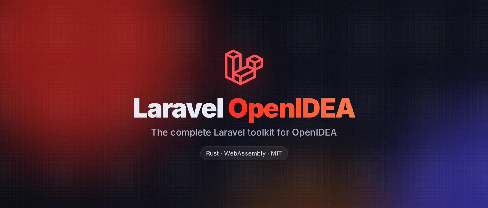
</p>

<p align="center">
  <a href="https://github.com/yzPeedro/laravel-openidea/actions/workflows/ci.yml"></a>
  <a href="https://github.com/yzPeedro/laravel-openidea/releases/latest"></a>
  
  
  
  <a href="LICENSE"></a>
</p>

<p align="center">
  <b>The complete Laravel toolkit for <a href="https://github.com/l0ng-ai/openidea">OpenIDEA</a>.</b><br>
  Completion and navigation for every Laravel string, Blade and Eloquent intelligence, and a hub with Artisan, Tinker,<br>
  every resource of your app, live logs, a live audit of requests, queries and events, and an MCP server for AI agents.
</p>

https://github.com/user-attachments/assets/bc56e061-73f0-484d-8e1c-d9776cdc9692

<p align="center"><sub>Install in under a minute, then a tour of the features. <a href="docs/media/install.mp4">Download the MP4</a>.</sub></p>

---

## Contents

- [Highlights](#highlights)
- [Installation](#installation)
- [Features](#features)
  - [Editor intelligence](#editor-intelligence)
  - [The Laravel OpenIDEA hub](#the-laravel-openidea-hub)
  - [Tinker](#tinker)
  - [SQL to Laravel](#sql-to-laravel)
  - [Live Audit](#live-audit)
  - [Logs, Artisan and the rest](#logs-artisan-and-the-rest)
  - [AI agents](#ai-agents)
- [Configuration](#configuration)
- [Privacy and security](#privacy-and-security)
- [How it works](#how-it-works)
- [Contributing](#contributing)
- [License](#license)

## Highlights

| | |
| --- | --- |
| ⚡ **Completion everywhere** | Routes (with verb and URI), views, config, env, translations, validation rules, middleware, gates, Eloquent columns and relations, Blade components and directives, assets, OpenAPI refs, Sanctum abilities, Spatie roles and permissions, queues, disks, and more. |
| 🧭 **Navigation** | Ctrl+click on a route name or URI opens the controller method; views, config keys, env keys and translations open where they are defined. Gutter icons link `route()` calls and views. |
| 🧩 **A hub for your whole app** | 40+ sections: routes, controllers, requests, models, scopes, observers, events and listeners, jobs, schedule, translations, config, env, bindings and more. Every section has filters, and every row opens its file. |
| 🐘 **Tinker in tabs** | Write PHP like in an editor, press Ctrl+Enter, get Tinker-style coloured output with dumps, SQL and timing. |
| 🔄 **SQL to Laravel and back** | Type SQL in any dialect and watch it turn into Eloquent or query builder code as you type, or swap sides to see the MySQL your Laravel code runs; run it in Tinker, copy it or insert it at the cursor. Right-click a query in the editor to copy it as MySQL. |
| 🔍 **Live Audit** | Requests, SQL with the line that ran it, events with payloads and listeners, jobs, cache, mail, HTTP client calls, gates, logs, exceptions and dumps, with N+1 and slow query insights. |
| 🤖 **AI agents that know your app** | A live MCP server with the hub's runtime data, Artisan, PHPStan, Pint, tests and Tinker behind an access level you choose (read, write or full), connected in one click next to Laravel Boost. |
| 🐳 **Docker-aware** | Artisan, Tinker and the recorder run with `php` or in a throwaway Docker Compose container, detected automatically. |

## Installation

**Requirements:** [OpenIDEA](https://github.com/l0ng-ai/openidea/releases/latest) 0.1.37 or newer and a Laravel 10 (or newer) project. PHP or Docker Compose is needed for the runtime features (Artisan, Tinker, Live Audit).

1. **Download** `laravel-openidea-<version>.zip` from the [latest release](https://github.com/yzPeedro/laravel-openidea/releases/latest).
2. In OpenIDEA open **Settings › Plugins › ⚙ › Install Plugin from Package File…** and pick the zip.

   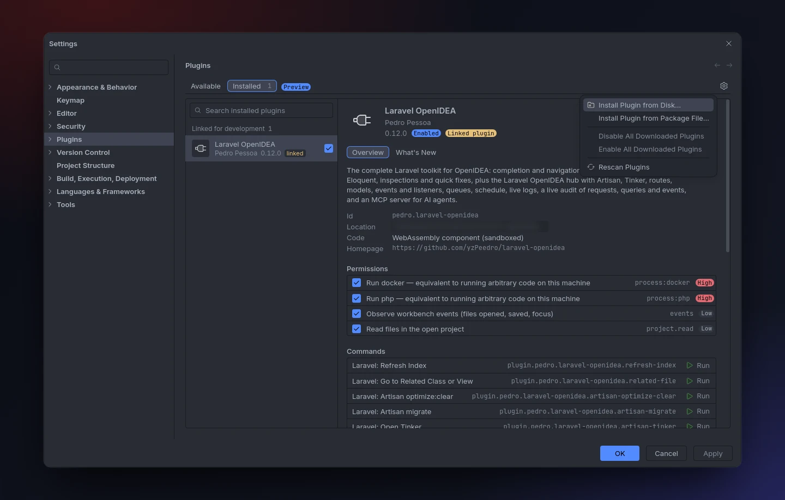

3. **Allow `process:php` or `process:docker`** in the plugin's permissions. They are optional: completion and navigation work without them, while Artisan, Tinker and Live Audit need one of them.

   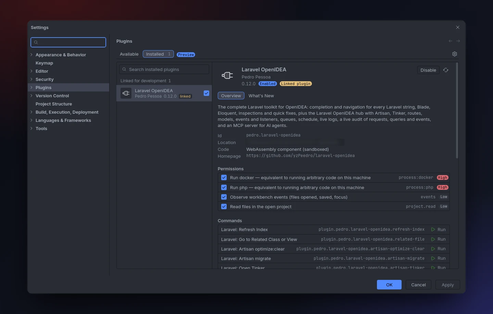

4. **Open a Laravel project** and click the Laravel icon at the bottom of the left tool bar.

<details>
<summary><b>Build from source</b></summary>

```sh
git clone https://github.com/l0ng-ai/openidea --branch v0.1.37
git clone https://github.com/yzPeedro/laravel-openidea
cd laravel-openidea
rustup target add wasm32-wasip2
./scripts/package.sh          # builds dist/plugin.wasm and build/laravel-openidea-<version>.zip
```

Install the zip as above, or link the folder for development with `openidea-plugin link` (see [CONTRIBUTING.md](CONTRIBUTING.md)).

</details>

## Features

### Editor intelligence

Completion and navigation come from cached indexes of your project files, built to answer within the IDE's 50 ms completion budget.

| Routes, with verb and URI | Eloquent columns from migrations |
| :---: | :---: |
| 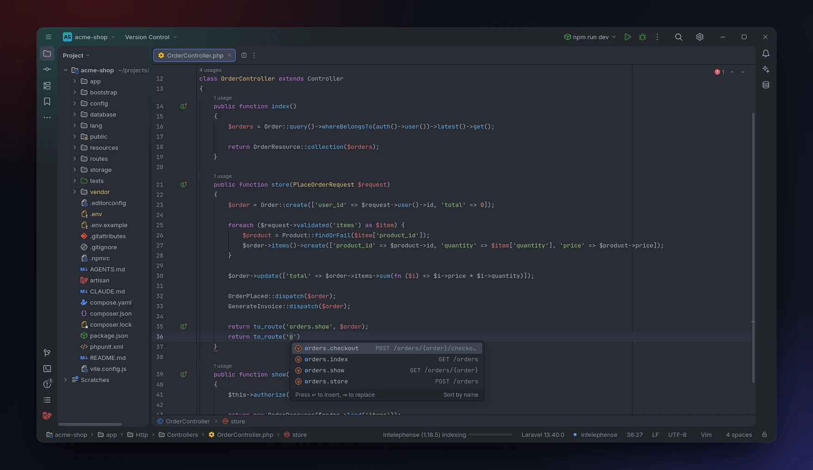 | 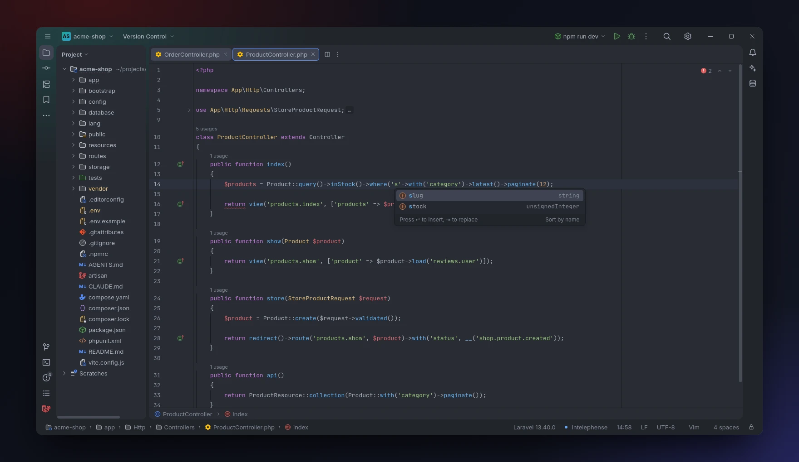 |
| **Traits, interfaces and base classes** | **Gutter links to routes and views** |
| 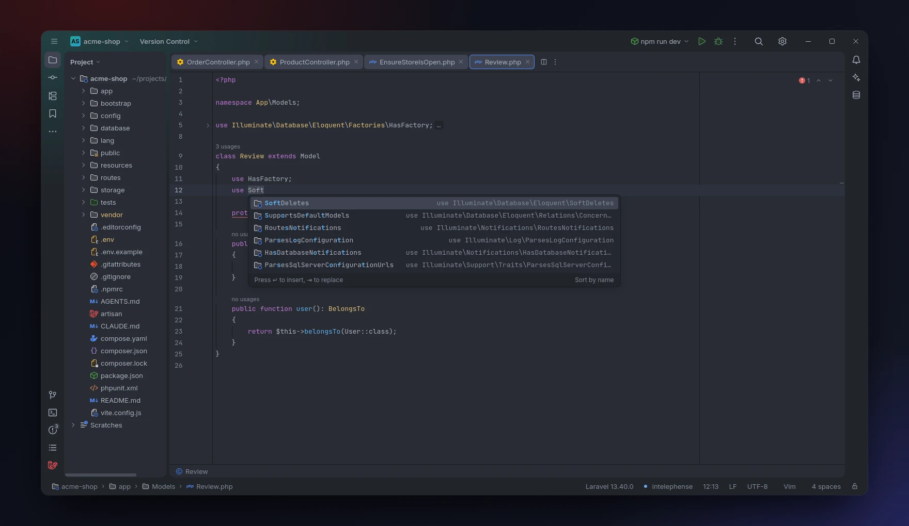 | 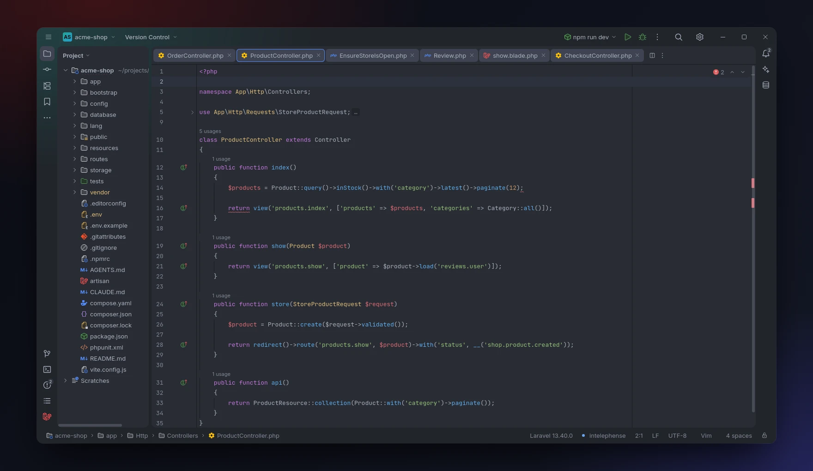 |

<p align="center">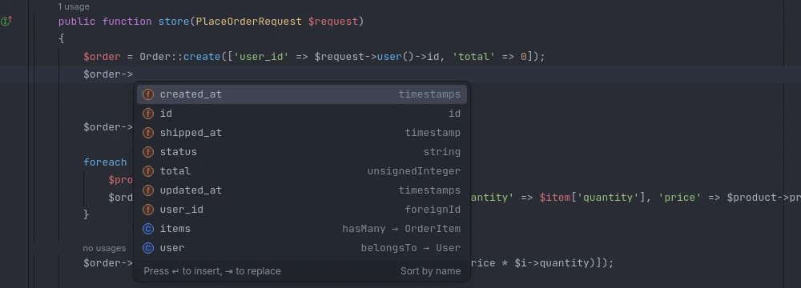" width="70%"><br><sub>Model columns and relations after <code>-&gt;</code></sub></p>

- **Strings that mean something:** `route()`, `to_route()`, `redirect()->route()`, `view()`, `config()`, `env()`, `__()`, `trans()`, `@lang`, `Route::has`, `routeIs`, `Storage::disk`, `Cache::store`, `Queue`, `Log::channel`, `DB::connection`, `Mail::mailer`, `auth()->guard`, middleware, gates, policies and rate limiters.
- **Model members:** after `$order->` the model's columns (with their types) and relations, and after `$order->user->` the related model's columns. The model comes from typed parameters, `Order::create/find/first…`, `new Order`, `foreach ($order->items as $item)`, `/** @var Order $x */`, `$this` in a model and `auth()->user()`. Relations are listed apart from columns with their kind and target (`belongsTo → User`), and cast columns show what they become (`string → OrderStatus`). Ctrl+click on a relation opens the related model; on a cast column, the enum, or the class (or interface) its cast's `get()` returns, falling back to the cast class; on any other column, its migration.
- **Eloquent:** columns and relations in `where`, `with`, `has`, `whereHas`, `orderBy`, `create`, `update`, `fill` and `pluck`, model attributes (`#[Fillable]`, `#[Hidden]`, `#[Table]`…), `casts()`, scopes, and member snippets for `$fillable`, `$casts` and relations.
- **Validation:** rule names inside `'required|…'` strings and rule arrays, plus custom rules.
- **Blade:** syntax highlighting, structure and folding, directives after `@` (including your own `Blade::directive` and `Blade::if`), `<x-…>` components, `<livewire:…>` tags, sections, stacks and assets.
- **OpenAPI and packages:** swagger-php `$ref`s, tags and security schemes, Sanctum token abilities, Spatie roles and permissions, Socialite drivers, broadcast channels, Inertia pages and Livewire components.
- **Types:** Laravel, package and project traits after `use`, interfaces after `implements` and base classes after `extends`, ranked by folder (models get `HasFactory` and `SoftDeletes` first, jobs get `ShouldQueue`, and so on).
- **Inspections and quick fixes:** unknown views, routes, rules, middleware and OpenAPI refs; N+1 queries (a relation read on each item of a `foreach` over a query that doesn't eager load it, fixed by adding `with()`); columns that don't exist in the model's table in `where`, `orderBy`, `pluck` and similar calls, with the closest column as the fix; `env()` outside `config/`, replaced by the `config()` key that reads the same variable; `create()` keys that `$fillable` leaves out, added to the model's `$fillable`; keys missing between `.env` and `.env.example`, copied over (a new key goes to `.env.example` without its value); *Add translation*; *Generate @property PHPDoc* for models from migrations, casts and relations; *Laravel: Go to Related Class or View* for Livewire and Blade components.
- **Refactorings (Alt+Enter):** change a route's name in its `->name('…')` or a translation key in a `lang/` file, and *Rename route* or *Rename translation* updates every usage across PHP and Blade, and for translations the same key in the other locales; it works before and after saving. A view that no longer exists (renamed or moved to another folder) offers the closest existing view, in that usage or in every usage. *Extract the validation into a Form Request* turns `$request->validate([…])`, `request()->validate(…)` or `$this->validate($request, …)` into `app/Http/Requests/<Method><Model>Request.php` with `rules()` (and `messages()`/`attributes()`), types the parameter with it, calls `validated()` and tidies the imports (needs `process:php` or `process:docker` to create the file).
- **Tools on save (opt-in):** set `formatOnSave` to `pint` or `php-cs-fixer` and turn on `phpstanOnSave` to format and analyse each PHP file you save, using the project's own `vendor/bin` tools and config (Larastan works through `phpstan.neon`). PHPStan errors show as warnings on their lines. They run in the background with a progress item in the status bar and stop after 15 seconds; a tool that times out or fails is reported once.
- **Tool configs:** completion for presets, rules and options in `pint.json`, rule sets and rules in `.php-cs-fixer.php`, and parameters, levels and includes (Larastan's too) in `phpstan.neon`, with NEON highlighting.
- **Pest:** dataset names in `->with('…')` and groups in `->group('…')`, `->groups('…')` and `#[Group('…')]`.
- **File templates:** *New File* offers a Laravel model, controller, Form Request, policy, job, event, listener, middleware and Pest test.
- **Folio:** pages under the Folio paths of `FolioServiceProvider` are routes: their `name()` completes in `route()`, Ctrl+click opens the page, and the hub's Routes section lists every page with its URI.
- **Cached routes:** after `php artisan route:cache`, named routes from packages (Sanctum, Horizon, Filament…) are read from `bootstrap/cache/routes-v7.php`.
- **Pivot attributes:** after `->pivot->`, or the name given with `->as()`, the keys, `withPivot()` columns and timestamps of many-to-many relations.
- **`.env` files:** key and value completion (connections, stores, disks, channels, mailers, locales) with navigation to the config that reads each key.
- **File icons** from the Material Icon Theme for Laravel files.

### The Laravel OpenIDEA hub

One tool window for everything your app has. It refreshes from your files and opens every row in the editor.

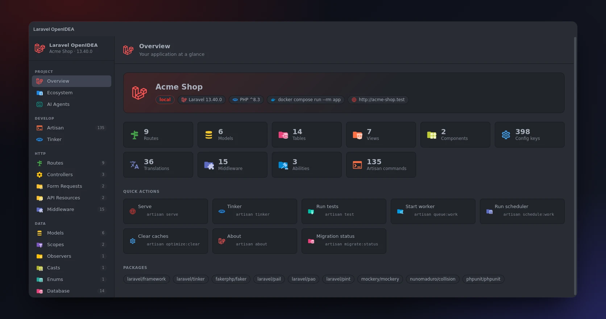

| Routes, filtered by method, prefix, controller and tests | Listeners and the events they handle |
| :---: | :---: |
| 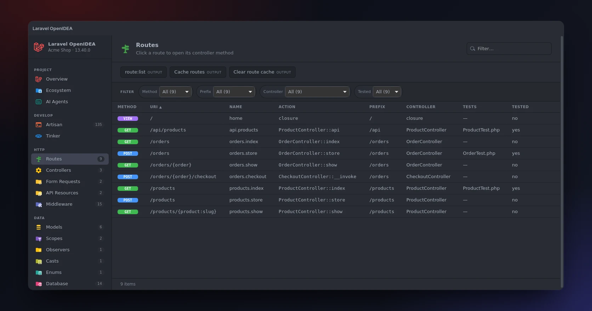 | 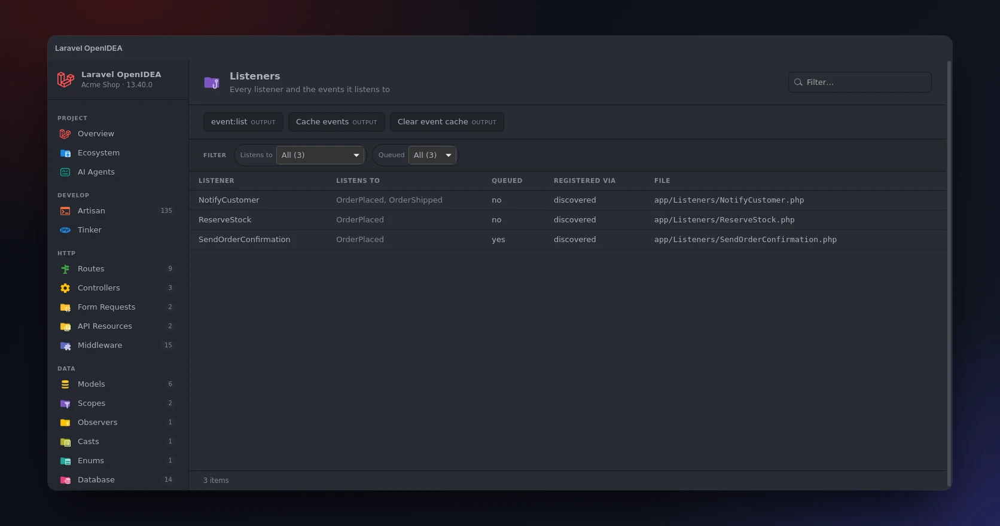 |
| **Models with tables, relations and scopes** | **Observers with their models and hooks** |
| 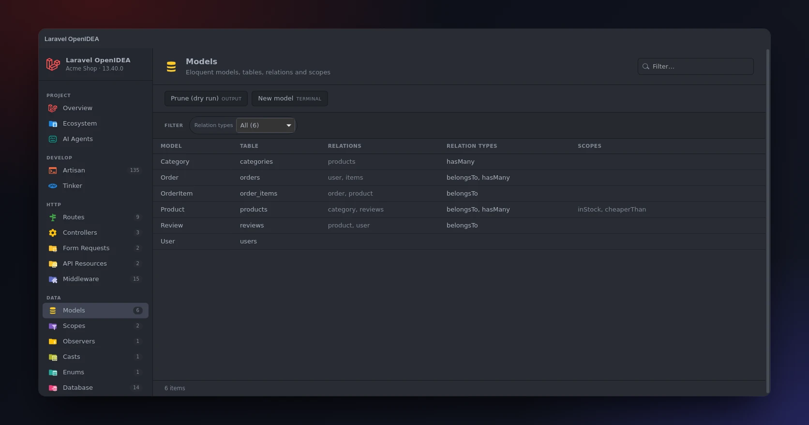 | 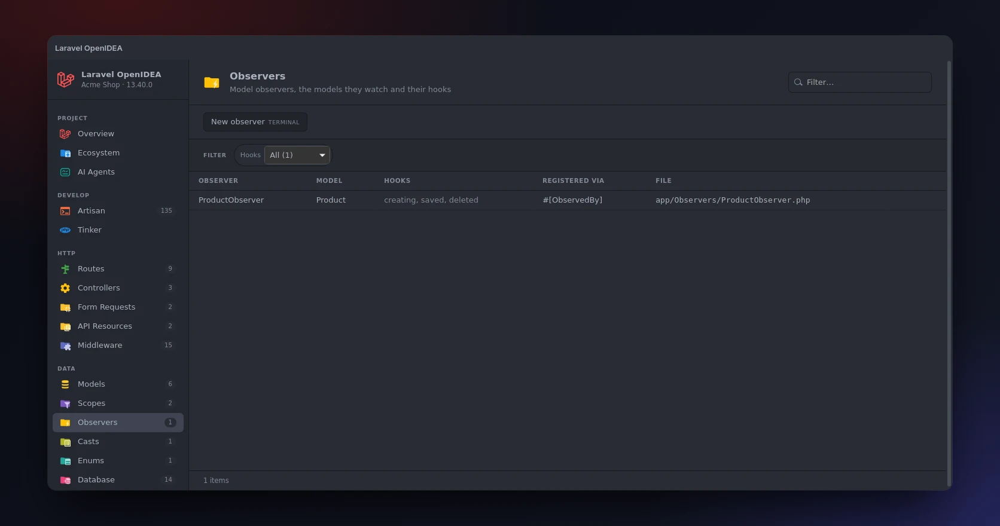 |
| **Translations, filtered by locale and group** | **Queues and workers** |
| 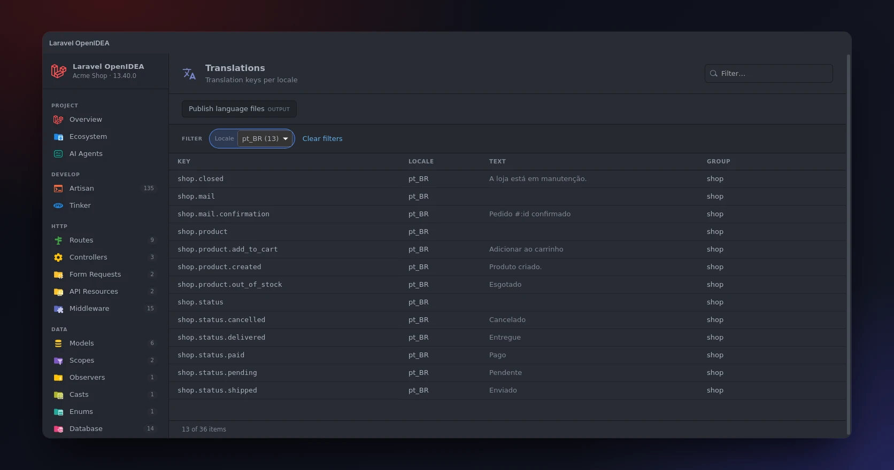 | 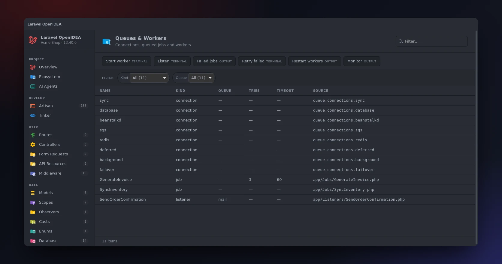 |

<details>
<summary><b>Every section</b></summary>

| Group | Sections |
| --- | --- |
| Project | Overview, Ecosystem (starter kit, Sanctum, Wayfinder, Horizon, Reverb, Octane, Pulse, Telescope…), AI Agents |
| Develop | Artisan, Tinker, SQL to Laravel |
| HTTP | Routes, Controllers, Form Requests, API Resources, Middleware |
| Data | Models, Scopes, Observers, Casts, Enums, Database, Factories & Seeders |
| Views | Views, Components, Frontend (Vite assets, Inertia pages), Translations |
| App | All Classes, Service Providers, Container Bindings, Validation Rules, Macros |
| Configure | Config, Environment, Drivers & Connections, Auth & Policies |
| Run | Queues & Workers, Scheduling, Events, Listeners, Mail & Notifications, Tests |
| Observe | Live Audit, Logs, Profiles (Clockwork, Debugbar), Debug Calls, Debug Tools |

| Events | Scopes | Database |
| :---: | :---: | :---: |
| 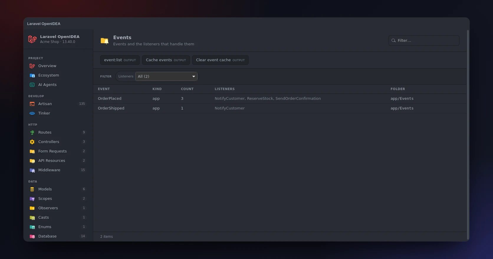 | 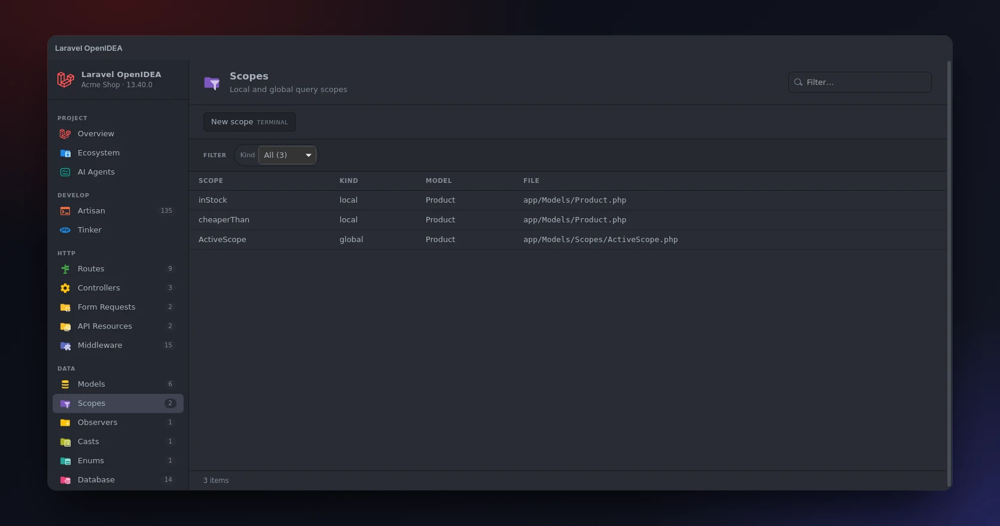 | 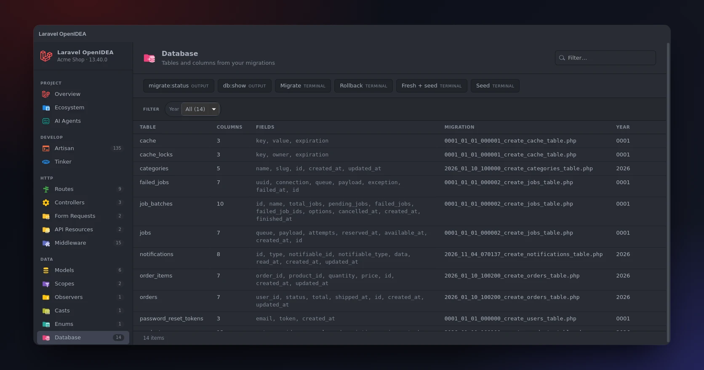 |
| **Config** | **Container bindings** | **All classes** |
| 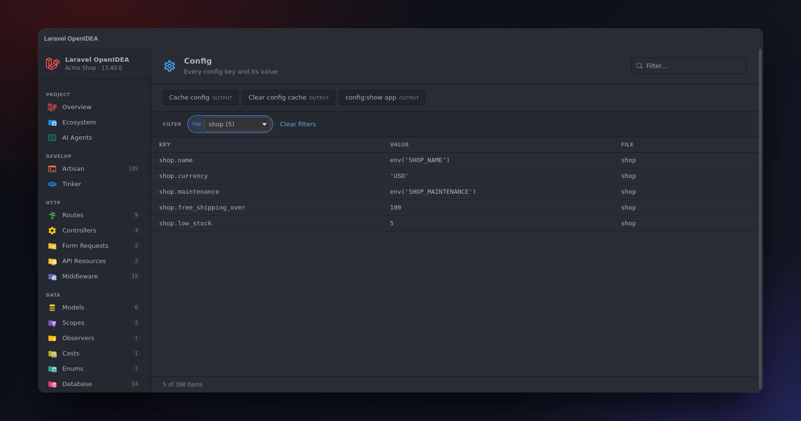 | 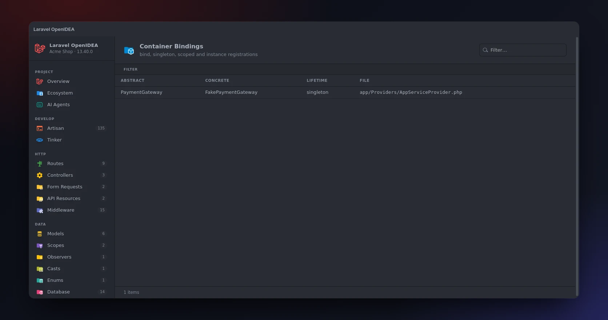 | 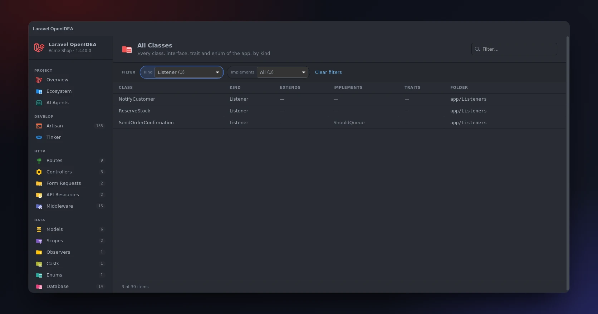 |
| **Scheduling** | **Ecosystem** | **Artisan** |
| 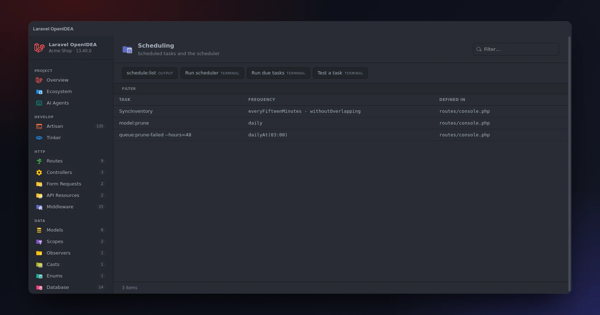 | 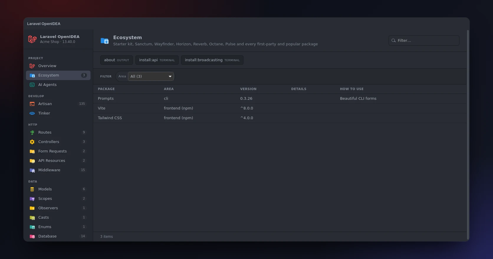 | 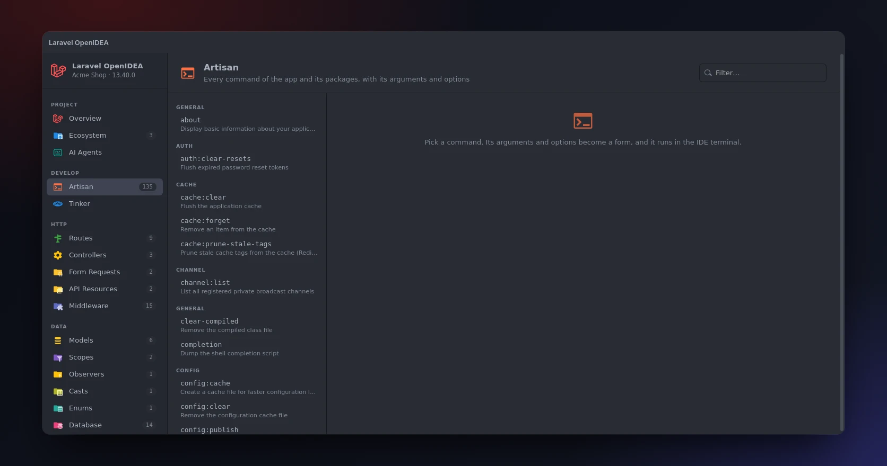 |

</details>

### Tinker

As many tabs as you like, with PHP highlighting, snippets and remembered code. **Ctrl+Enter** runs the tab and **Ctrl+Shift+Enter** runs the selection. Each statement shows its value the way Tinker does, with echo output, `dump()` calls, SQL queries and timing. Models resolve by their short name.

In a PHP file, select some code and pick **Laravel: Run Selection in Tinker** from the right-click menu: a terminal opens `artisan tinker` (with `php` or Docker Compose) with the file's `use` imports, dumps the value of each statement and stays open with the selection's variables defined.

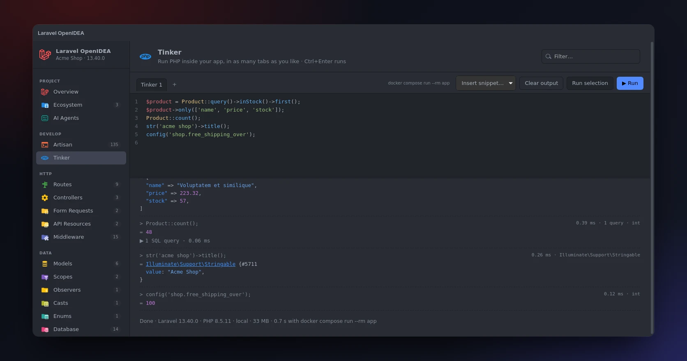

### SQL to Laravel

Write a query in the dialect you have at hand (MySQL, PostgreSQL, SQL Server, SQLite, Oracle) and the Laravel code updates on the right as you type, highlighted like the editor. Switch between **Eloquent**, which uses the model of each table, and the **Query Builder**. Joins, nested `AND`/`OR`, `IN`, `BETWEEN`, `EXISTS` and subqueries, dates, aggregates, `GROUP BY`/`HAVING`, `LIMIT`/`TOP`/`FETCH`, locks, `UNION`, `INSERT` (with upserts and `INSERT IGNORE`), `UPDATE` (with `increment`), `DELETE` and `TRUNCATE` become the matching builder calls; anything without one falls back to `whereRaw` or `DB::raw`, and the notes under the code say where. The copy button puts the code on the clipboard and the insert button writes it at the cursor of the editor you were in, indented like the line (they need the optional `clipboard` and `editor.read`/`editor.write` permissions). The run button opens the code in a new Tinker tab and runs it; code that changes data asks first.

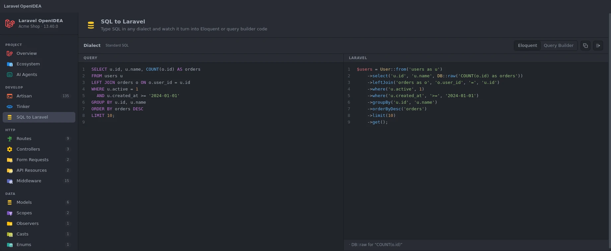

The swap button turns it around: write Eloquent or query builder code and the MySQL it runs appears on the right as you type. The tables come from your models, soft-deleted rows are left out the way Eloquent does, local scopes (`scopeActive()` or `#[Scope]`) are applied from the model with their arguments, and variables become `?` placeholders listed in the notes, together with anything that isn't translated (eager loading, relation queries, the count query of `paginate()`).

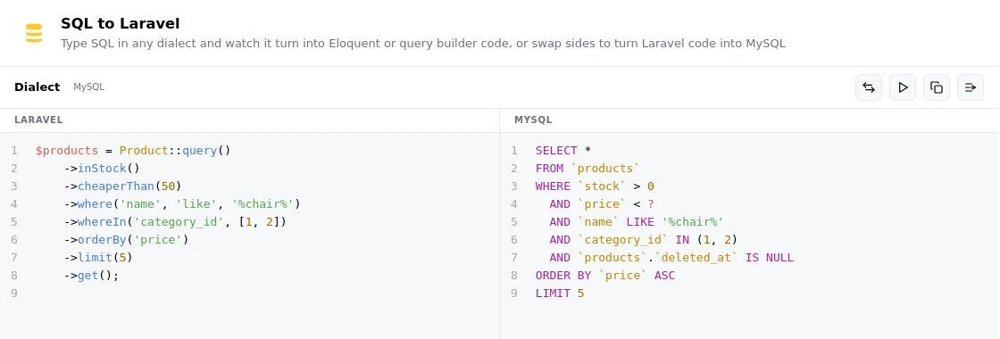

In the editor, right-click a query and pick **Laravel: Copy Query as MySQL**: the statement under the cursor (or the selection) is copied as MySQL, translated the same way.

### Live Audit

Turn the recorder on and every request, Artisan command, queued job and Tinker run in the local environment is recorded:

- requests with route, middleware, input and timing;
- SQL with bindings and the line of your code that ran it;
- events with their payload and the listeners that received them;
- jobs queued, processed and failed, cache hits and misses, mail, notifications, HTTP client calls, gate checks, logs, exceptions and `dump()` output.

The hub groups records by request, filters them by type, and flags **N+1 queries**, slow queries, exceptions and failed jobs.

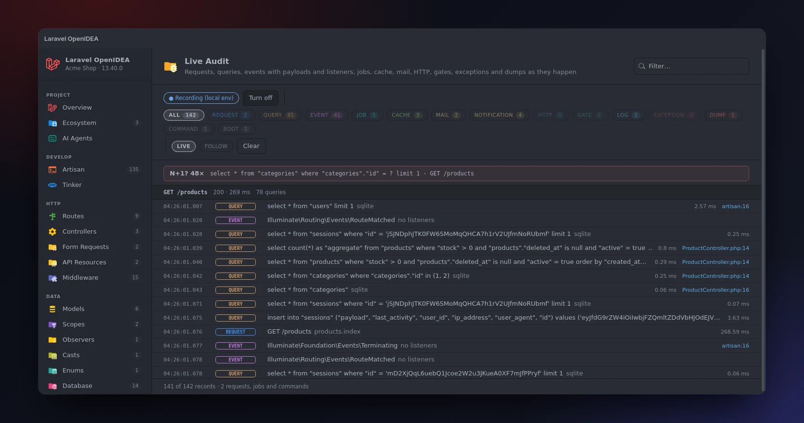

### Logs, Artisan and the rest

- **Logs:** every file in `storage/logs`, live, with level chips and counts (click one level, Ctrl+click to combine), search, stack traces with clickable frames.
- **Artisan:** every command of the app and its packages, with arguments and options as a form. Run it in the terminal or show the coloured output in place, with history.
- **Debug toolbox:** Clockwork and Debugbar profiles, `dd()`/`dump()`/`ray()`/`ds()` calls left in the code, and the debug tools you have installed.

| Logs, every level | Logs, only errors |
| :---: | :---: |
| 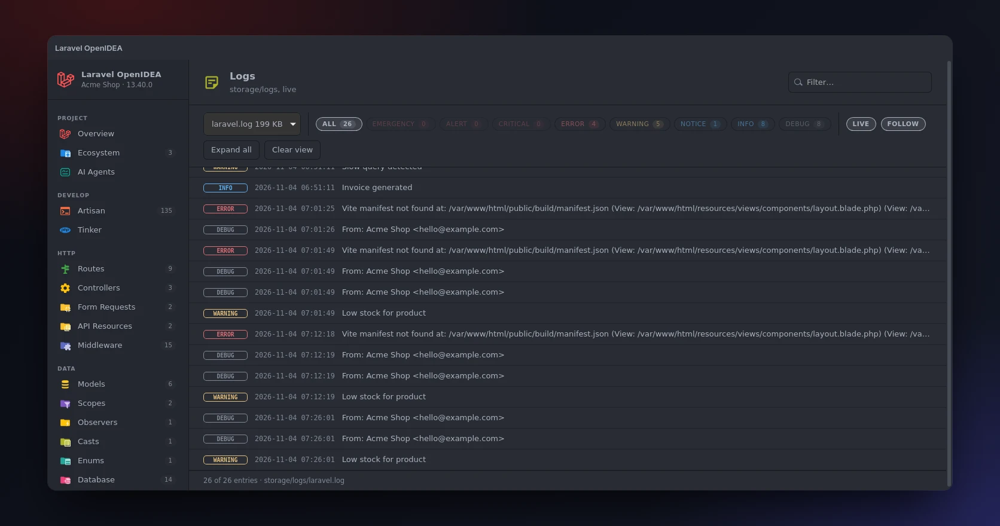 | 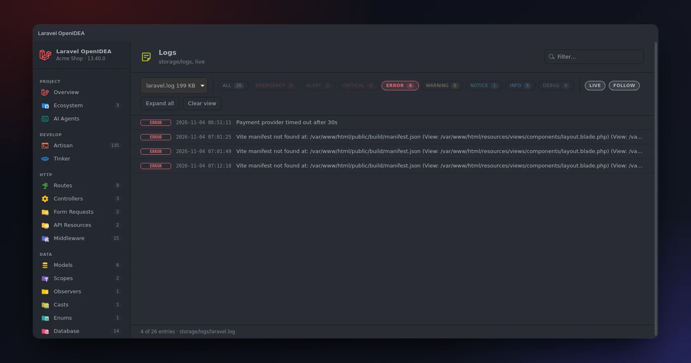 |

### AI agents

**Connect AI agents** installs the `laravel-openidea` MCP server and registers it in `.mcp.json` and, when their folders exist, in the Cursor, VS Code (Copilot), Junie and Gemini configs, with a short guide in `AGENTS.md`. Every call boots the app again, so answers follow your code as it changes, and the plugin keeps the server files in step with the plugin version.

What agents may do is up to you, with the `mcpAccess` setting:

| Level | Tools |
| --- | --- |
| **read** (default) | `app_overview` · `access_level` · `list_routes` · `list_classes` · `list_events_and_listeners` · `list_models` · `list_container_bindings` · `list_schedule` · `list_queues` · `list_artisan_commands` · `get_config` (secrets masked) · `database_schema` · `missing_translations` · `check_env_keys` · `list_tests` · `run_phpstan` · `read_logs` · `audit_recent` · `hub_sections` · `run_artisan` for read-only commands (`route:list`, `about`, `migrate:status`, `model:show`…) |
| **write** | adds `format_code` (Pint or PHP CS Fixer), `run_tests`, `query_to_sql` (the SQL of an Eloquent expression, captured with `DB::pretend()` without running it), `audit_recorder` and `run_artisan` for `make:*`, `migrate`, `db:seed`, cache and optimize commands |
| **full** | adds `run_tinker` and `run_artisan` for every other command (`migrate:fresh`, `db:wipe`, `key:generate`…) |

A tool above the level tells the agent to ask you, and connected clients get the new tool list when you change it. No tool installs, changes or removes the plugin, its settings, its grants or its files in `storage/openidea`.

[Laravel Boost](https://github.com/laravel/boost) installs and updates from the same page; with Boost the guide goes to `.ai/guidelines` so `boost:update` merges it.

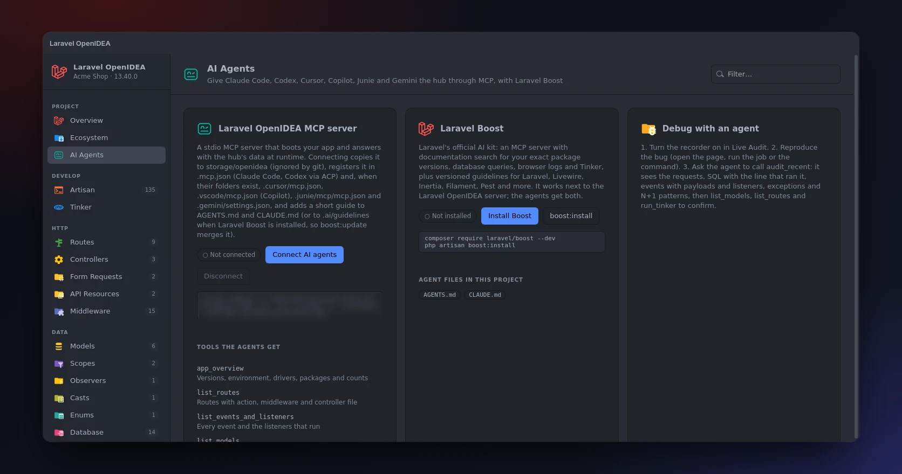

## Configuration

*Settings › Plugins › Laravel OpenIDEA*:

| Setting | Default | What it does |
| --- | --- | --- |
| `artisanRunner` | `auto` | `php`, `docker-run` (throwaway `docker compose run --rm --no-deps`), `docker` (`docker compose exec`) or `auto` (Docker Compose when the project has a compose file) |
| `dockerService` | detected | Compose service that runs PHP (`app`, `laravel.test`, `php`… are detected) |
| `locale` | `en` | Preferred locale for translation completion |
| `unknownViewInspection` | on | Report views that don't exist |
| `unknownRouteInspection` | off | Report unknown route names |
| `unknownRuleInspection` | on | Report unknown validation rules |
| `unknownAuthInspection` | off | Report unknown middleware and abilities |
| `unknownOpenApiRefInspection` | on | Report unknown OpenAPI `$ref` components |
| `unknownColumnInspection` | on | Report columns that don't exist in the model's table |
| `envCallInspection` | on | Report `env()` calls outside config files |
| `fillableInspection` | on | Report `create()` keys that `$fillable` leaves out |
| `nPlusOneInspection` | on | Report relations loaded once per item in a `foreach` |
| `envKeysInspection` | on | Report keys missing between `.env` and `.env.example` |
| `formatOnSave` | `off` | Format the saved PHP file with `pint` or `php-cs-fixer` from `vendor/bin` |
| `mcpAccess` | `read` | What AI agents may do through the MCP server: `read`, `write` or `full` (see [AI agents](#ai-agents)) |
| `phpstanOnSave` | off | Analyse the saved PHP file with PHPStan (and Larastan) when the project has a `phpstan.neon` |

Live Audit reads two environment variables from your app: `OPENIDEA_AUDIT=false` turns the recorder off and `OPENIDEA_AUDIT_SHOW_PII=true` shows personal data.

## Privacy and security

- The plugin is a sandboxed WebAssembly component. It reads project files, and it runs processes only through the `process:php` and `process:docker` permissions you grant. It writes to the editor (`editor.read`, `editor.write`) and the clipboard (`clipboard`) only when you press the insert or copy button of SQL to Laravel, and only if you allowed it.
- The Live Audit recorder runs only in the `local`, `development` and `dev` environments. It lives in `storage/openidea`, which has its own `.gitignore`, and loads through a marked hook in `vendor/autoload.php`, so no tracked file changes. *Turn off* removes both.
- Passwords, tokens, keys, cookies and signatures are always masked in recorded payloads. Personal data such as e-mail, CPF, phone, documents and addresses is masked by default.
- Pint, PHP CS Fixer and PHPStan only run on save when you turn them on, and they're the project's own `vendor/bin` tools, run like Artisan.
- The MCP server masks secrets in config values and only reads at the default `read` level. `write` lets agents generate files, migrate, seed and run tests; `full` runs any PHP through Tinker, which can't be fenced in, so give it only to agents you trust. The level decides what the server offers, not what an agent with its own file or shell tools could do anyway.
- Nothing is sent anywhere: records stay in `storage/logs/openidea-audit.jsonl` on your machine.

## How it works

```
OpenIDEA ── WIT (openidea:plugin@1.0) ──► laravel-openidea.wasm (Rust)
  │                                         ├─ index/      cached indexes of routes, config, views, models, migrations…
  │  completion, definitions, gutter,       ├─ refs.rs     which helper, facade or directive points to which index
  │  code actions, Blade syntax             ├─ php.rs      PHP and Blade tokenizer with call context
  │                                         ├─ panels.rs   the hub (HTML view) and its sections
  │  web view messages ◄──────────────────► ├─ devtools.rs Tinker, Live Audit, debug tools, ecosystem, agents
  │                                         └─ runner.rs   php or Docker Compose
  └─ processes (php / docker) ──► php/tinker.php · php/Recorder.php · php/install.php · php/mcp.php
```

See [CONTRIBUTING.md](CONTRIBUTING.md) for the development setup, tests and conventions.

## Contributing

Issues and pull requests are welcome. Start with [CONTRIBUTING.md](CONTRIBUTING.md), and see the [roadmap](ROADMAP.md) for what's next. Please follow the [code of conduct](CODE_OF_CONDUCT.md), and report security issues as described in [SECURITY.md](SECURITY.md).

## License

[MIT](LICENSE) © Pedro Pessoa. File icons come from the [Material Icon Theme](https://github.com/material-extensions/vscode-material-icon-theme) (MIT, see `icons/LICENSE-material-icon-theme`).

Laravel is a trademark of Taylor Otwell. This project is not affiliated with Laravel, JetBrains or the OpenIDEA authors.
