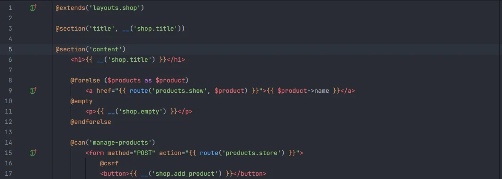
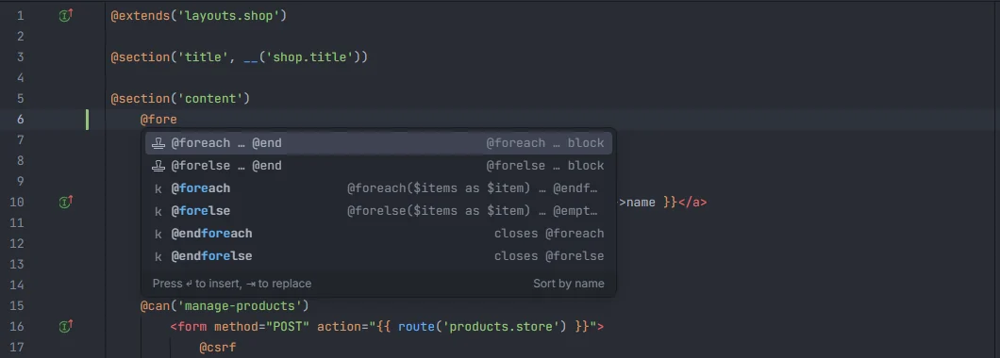
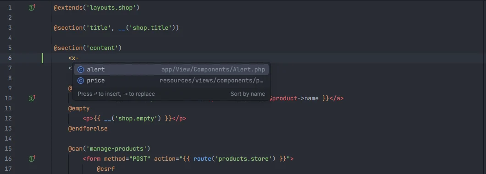

# Blade

The plugin gives `.blade.php` files their own Blade language: highlighting that understands directives, echoes, components and the PHP inside them, folding of directive blocks, a structure view of sections, stacks, slots and includes, and completion of directives (your own included), components, Livewire tags, sections, stacks and assets. Every PHP string feature (routes, views, translations, config…) works inside Blade too.

Directives, echoes, the PHP inside them and HTML, each with its own colour

## The Blade language

Files ending in `.blade.php` open as **Blade** (not plain PHP or HTML), with `{{-- --}}` as the block comment (so *Comment* toggles Blade comments) and four-space indentation.

### Highlighting

| Element | Shown as |
| --- | --- |
| `{{-- … --}}` and `<!-- … -->` | comment |
| `{{`, `}}`, `{!!`, `!!}`, `<?php`, `<?=`, `?>` | macro (delimiters) |
| `@directive` names, `@php` and `@endphp`, `@verbatim` and `@endverbatim` | macro |
| The parentheses of a directive | punctuation |
| HTML tags (`<div`, `</td`, `>`) | tag |
| Component tags (`<x-alert`, `<livewire:cart`) | type |
| Attribute names (`class`, `:type`, `wire:model`, `x-bind:class`) | attribute |
| Attribute values | string |

PHP is highlighted inside `{{ }}`, `{!! !!}`, `<?php ?>`, `<?= ?>`, `@php … @endphp`, a directive's parentheses, bound attribute values (`:type="$kind"`, `x-bind:…`) and `{{ }}` inside attribute values: strings, numbers, `$this`, variables, 40 PHP keywords, function calls, properties and methods after `->` or `::`, class names, constants and operators.

`@{{ … }}` (escaped echo) is left as text, the inside of `@verbatim … @endverbatim` isn't highlighted, and the contents of `<script>` and `<style>` are left to the editor.

### Folding

Directive blocks fold from the opening directive to its closing one: `@if`, `@unless`, `@foreach`, `@forelse`, `@for`, `@while`, `@section`, `@push`, `@prepend`, `@pushOnce`, `@prependOnce`, `@component`, `@slot`, `@auth`, `@guest`, `@can`, `@cannot`, `@canany`, `@isset`, `@empty`, `@switch`, `@once`, `@env`, `@production`, `@error`, `@fragment` and `@php`. A block closes with `@end…`; a `@section` also closes with `@show`, `@stop`, `@overwrite` or `@append`. A one-line `@section('title', 'Home')` doesn't fold, and a block on a single line has nothing to fold.

### Structure

The structure (outline) view lists:

| Directive | Kind |
| --- | --- |
| `@section('…')` (block or inline) | module |
| `@push('…')`, `@prepend('…')`, `@pushOnce('…')` | event |
| `@slot('…')` | field |
| `@extends('…')`, `@include('…')`, `@component('…')`, `@livewire('…')` | package |

Each entry is named after the directive's first quoted argument and shows the directive as detail.

## Directives

<code>@fore</code>: the block snippets first, then the matching directives

Type `@` and a few letters anywhere in a Blade file. The `@` must not follow a letter, digit, `_`, `@` or `.`, so e-mail addresses (`mail@example.com`) don't trigger it. The list filters by substring, ignoring case, so `@each` also finds `@foreach`.

Each directive shows how it is used (`@foreach($items as $item) … @endforeach`, `closes @foreach`…). The list contains:

1. **Laravel's directives**: with `vendor/laravel/framework` installed, every directive the installed `BladeCompiler` compiles (its `compile…` methods, through its traits), plus `@endphp`, `@verbatim` and `@endverbatim`. A directive added in a later Laravel version isn't offered in an older project. Without `vendor/`, a built-in list of 107 directives is used.
2. **Package directives**, only when the package is installed in `vendor/` (or always, without `vendor/`):

   | Package | Directives |
   | --- | --- |
   | `inertiajs/inertia-laravel` | `@inertia`, `@inertiaHead` |
   | `tightenco/ziggy` or `tighten/ziggy` | `@routes` |
   | `livewire/livewire` | `@livewire`, `@livewireStyles`, `@livewireScripts`, `@livewireScriptConfig`, `@persist`, `@endpersist`, `@teleport`, `@endteleport` |
   | `livewire/volt` | `@volt`, `@endvolt` |
   | `spatie/laravel-permission` | `@role`, `@endrole`, `@hasrole`, `@endhasrole`, `@hasanyrole`, `@endhasanyrole`, `@unlessrole`, `@endunlessrole` |

3. **Your own directives**, from every file under `app/` that calls them: `Blade::directive('name', …)` adds `@name` (*custom directive*), and `Blade::if('name', …)` adds `@name`, `@elsename`, `@unlessname` and `@endname`.

### Block snippets

For the block directives, a snippet named `@foreach … @end` inserts the whole block with its closing directive and placeholders to tab through. Snippets exist for `@if`, `@unless`, `@isset`, `@empty`, `@auth`, `@guest`, `@foreach`, `@forelse` (with its `@empty` part), `@for`, `@while`, `@switch`, `@section`, `@push`, `@once`, `@can`, `@error`, `@php`, `@verbatim`, `@production` and `@env`, each offered only when that directive is in the list above. They match by prefix (`@fore` shows `@foreach` and `@forelse`). See [Snippets](Snippets.md).

## Components and Livewire tags

<code>&lt;x-</code>: class and anonymous components, each with its file

| Typed | Suggests |
| --- | --- |
| `<x-` | Blade components |
| `<livewire:` | Livewire components |

| File | Name |
| --- | --- |
| `app/View/Components/Alert.php` | `alert` |
| `app/View/Components/Forms/TextInput.php` | `forms.text-input` |
| `resources/views/components/price.blade.php` | `price` |
| `resources/views/components/card/index.blade.php` | `card` |
| `app/Livewire/UserTable.php`, `app/Http/Livewire/UserTable.php` | `user-table` |
| `resources/views/livewire/cart/summary.blade.php` | `cart.summary` |

Class names become kebab case and folders become dots; for views, a trailing `index` is dropped. When a class and a view give the same name, the class is listed. The detail is the file, and Ctrl+click on the name in a tag opens it.

`@livewire('…')` completes Livewire components too. Components from packages (`<x-package::name>`) and anonymous component paths registered at runtime aren't indexed.

## Sections and stacks

| Directive | Argument | Suggests |
| --- | --- | --- |
| `@section('…')`, `@yield('…')`, `@hasSection('…')`, `@sectionMissing('…')` | 1st | sections |
| `@push('…')`, `@prepend('…')`, `@stack('…')`, `@pushOnce('…')`, `@prependOnce('…')` | 1st | stacks |
| `@pushIf($condition, '…')` | 2nd | stacks |

Section names are collected from every `@yield('…')` and `@section('…')`, and stack names from every `@stack('…')`, `@push('…')` and `@prepend('…')`, in all views under `resources/views/`. The detail says where the name was first seen (`@yield in layouts.app`), and Ctrl+click opens that place.

## Assets

| Call | Arrays too |
| --- | --- |
| `@vite('…')` | yes: `@vite(['resources/css/app.css', 'resources/js/app.js'])` |
| `asset('…')`, `secure_asset('…')`, `mix('…')` | no |
| `Vite::asset('…')`, `Vite::content('…')` | no |

The suggestions are every file under `resources/css`, `resources/js`, `resources/ts`, `resources/sass`, `resources/scss`, `resources/images`, `resources/img` and `resources/fonts`, with its full path and the detail `vite`, then every file under `public/` with its path relative to `public/` and the detail `public` (leaving out `.php` files, dotfiles, `public/storage/` and `public/build/`). Ctrl+click opens the file.

## PHP strings in Blade

Inside Blade, the plugin reads PHP in `{{ }}`, `{!! !!}`, `<?php ?>`, `@php … @endphp` and on the rest of a line that starts with a directive. Everything documented for PHP works there: [routes](Route-Names.md), [views](Views.md) (`@include`, `@extends`…), [translations](Translations.md) (`@lang`, `@choice`), [config](Config-Keys.md), abilities (`@can`), guards (`@auth('admin')`), roles and permissions, request fields in `old('…')` and the rest. Plain HTML text and component attributes (`:href="route('…')"`) aren't read as PHP strings, so they don't complete. Blade comments are skipped.

## Details

- Multibyte characters (`…`, `—`, accents, emoji) anywhere in a view are handled; highlighting, folding and the structure view keep working around them.
- Directive, component, section and stack lists are rebuilt when files under `app/`, `resources/views/`, `app/View/Components/`, `app/Livewire/` or `app/Http/Livewire/` change.
- None of this runs PHP.

## Settings and permissions

Blade has no settings of its own, and only `project.read` is needed. See [Settings](Settings.md) and [Permissions](Permissions.md).

## Related

- [Views](Views.md)
- [Snippets](Snippets.md)
- [Packages](Packages.md): Livewire, Inertia, Spatie Permission
- [Go to Related Class or View](Related-Class-or-View.md)
- [File icons](File-Icons.md)
- [Components in the hub](Hub-Components.md) and [Views in the hub](Hub-Views.md)

---
[← Wiki home](Home.md)
