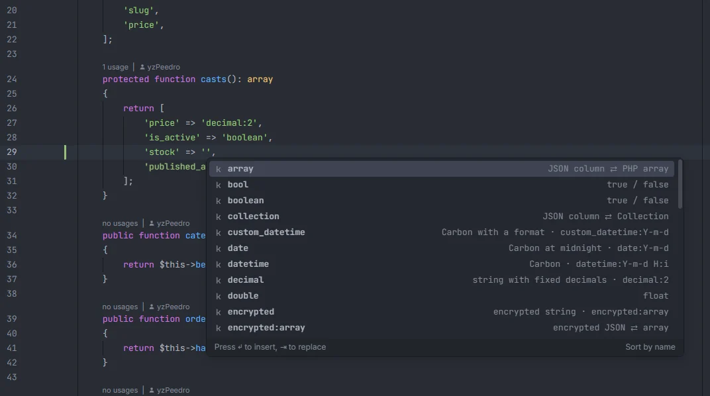
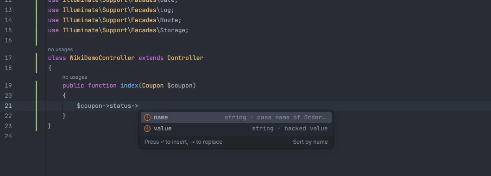
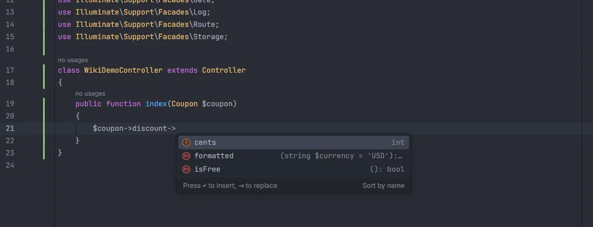
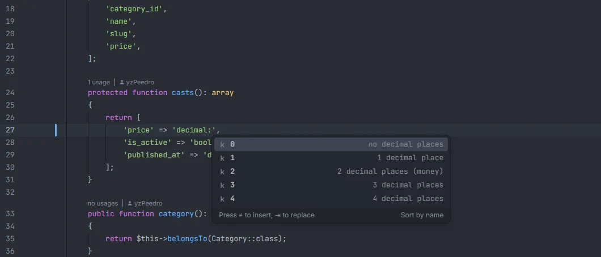

# Casts

The plugin understands the casts of your models in both directions. In `casts()` and `$casts` it completes every cast type your Laravel version ships, the arguments after the colon, and your own enums and cast classes as `Name::class`. Everywhere else it uses them: cast columns show what they become, `$coupon->status->` completes the enum's members, `$coupon->discount->` completes the value object's members, and Ctrl+click on a cast column opens the enum or the class.

<p align="center"></p>
<p align="center"><sub>Cast types inside <code>casts()</code>, each with what it does</sub></p>

## How to use it

### Cast types and their arguments

In a model, inside the quotes of a cast value:

```php
protected function casts(): array
{
    return [
        'is_active' => '',            // cast types
        'price' => 'decimal:',        // 0 to 4 decimal places
        'published_at' => 'datetime:',// date formats
        'secret' => 'encrypted:',     // array, collection, json, object
    ];
}

protected $casts = ['meta' => ''];    // the $casts property works the same
```

The keys of the same array complete the model's columns ([Eloquent columns and relations](Eloquent-Columns-and-Relations.md)).

### Enums and cast classes

Without quotes, after `=>` in `$casts` or `casts()`, type part of a class name:

```php
protected $casts = [
    'status' => OrderSt,     // → OrderStatus::class, with use App\Enums\OrderStatus;
    'total' => Mon,          // → MoneyCast::class
];
```

### Using cast columns

```php
public function show(Coupon $coupon)
{
    $coupon->            // status · string → OrderStatusEnum
    $coupon->status->    // name, value and the enum's methods
    $coupon->discount->  // the public properties and methods of App\Support\Price
}
```

<p align="center">status-> showing name (string, case name of the enum) and value (string, backed value)" width="760"></p>
<p align="center"><sub><code>$coupon->status</code> is cast to a string-backed enum: <code>name</code> and <code>value</code></sub></p>

<p align="center">discount-> showing cents (int), formatted(string $currency = 'USD') and isFree(): bool" width="760"></p>
<p align="center"><sub><code>$coupon->discount</code> is cast through <code>App\Casts\Money</code>, whose <code>get()</code> returns <code>App\Support\Price</code>: its property and methods</sub></p>

## What you see

### Cast types

| Type | Detail |
| --- | --- |
| `array`, `json` | JSON column ⇄ PHP array |
| `boolean`, `bool` | true / false |
| `collection` | JSON column ⇄ Collection |
| `date`, `datetime`, `custom_datetime` | Carbon (with the format syntax) |
| `immutable_date`, `immutable_datetime`, `immutable_custom_datetime` | CarbonImmutable |
| `timestamp` | Unix timestamp as int |
| `decimal` | string with fixed decimals · `decimal:2` |
| `double`, `float`, `real` | float |
| `integer`, `int`, `string` | int, string |
| `object` | JSON column ⇄ stdClass |
| `json:unicode` | JSON without escaping unicode |
| `hashed` | hashed on set (passwords) |
| `encrypted`, `encrypted:array`, `encrypted:collection`, `encrypted:json`, `encrypted:object` | encrypted string or JSON |
| `Illuminate\Database\Eloquent\Casts\AsArrayObject`, `AsCollection`, `AsEncryptedArrayObject`, `AsEncryptedCollection`, `AsEnumArrayObject`, `AsEnumCollection`, `AsStringable`, `AsUri`, `AsFluent`, `AsHtmlString`, `AsBinary`, `AsVector` | the class cast (inserted with its full name inside the string) |

With Laravel installed, the list follows that version: the plain types are the ones in `$primitiveCastTypes` of `HasAttributes` (or, on older versions, the `case` labels of `castAttribute()`), and a class cast is kept only when the installed framework has the class. A type the installed version has and the table doesn't is added with the detail `cast type`. Without `vendor/`, the whole table is offered.

### Arguments after the colon

| Before the colon | Suggests |
| --- | --- |
| `decimal` | `0` to `4` decimal places (`2` is "2 decimal places (money)") |
| `date`, `datetime`, `custom_datetime`, `immutable_date`, `immutable_datetime`, `immutable_custom_datetime` | `Y-m-d`, `Y-m-d H:i:s`, `Y-m-d H:i`, `d/m/Y`, `d/m/Y H:i`, `m/d/Y`, `H:i`, `c` (ISO 8601), `U` (Unix timestamp), each with an example |
| `encrypted` | `array`, `collection`, `json`, `object` |
| `json` | `unicode` |
| `AsBinary` (also with its namespace) | `uuid`, `ulid` (16-byte UUID or ULID) |

Other types take no suggested argument.

<p align="center"></p>
<p align="center"><sub>After <code>decimal:</code></sub></p>

### `Name::class` items

The class items are labelled `OrderStatus::class` with the detail `enum` or `cast`. They are your project's enums and the classes that implement `CastsAttributes`, `CastsInboundAttributes` or `Castable`. Picking one inserts `Name::class` and adds the `use` statement, unless the class is already imported or lives in the model's namespace. In this position only these items are offered.

### What a cast column becomes

After `$model->`, a cast column's detail is `column type → target`:

| Cast | Target shown |
| --- | --- |
| `'boolean'`, `'bool'` | `bool` |
| `'integer'`, `'int'`, `'timestamp'` | `int` |
| `'float'`, `'double'`, `'real'` | `float` |
| `'decimal:2'`, `'string'`, `'encrypted'`, `'hashed'` | `string` |
| `'array'`, `'json'` | `array` |
| `'object'` | `object` |
| `'collection'` | `Collection` |
| `'date'`, `'datetime'`, `'custom_datetime'` | `Carbon|null` |
| `'immutable_date'`, `'immutable_datetime'` | `CarbonImmutable|null` |
| An enum (`OrderStatus::class`) | the enum's name |
| A cast class whose `get()` returns a class or interface | that class's name (`App\Casts\Money` returning `Price` shows `Price`) |
| A cast class whose `get()` returns a scalar | the scalar (`float`), or the cast class's name for `mixed`, `static` and `self` |
| A cast class without a return type on `get()`, or a class the plugin can't find | the cast class's name |

The same types are used by [Generate model PHPDoc](Generate-Model-PHPDoc.md).

### Members of enum and value-object casts

After `$model->column->`:

- **Enum:** `name` (`string · case name of OrderStatus`), `value` for backed enums (`string · backed value` or `int · backed value`), then the enum's public, non-static methods, including those of the traits it uses. Static methods such as `cases()` or `from()` are not listed here.
- **Value object:** the public properties (typed properties and `public` promoted constructor parameters, with their type), then the public, non-static methods with their signatures. Methods and properties of the traits it uses are included.

`name` and `value` come first, then properties, then methods.

## Details

- **Where casts are read:** the first array after `$casts` and after `function casts` in the model file, each `'column' => expression` at the top level of that array (within the first 6000 characters). `$casts` and `casts()` can both be present; both are read.
- **The class of a cast** is `Name::class`, or the class inside `AsEnumCollection::of(Name::class)`, `AsEnumArrayObject::of(…)` and `AsCollection::using(Name::class)`, or the class before a string suffix such as `Address::class.':nullable'`.
- **Resolving the class** follows PHP: a leading `\` is a full name, otherwise the model's `use` statements (aliases included) and then its namespace. The file is found through the PSR-4 map of `composer.json` (`autoload` and `autoload-dev`, falling back to `App\` → `app/`), so classes in `vendor/` are not opened.
- **`get()`'s return type** is read from the cast class: a nullable or union type uses its first non-null member (`?Price` and `Price|null` give `Price`). The returned class is resolved against the cast class's own `use` statements.
- Traits are followed up to three levels deep for enum and value-object members.
- Value-object members are listed only when the chain before the column resolves to a single model.
- When a cast column is compared in `where()` with a value its backed enum doesn't have, the [enum value inspection](Inspection-Enum-Values.md) reports it, and the value argument completes the enum's values.
- Inside a model's class body, the `casts()` member snippet writes the casts your migrations suggest (`date`, `datetime`, `boolean`, `array`, `decimal:2`, `float`, `integer`), as a `$casts` property on Laravel versions without the `casts()` method; see [Snippets](Snippets.md#inside-a-model).

### Go to definition

Ctrl+click on a cast column after `->` (`$order->status`, `$coupon->discount`):

- an enum cast opens the enum declaration;
- a class cast opens the class or interface its `get()` returns, or the cast class itself when `get()` returns a scalar, has no return type, or returns a class the plugin can't find;
- a column with a plain cast (`'datetime'`) opens its migration, like any other column.

## Settings and permissions

No setting and no optional permission for completion and navigation. `enumValueInspection` turns the enum value check off ([Settings](Settings.md)).

## Related

- [Model members](Model-Members.md)
- [Static completion](Static-Completion.md): `::` on enums and the `Name::class` items
- [Enum values](Inspection-Enum-Values.md)
- [Generate model PHPDoc](Generate-Model-PHPDoc.md)
- [Casts](Hub-Casts.md) and [Enums](Hub-Enums.md) in the hub

---
[← Wiki home](Home.md)
