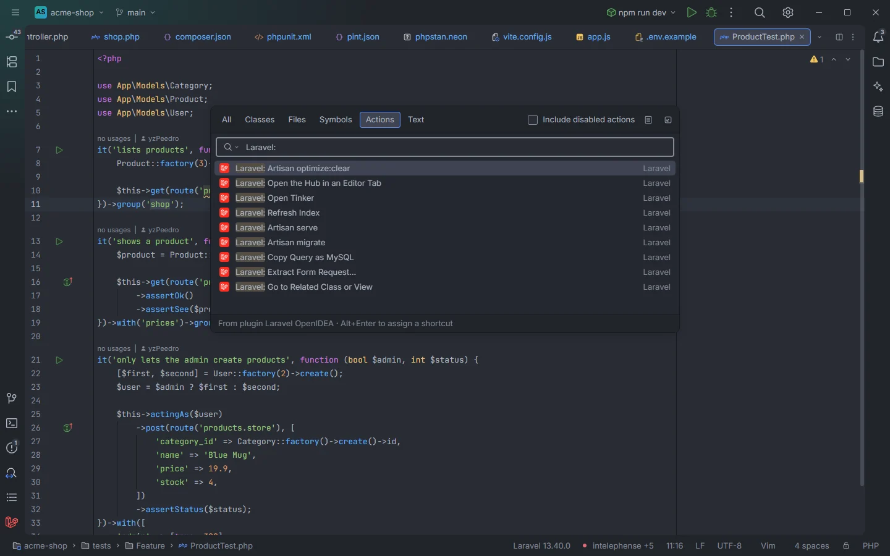
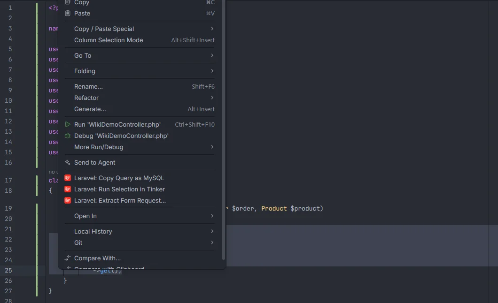
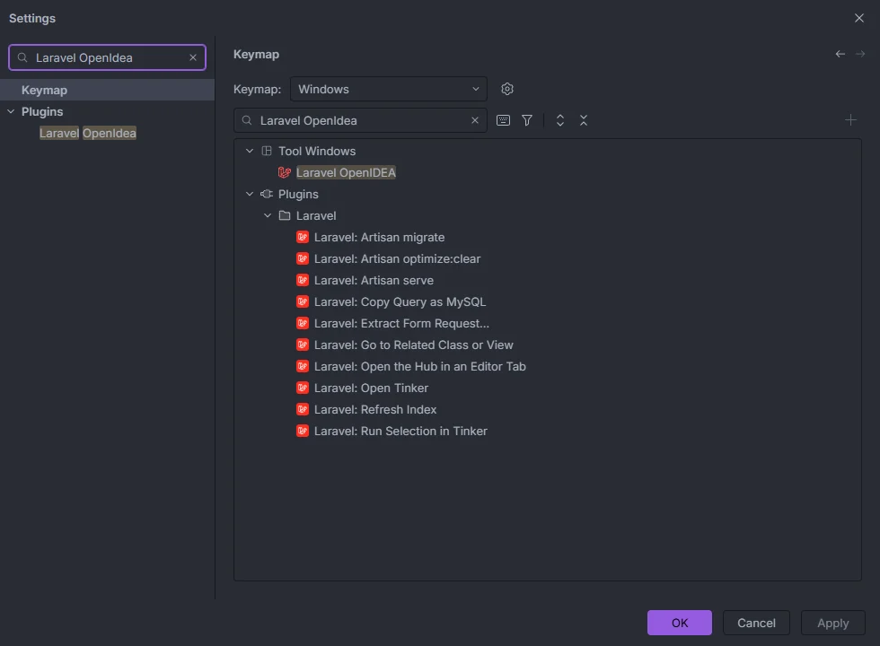
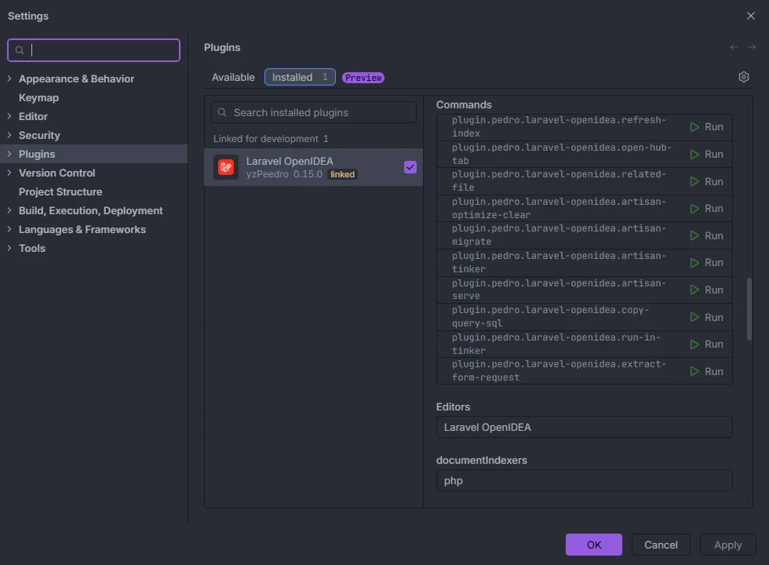

# Commands and shortcuts

Laravel OpenIDEA adds ten `Laravel:` commands to OpenIDEA. They run from the action search, from the editor's right-click menu (three of them) or from a key you bind in Settings › Keymap. This page lists every command, where it shows up, what it needs and what it does.

Search for "Laravel:" in the Actions tab of the search popup

## How to use them

- **Action search:** open the IDE's search popup, switch to **Actions** and type `Laravel:`. Every command is listed with the *Laravel* category on the right, and the footer reads "From plugin Laravel OpenIDEA · Alt+Enter to assign a shortcut".
- **Right-click menu:** in a PHP editor, *Laravel: Copy Query as MySQL*, *Laravel: Run Selection in Tinker* (only with a selection) and *Laravel: Extract Form Request…* sit together in the context menu.
- **Keys:** none of the commands has a default shortcut. Bind one in **Settings › Keymap** (see below), or press Alt+Enter on a command in the action search.
- **Settings › Plugins:** the plugin's page lists every command id with a **Run** button.

## The commands

| Command | Id | Available | What it does |
| --- | --- | --- | --- |
| **Laravel: Refresh Index** | `refresh-index` | Always | Drops every index of the project and builds them again; also runs when you click the [status bar item](Status-Bar.md) |
| **Laravel: Open the Hub in an Editor Tab** | `open-hub-tab` | Always | Opens the whole [hub](Hub.md) in an editor tab |
| **Laravel: Go to Related Class or View** | `related-file` | Always | Jumps between a Livewire or Blade component class and its view ([page](Related-Class-or-View.md)) |
| **Laravel: Artisan optimize:clear** | `artisan-optimize-clear` | Always | Opens a terminal tab running `artisan optimize:clear` |
| **Laravel: Artisan migrate** | `artisan-migrate` | Always | Opens a terminal tab running `artisan migrate` |
| **Laravel: Open Tinker** | `artisan-tinker` | Always | Opens a terminal tab running `artisan tinker` |
| **Laravel: Artisan serve** | `artisan-serve` | Always | Opens a terminal tab running `artisan serve` |
| **Laravel: Copy Query as MySQL** | `copy-query-sql` | PHP editor | Copies the query under the cursor, or the selection, as MySQL ([page](Copy-Query-as-MySQL.md)) |
| **Laravel: Run Selection in Tinker** | `run-in-tinker` | PHP editor with a selection | Runs the selected PHP in an `artisan tinker` terminal ([page](Run-Selection-in-Tinker.md)) |
| **Laravel: Extract Form Request…** | `extract-form-request` | PHP editor | Turns the `validate([…])` call at the cursor into a Form Request class ([page](Extract-Form-Request.md)) |

"PHP editor" is the command's `when` condition `editorLangId == php`; *Run Selection in Tinker* adds `editorHasSelection`. Outside those contexts the command is hidden from the action search and the menu.

The three editor commands in the right-click menu of a PHP file, with a selection

## Details

### Laravel: Refresh Index

1. Forgets every cached index and which projects are Laravel projects.
2. Checks the current project again: without a project it fails with "open a Laravel project first", and in a project without `artisan` and `laravel/framework` with "this project is not a Laravel application".
3. Reads the Laravel version from `composer.lock` again and updates the status bar.
4. Rebuilds the indexes as a background task (*Indexing the Laravel project*) for at most **3.5 seconds**, then rereads the project's PHP files for the [gutter usages](Gutter-Usages.md) and the class lists with whatever time is left (at most 2.5 seconds of it).
5. Reports what it found, such as "Indexed 395 config keys, 6 routes, …", one count per non-empty index. When everything fit in the time it adds "N facades and helpers"; when it didn't, it ends with "; the rest keeps indexing in the background", and the remaining indexes are built in slices when you open, focus or save a file, or on demand when a feature needs one.

You rarely need it: files you save, files changed on disk and git branch switches refresh the affected indexes on their own (see [How it works](How-It-Works.md)). Use it after changes the IDE can't report, or when something looks stale.

### Laravel: Open the Hub in an Editor Tab

Writes the hub tab files to `storage/openidea/hub` (one small `<section>.laravel-hub` file per section, plus `sections`, all ignored by git through `storage/openidea/.gitignore`) and opens `storage/openidea/hub/hub.laravel-hub`, which the plugin's custom editor shows as the whole hub. Writing the files needs `process:php` or `process:docker`; without it the command fails with "the hub tab files couldn't be written to storage/openidea/hub: …". The hub's own *Open in editor* button opens the current section the same way. See [The hub](Hub.md).

### The Artisan commands

*Artisan optimize:clear*, *Artisan migrate*, *Open Tinker* and *Artisan serve* open a terminal tab titled `artisan <command>` in the project root, run with the [runner](Settings.md#artisanrunner) the project uses:

| Runner | Program and arguments |
| --- | --- |
| `php` | `php artisan migrate` |
| `docker-run` | `docker compose run --rm --no-deps --entrypoint php <service> artisan migrate` |
| `docker` | `docker compose exec <service> php artisan migrate` |

The terminal is interactive (no `-T` for Docker), so prompts such as `migrate`'s confirmation in production and Tinker's REPL work. The terminal needs `process:php` (or `process:docker`); without it the IDE refuses to open it.

Since 0.15.0, *optimize:clear* and *migrate* run in a terminal like the other two. Before, the plugin waited for them itself, and a command slower than OpenIDEA's five-second limit for a plugin call (`optimize:clear` takes about seven seconds on a Laravel 8 project with Xdebug) restarted the plugin. In OpenIDEA 0.1.40 a terminal tab closes when its process exits, so the tabs of *optimize:clear* and *migrate* close once the command finishes, while *Open Tinker* and *Artisan serve* stay open until you stop them.

The hub's Artisan section runs any command, with a form for its arguments and options, in a terminal or with its output captured in place. See [Artisan](Hub-Artisan.md).

## Bind keys

Settings › Keymap, searched for "Laravel OpenIdea"

Open **Settings › Keymap** and search for "Laravel OpenIdea" (or "Laravel:"):

- **Tool Windows › Laravel OpenIDEA** toggles the hub's tool window.
- **Plugins › Laravel** holds the ten commands, in alphabetical order.

Pick one and assign a shortcut the way you would for any IDE action. The binding belongs to the keymap you have selected (*Windows* in the screenshot).

## Commands in the plugin's settings page

Settings › Plugins › Laravel OpenIDEA › Commands

The plugin's page in **Settings › Plugins** lists each command by its full id, `plugin.pedro.laravel-openidea.<id>`, with a **Run** button. Below it, **Editors** shows the *Laravel OpenIDEA* custom editor (the hub in editor tabs, for `*.laravel-hub` files) and **documentIndexers** shows `php`, the background indexer behind [gutter usages](Gutter-Usages.md).

## Code actions (Alt+Enter)

Several features are not commands but code actions, offered with Alt+Enter where they apply:

| Code action | Page |
| --- | --- |
| *Rename route '…' to '…' in every usage* | [Rename route](Rename-Route.md) |
| *Rename translation '…' to '…' in every locale and usage* | [Rename translation](Rename-Translation.md) |
| *Extract the validation into a Form Request (…)* | [Extract Form Request](Extract-Form-Request.md) |
| *Generate @property PHPDoc for … (N columns, M relations)* | [Generate model PHPDoc](Generate-Model-PHPDoc.md) |
| *Change to '…'* / *Change every usage of view '…' to '…'* | [Unknown views](Inspection-Unknown-Views.md) |
| *Add '…' to lang/…* | [Translations](Translations.md) |
| Quick fixes of each inspection | [Inspections overview](Inspections.md) |

## Settings and permissions

- The Artisan commands, *Open Tinker*, *Run Selection in Tinker*, *Extract Form Request…* and *Open the Hub in an Editor Tab* need `process:php` or `process:docker`.
- *Copy Query as MySQL* needs `editor.read` and `clipboard`; *Run Selection in Tinker* needs `editor.read`; *Extract Form Request…* needs `editor.read` and `editor.write`.
- `artisanRunner` and `dockerService` choose how the Artisan commands run.

See [Permissions](Permissions.md) and [Settings](Settings.md).

## Related

- [Status bar](Status-Bar.md)
- [The hub](Hub.md)
- [Artisan](Hub-Artisan.md)
- [Copy Query as MySQL](Copy-Query-as-MySQL.md)
- [Run Selection in Tinker](Run-Selection-in-Tinker.md)
- [Extract Form Request](Extract-Form-Request.md)
- [Go to Related Class or View](Related-Class-or-View.md)
- [Run configurations](Run-Configurations.md)

---
[← Wiki home](Home.md)
