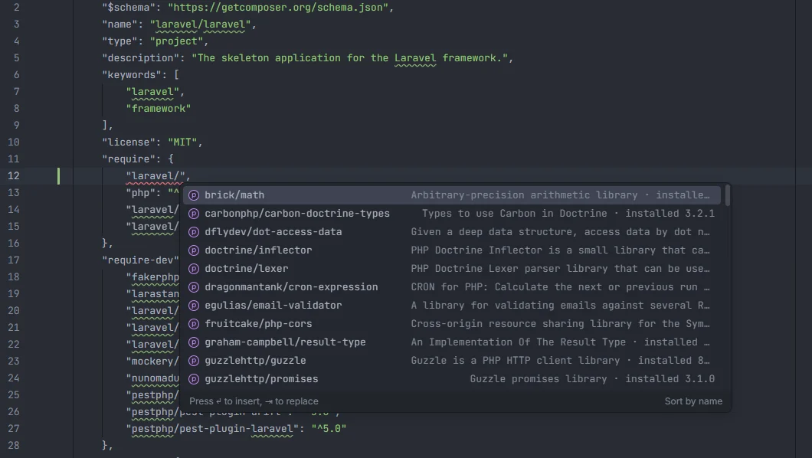

# composer.json

In `composer.json`, the plugin completes the top-level keys, package names (the ones installed in `composer.lock` first, with their description and installed version), version constraints built from the installed version, `autoload` keys, namespaces and folders, script events and the usual Laravel script commands, `config` keys and values, `allow-plugins`, and Laravel's package discovery settings.

Package names in <code>require</code>, from <code>composer.lock</code> with description and installed version

## How to use it

Open any file named `composer.json` and type inside a quoted key or value; the plugin works out which key you are in from the JSON around the cursor. The suggestion replaces the whole string between the quotes.

## What completes where

| Cursor in | Suggests |
| --- | --- |
| A top-level key | `name`, `description`, `type`, `keywords`, `license`, `homepage`, `authors`, `support`, `funding`, `require`, `require-dev`, `conflict`, `replace`, `provide`, `suggest`, `autoload`, `autoload-dev`, `repositories`, `config`, `scripts`, `scripts-descriptions`, `scripts-aliases`, `extra`, `bin`, `minimum-stability`, `prefer-stable`, `version`, each with a one-line description |
| The value of `minimum-stability` | `stable`, `RC`, `beta`, `alpha`, `dev` |
| The value of `type` | `project`, `library`, `metapackage`, `composer-plugin` |
| The value of `license` | `MIT`, `proprietary`, `Apache-2.0`, `BSD-3-Clause`, `GPL-3.0-or-later`, `LGPL-3.0-or-later` |
| A key in `require`, `require-dev`, `conflict`, `replace`, `provide` or `suggest` | Package names (see below) |
| A version in `require`, `require-dev` or `conflict` | Version constraints for that package (see below) |
| A key in `autoload` or `autoload-dev` | `psr-4`, `classmap`, `files`, `exclude-from-classmap`, `psr-0` |
| A key in `autoload.psr-4` | `App\\`, `Database\\Factories\\`, `Database\\Seeders\\`, `Tests\\`, each with its usual folder |
| A folder in `psr-4`, `classmap`, `files` or `exclude-from-classmap` | `app/`, `database/factories/`, `database/seeders/`, `tests/`, `src/`, `app/helpers.php` |
| A key in `scripts` or `scripts-descriptions` | Composer's script events (`post-autoload-dump`, `pre-autoload-dump`, `post-install-cmd`, `pre-install-cmd`, `post-update-cmd`, `pre-update-cmd`, `post-root-package-install`, `post-create-project-cmd`, `pre-package-uninstall`, `post-package-install`, `post-package-update`) and common custom scripts (`dev`, `test`, `lint`, `analyse`, `format`, `setup`) |
| A command in `scripts` (a string value, or inside a script's array) | `Illuminate\\Foundation\\ComposerScripts::postAutoloadDump`, `@php artisan package:discover --ansi`, `@php artisan vendor:publish --tag=laravel-assets --ansi --force`, `@php artisan key:generate --ansi`, `@php artisan migrate --graceful --ansi`, `@php artisan config:clear --ansi`, `@php artisan optimize:clear --ansi`, `@php artisan test`, `@php artisan boost:update --ansi`, `@php artisan ide-helper:generate`, `@php vendor/bin/pint`, `@php vendor/bin/phpstan analyse`, `@php vendor/bin/pest`, the command that copies `.env.example` to `.env`, `@putenv COMPOSER=composer.json`, `npm install` and `npm run build` |
| A key in `config` | `optimize-autoloader`, `classmap-authoritative`, `preferred-install`, `sort-packages`, `allow-plugins`, `platform`, `platform-check`, `process-timeout`, `vendor-dir`, `bin-dir`, `discard-changes`, `audit`, `lock`, `notify-on-install` |
| The value of `config.preferred-install` | `dist`, `source`, `auto` |
| The value of `config.discard-changes` | `stash`, `true` |
| A key in `config.allow-plugins` | The installed packages of type `composer-plugin`, then `pestphp/pest-plugin` and `php-http/discovery` |
| A key in `config.platform` | `php` and the PHP extensions below |
| A key in `extra` | `laravel`, `branch-alias` |
| A key in `extra.laravel` | `dont-discover`, `providers`, `aliases` |
| A value in `extra.laravel.dont-discover` | `*` (every package), then the package names |

Anything else (for example `repositories` or `authors`) gets no suggestions.

### Package names

In this order, each name once:

1. Every package in `composer.lock` (`packages` and `packages-dev`), with its description and `installed <version>` as detail.
2. A list of well-known packages with a short description: `php`, `laravel/framework`, `laravel/tinker`, `laravel/sanctum`, `laravel/passport`, `laravel/fortify`, `laravel/socialite`, `laravel/horizon`, `laravel/telescope`, `laravel/pulse`, `laravel/reverb`, `laravel/octane`, `laravel/scout`, `laravel/cashier`, `laravel/pennant`, `laravel/folio`, `laravel/prompts`, `laravel/pail`, `laravel/pint`, `laravel/sail`, `laravel/boost`, `laravel/wayfinder`, `laravel/nightwatch`, `livewire/livewire`, `livewire/volt`, `inertiajs/inertia-laravel`, `tightenco/ziggy`, `filament/filament`, the Spatie packages (`laravel-permission`, `laravel-medialibrary`, `laravel-data`, `laravel-query-builder`, `laravel-backup`, `laravel-activitylog`, `laravel-ray`), `barryvdh/laravel-debugbar`, `barryvdh/laravel-ide-helper`, `barryvdh/laravel-dompdf`, `maatwebsite/excel`, `itsgoingd/clockwork`, `larastan/larastan`, `pestphp/pest`, `pestphp/pest-plugin-laravel`, `phpunit/phpunit`, `mockery/mockery`, `fakerphp/faker`, `nunomaduro/collision`, `guzzlehttp/guzzle`, `predis/predis`, `league/flysystem-aws-s3-v3`, `sentry/sentry-laravel`, `rector/rector` and `friendsofphp/php-cs-fixer`.
3. PHP extensions: `ext-bcmath`, `ext-ctype`, `ext-curl`, `ext-dom`, `ext-fileinfo`, `ext-gd`, `ext-intl`, `ext-json`, `ext-mbstring`, `ext-openssl`, `ext-pcntl`, `ext-pdo`, `ext-pdo_mysql`, `ext-pdo_pgsql`, `ext-pdo_sqlite`, `ext-redis`, `ext-sodium`, `ext-tokenizer`, `ext-xml` and `ext-zip`.

### Version constraints

For a package installed at `13.40.0`:

| Suggestion | Detail |
| --- | --- |
| `^13.40` | installed minor and up |
| `^13.0` | installed major |
| `13.40.0` | exactly the installed version |
| `*` | any version |
| `dev-main` | the main branch |

A package that isn't installed only gets `*` and `dev-main`. For `php`, `^8.2`, `^8.3`, `^8.4` and `^8.5` are added.

## Details

- `composer.lock` is read from the project root every time you complete, so a `composer require` is reflected right away. Without a lock file, only the well-known packages and extensions are offered.
- The plugin returns the suggestions in the order above and leaves filtering by what you typed to the editor.
- Nothing here runs Composer or PHP.
- The plugin adds no Ctrl+click targets in `composer.json`.

## Settings and permissions

There are no settings for this completion, and only `project.read` is needed. See [Settings](Settings.md) and [Permissions](Permissions.md).

## Related

- [PSR-4 namespaces](Namespaces.md): `namespace` completion from `autoload`
- [phpunit.xml](PHPUnit-Xml.md)
- [Pint, PHP CS Fixer and PHPStan configs](Tool-Configs.md)
- [Ecosystem in the hub](Hub-Ecosystem.md)

---
[← Wiki home](Home.md)
