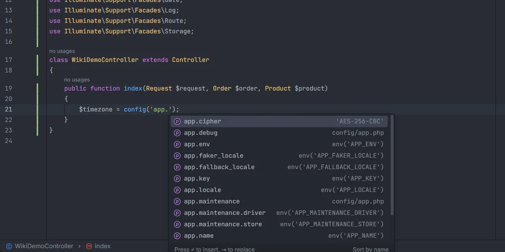

# Config keys

`config('…')` and the `Config` facade complete every key of every file in `config/`, nested keys included, and each suggestion shows the value written in the file: a string, a number, `true`, or the `env()` variable that feeds it. Ctrl+click opens the key in its config file.

<p align="center"></p>
<p align="center"><sub>Keys of <code>config/app.php</code>, each with the value written for it</sub></p>

## How to use it

Type inside the quotes of the first argument:

| Call | Notes |
| --- | --- |
| `config('…')` | Only a string argument. `config(['key' => 'value'])` sets values, so its keys aren't completed. |
| `Config::get('…')`, `Config::set('…')`, `Config::has('…')` | |
| `Config::string()`, `Config::integer()`, `Config::float()`, `Config::boolean()`, `Config::array()`, `Config::collection()` | the typed getters |
| `Config::prepend()`, `Config::push()` | |

```php
$timezone = config('app.timezone');
$driver = Config::string('mail.default');
Config::set('services.stripe.key', $key);
```

In Blade, the same calls work inside `{{ }}`, `{!! !!}`, `@php … @endphp` and directive lines:

```blade
<title>{{ config('app.name') }}</title>
```

## What you see

Every key is listed with its full dotted path: the file name (with subfolders as dots), then each nested array key.

| Detail | When |
| --- | --- |
| `'AES-256-CBC'` | The value is a string, shown with its quotes |
| `120`, `true`, `null` | The value is a number or a bare word (`true`, `false`, `null`, a constant or a class name) |
| `env('APP_ENV')` | The value is an `env()` call; only the variable is shown, not the default |
| `config/app.php` | The value is an array, a function call or another expression. The file key itself (`app`) also shows its file. |

For example, with `config/services/mail.php` containing `return ['driver' => 'smtp'];` the keys are `services.mail` (detail `config/services/mail.php`) and `services.mail.driver` (detail `'smtp'`).

Suggestions whose key starts with what you typed come first, then the ones that only contain it, each group in alphabetical order. Typing filters by substring, ignoring case, so `config('timezone')` already finds `app.timezone`. At most 500 suggestions are listed. Picking one replaces the whole string up to the closing quote.

## Where the keys come from

Every `*.php` file under `config/` (up to 2000 files) is read as text; nothing is executed. The plugin follows the array literal the file returns, with `[…]` and `array(…)`, at any depth. Keys built at runtime (`array_merge`, loops, spreads) aren't seen.

Values are never read from `.env`: the plugin shows `env('APP_KEY')`, not the key itself, so a secret written in `.env` never appears in the list.

## Ctrl+click

Ctrl+click on a key opens its config file at the key's string. The file key (`config('app')`) opens the file at the top. When two files produce the same key, every location is listed.

## Where else these keys are used

The config index also feeds:

- the driver and connection names in [Drivers and connections](Drivers-and-Connections.md): `filesystems.disks.*`, `cache.stores.*`, `queue.connections.*`, `logging.channels.*`, `database.connections.*`, `mail.mailers.*`, `auth.guards.*`, `auth.passwords.*` and `broadcasting.connections.*`;
- the variable names suggested in `.env` and in `phpunit.xml` `<env>`, taken from every `env('…')` in your config files ([Environment variables](Environment-Variables.md), [phpunit.xml](PHPUnit-Xml.md));
- Ctrl+click on a key in `.env`, which opens the config keys that read it;
- Socialite driver names (`services.*.client_id`) and queue names (`queue.connections.*.queue`) on [Packages](Packages.md) and [Drivers and connections](Drivers-and-Connections.md).

## Details

- The plugin doesn't need PHP, Docker or `vendor/` for config keys.
- The index is rebuilt when a file under `config/` changes, in the editor or on disk, together with every list derived from it.
- `config()->get('…')` and other method calls on the config repository aren't recognised; use `config('…')` or the facade.

## Settings and permissions

Config completion has no setting of its own and only needs `project.read`. See [Settings](Settings.md) and [Permissions](Permissions.md).

## Related

- [Environment variables](Environment-Variables.md)
- [`env()` outside config](Inspection-Env-Outside-Config.md): its quick fix rewrites `env('X')` to the `config()` key that reads the same variable
- [Drivers and connections](Drivers-and-Connections.md)
- [Config in the hub](Hub-Config.md)

---
[← Wiki home](Home.md)
