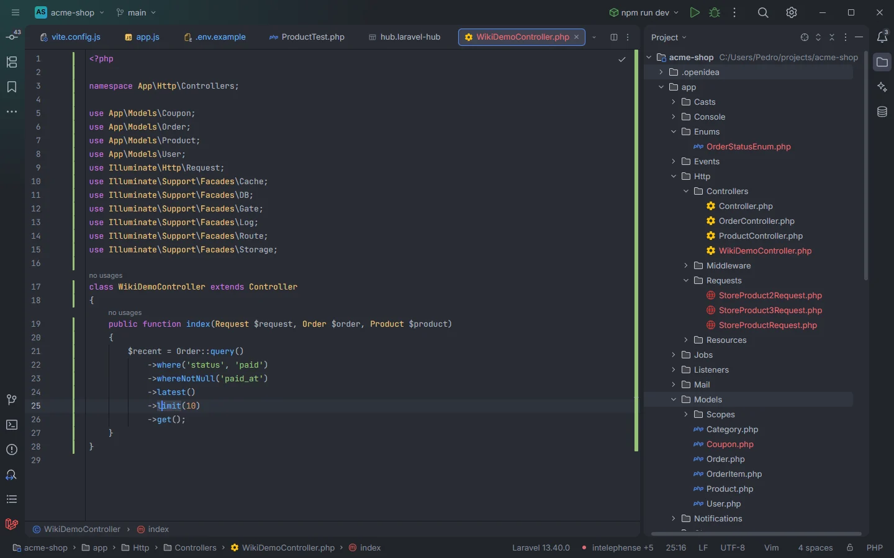

# Copy Query as MySQL

Right-click an Eloquent or query builder chain and pick *Laravel: Copy Query as MySQL*: the SQL it runs lands on your clipboard, with your models' tables, soft deletes and local scopes applied. Nothing runs: the plugin translates the code itself, so it works without PHP and without a database.

<p align="center">where('status', 'paid')->whereNotNull('paid_at')->latest()->limit(10)->get() and the cursor on limit" width="100%"></p>
<p align="center"><sub>The cursor anywhere in the statement is enough</sub></p>

## How to use it

1. In a PHP file, place the cursor anywhere in a query statement, or select the code.
2. Right-click and pick **Laravel: Copy Query as MySQL**, or run it from the action search.
3. Paste the SQL where you need it. The IDE shows "Copied the query as MySQL." followed by any notes.

With the cursor on `limit` in:

```php
$recent = Order::query()
    ->where('status', 'paid')
    ->whereNotNull('paid_at')
    ->latest()
    ->limit(10)
    ->get();
```

the clipboard gets:

```sql
SELECT *
FROM `orders`
WHERE `status` = 'paid'
  AND `paid_at` IS NOT NULL
ORDER BY `created_at` DESC
LIMIT 10
```

## What you see

- **The SQL** is MySQL, one clause per line: `SELECT`, `FROM`, joins, `WHERE` (each further condition on its own line, indented, starting with `AND` or `OR`), `GROUP BY`, `HAVING`, `ORDER BY`, `LIMIT`, `OFFSET` and the lock. Identifiers are quoted with backticks, strings with single quotes (a `'` inside is doubled), `true` and `false` become `1` and `0`.
- **The message** "Copied the query as MySQL." is followed by notes, one sentence each, when something needs saying:

| Note | When |
| --- | --- |
| ? stands for $id, $min | Variables and expressions become `?` placeholders |
| Order isn't a known model here: the table name `orders` is a guess | The class isn't one of your models; the table is guessed from the name (`OrderItem` → `order_items`, `Category` → `categories`, `Person` → `people`) |
| Eager loading runs as separate queries and isn't shown | `with()`, `load()`, `without()`, `withOnly()`, `loadMissing()` |
| withCount() adds a subquery per relation and isn't translated | `withCount()`, `withSum()`, `withAvg()`, `withMin()`, `withMax()`, `withExists()`, `withAggregate()` |
| whereHas() needs the relation's query and isn't translated | `whereHas()`, `whereDoesntHave()`, `has()`, `doesntHave()`, `whereRelation()`, `whereBelongsTo()`, `whereMorphedTo()`, `withWhereHas()`, `whereExists()`, `whereNotExists()` |
| when() is shown as if its callback runs | `when()` and `unless()` with a closure: its conditions are included |
| paginate() also runs a count query; the first page is shown | `paginate()` (`simplePaginate()` and `cursorPaginate()`: "The first page is shown") |
| chunk() repeats the query page by page | `chunk()`, `chunkById()`, `lazy()`, `lazyById()` |
| The model uses soft deletes: delete() sets deleted_at | `delete()` on a soft-deleting model |
| active() is a scope or method that isn't translated | A method the plugin doesn't know, and that isn't a local scope of the model |
| A subquery closure isn't translated: it shows as ? / A join closure isn't translated: its ON shows as ? / A subquery select isn't translated | Closures it can't follow |

## Details

### Which code is translated

- **With a selection**, the selected text.
- **Without one**, the statement around the cursor: from the previous `;`, `{` or `}` outside brackets to the next `;`. Strings and comments are skipped while looking.
- Leading `return`, `echo`, `yield` and `$variable =` are ignored.
- The chain must start with a model (`Order::query()`, `Order::where(…)`, `Order::find(…)`…) or with `DB::table('…')` / `DB::connection('…')->table('…')`. Raw `DB::select('…', [bindings])`, `DB::statement()`, `DB::insert()`, `DB::update()`, `DB::delete()`, `DB::selectOne()`, `DB::scalar()` and `DB::affectingStatement()` return their SQL with the bindings filled in.
- One query at a time. Properties (`->name`) can't be translated, only method calls.

When the code can't be translated, the command fails with the reason:

| Message | Fix |
| --- | --- |
| Select the code first, or place the cursor in a query. | The cursor is on an empty statement |
| Start the chain with DB::table('…') or a model (User::query()), not $user | The chain starts with a variable, such as `$user->posts()->…` |
| Start the chain with DB::table('…') or a model, like User::query() | Anything else at the start |
| Only one query at a time: unexpected `…` | The selection holds more than one statement |
| \`name\` is a property: only method calls can be translated | A property in the chain |
| Add ->table('…') after DB::connection() | `DB::connection()` without a table |
| DB::raw() isn't a query this can translate | Another `DB::` method |

### Models

The models come from the [model index](Model-Members.md) (classes under `app/Models` and `app/**/Models`), matched by short name:

- **Table:** the model's `$table` or `#[Table]`, otherwise Laravel's convention.
- **Soft deletes:** when the model's file mentions `SoftDeletes`, `` AND `orders`.`deleted_at` IS NULL `` is added; `withTrashed()` removes it, `onlyTrashed()` turns it into `IS NOT NULL`, and `delete()` becomes `` UPDATE … SET `deleted_at` = NOW() ``. `forceDelete()` stays a `DELETE`.
- **Local scopes:** a call such as `->published()` or `->olderThan(30)` is replaced by the conditions of `scopePublished()` / `scopeOlderThan()` or of a `#[Scope]` method, with its arguments put in place of the scope's parameters.

### What is translated

| Builder methods | SQL |
| --- | --- |
| `where`, `orWhere`, `whereNot`, nested closures | `WHERE … AND (… OR …)`, `NOT (…)` |
| `whereIn`, `whereNotIn`, `whereIntegerInRaw`, `whereKey`, `whereKeyNot` | `IN (…)`, `NOT IN (…)` |
| `whereNull`, `whereNotNull` | `IS NULL`, `IS NOT NULL` |
| `whereBetween`, `whereNotBetween`, `havingBetween` | `BETWEEN … AND …` |
| `whereColumn` | `` `a` = `b` `` |
| `whereDate`, `whereMonth`, `whereDay`, `whereYear`, `whereTime` | `DATE(…)`, `MONTH(…)`… |
| `whereLike`, `whereNotLike` | `LIKE`, `NOT LIKE` |
| `whereRaw`, `havingRaw`, `selectRaw`, `orderByRaw`, `groupByRaw` | The raw SQL with its bindings |
| `select`, `addSelect`, `distinct`, `value`, `pluck` | The column list |
| `join`, `leftJoin`, `rightJoin`, `crossJoin`, `joinWhere`, `leftJoinWhere` | `JOIN … ON …` |
| `groupBy`, `having` | `GROUP BY`, `HAVING` |
| `orderBy`, `orderByDesc`, `latest`, `oldest`, `reorder`, `inRandomOrder` | `ORDER BY` (`latest()` and `oldest()` use `created_at`; `inRandomOrder()` is `RAND()`) |
| `limit`, `take`, `offset`, `skip`, `forPage` | `LIMIT`, `OFFSET` |
| `lockForUpdate`, `sharedLock` | `FOR UPDATE`, `LOCK IN SHARE MODE` |
| `get`, `all`, `cursor`, `each` | The query as is |
| `first`, `firstOrFail`, `sole` | `LIMIT 1` |
| `find`, `findOrFail`, `findOr`, `findMany` | `` WHERE `table`.`id` = … LIMIT 1 `` or `IN (…)` |
| `paginate`, `simplePaginate`, `cursorPaginate` | `LIMIT <per page, 15 by default> OFFSET 0` |
| `count`, `sum`, `avg`, `average`, `min`, `max` | `` SELECT COUNT(*) AS `aggregate` `` |
| `exists`, `doesntExist` | `SELECT EXISTS(…)`, `SELECT NOT EXISTS(…)` |
| `update`, `increment`, `decrement`, `incrementEach`, `decrementEach` | `UPDATE … SET …` (Eloquent adds `updated_at = NOW()`) |
| `insert`, `insertOrIgnore`, `insertGetId`, `create`, `forceCreate`, `upsert` | `INSERT INTO …`, `INSERT IGNORE`, `ON DUPLICATE KEY UPDATE` (Eloquent's `create()` adds the timestamps) |
| `delete`, `forceDelete`, `truncate` | `DELETE FROM`, `TRUNCATE TABLE` |
| `query`, `newQuery`, `toBase`, `toSql`, `toRawSql`, `dd`, `dump`, `clone`, `tap`, `withoutGlobalScopes`, `useWritePdo` | Ignored |

Every `or…` variant (`orWhereIn`, `orWhereNull`…) joins its condition with `OR`.

The same translator powers the reverse side of the hub's [SQL to Laravel](Hub-SQL-to-Laravel.md) section (the swap button), and the MCP tool `query_to_sql` at the `write` level uses Laravel itself (`DB::pretend()`) instead.

## Settings and permissions

- **`editor.read`** to read the editor and **`clipboard`** to copy. Without `clipboard`: "Allow "clipboard" for Laravel OpenIDEA in Settings › Plugins to copy queries."
- No process permission: nothing runs.
- The command shows only in PHP files (`editorLangId == php`).

See [Permissions](Permissions.md).

## Related

- [SQL to Laravel](Hub-SQL-to-Laravel.md)
- [Eloquent chains](Eloquent-Chains.md)
- [Scopes](Scopes.md)
- [Run Selection in Tinker](Run-Selection-in-Tinker.md)
- [Commands and shortcuts](Commands.md)
- [Live Audit](Hub-Live-Audit.md) (the SQL that really ran, with bindings)

---
[← Wiki home](Home.md)
