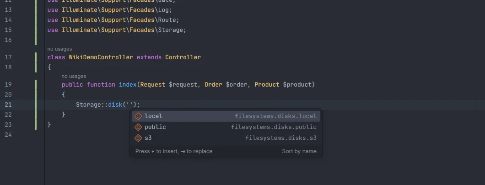
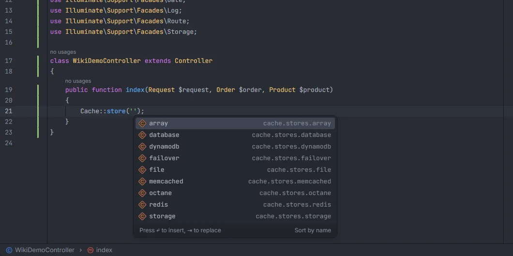
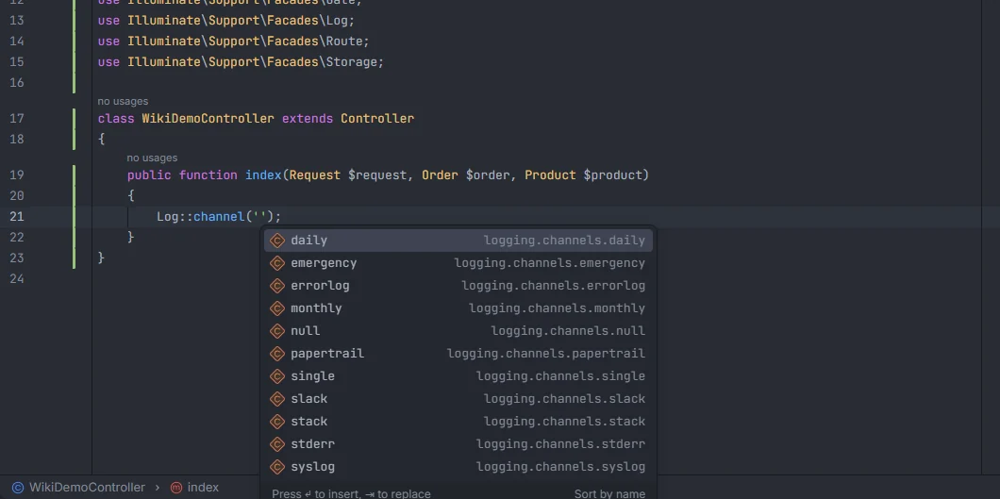
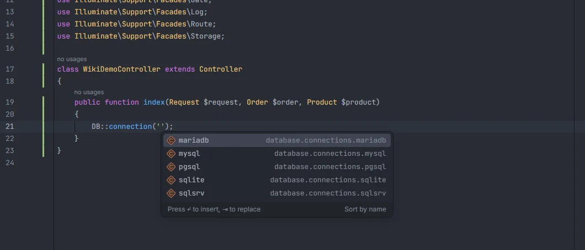

# Drivers and connections

The names you pass to `Storage::disk()`, `Cache::store()`, `Log::channel()`, `DB::connection()`, `Mail::mailer()`, `Queue::connection()`, `auth()`, `Password::broker()` and `Broadcast::connection()` complete with the disks, stores, channels, connections, mailers, guards and brokers your config files define. Rate limiters, queue names and broadcast channels complete from your code. Ctrl+click opens the definition in the config file.

<p align="center"></p>
<p align="center"><sub>Disks of <code>config/filesystems.php</code> in <code>Storage::disk('')</code></sub></p>

## How to use it

Type inside the quotes. Facade and method names are matched case-insensitively, and fully qualified facades work too.

| Kind | Calls | Read from |
| --- | --- | --- |
| Disks | `Storage::disk('…')`, `Storage::fake('…')`, `Storage::persistentFake('…')`, `Storage::build('…')` | `filesystems.disks.*` |
| Cache stores | `Cache::store('…')`, `Cache::driver('…')`, `Cache::memo('…')` | `cache.stores.*` |
| Queue connections | `Queue::connection('…')`, `->onConnection('…')` | `queue.connections.*` |
| Log channels | `Log::channel('…')`, `logs('…')`, `Log::stack([…])` (arrays) | `logging.channels.*` |
| Database connections | `DB::connection('…')`, `Schema::connection('…')`, `#[Connection('…')]` on a model | `database.connections.*` |
| Mailers | `Mail::mailer('…')` | `mail.mailers.*` |
| Guards | `auth('…')`, `Auth::guard('…')`, `Auth::shouldUse('…')`, `->guard('…')`, `@auth('…')`, `@guest('…')`, the parameter of `auth:`, `auth.basic:`, `auth.session:` and `guest:` middleware | `auth.guards.*` |
| Password brokers | `Password::broker('…')` | `auth.passwords.*` |
| Broadcasters | `Broadcast::connection('…')`, `Broadcast::driver('…')` | `broadcasting.connections.*` |
| Rate limiters | the parameter of `throttle:` middleware | `RateLimiter::for()` in `app/` |
| Queue names | `->onQueue('…')` | `->onQueue()` in `app/` and the connections' `queue` value |
| Broadcast channels | `new PrivateChannel('…')`, `new PresenceChannel('…')`, `new EncryptedPrivateChannel('…')`, `new Channel('…')` | `Broadcast::channel()` in `routes/` |

All of them take the first argument, except where noted.

```php
Storage::disk('public')->put('avatars/1.png', $file);
Cache::store('redis')->remember('stats', 60, fn () => $this->stats());
Log::stack(['daily', 'slack'])->info('Order shipped');
DB::connection('sqlite')->table('orders')->count();
$user = auth('admin')->user();
dispatch(new ShipOrder($order))->onQueue('shipping');
```

<p align="center"></p>
<p align="center"><sub>Cache stores in <code>Cache::store('')</code></sub></p>

<p align="center"></p>
<p align="center"><sub>Log channels in <code>Log::channel('')</code></sub></p>

<p align="center"></p>
<p align="center"><sub>Database connections in <code>DB::connection('')</code></sub></p>

## What you see

For the names read from config, each suggestion is the direct child key of the config array, and the detail is its full config key: `public` · `filesystems.disks.public`. Only direct children count, so `filesystems.disks.public.driver` isn't a disk.

| Kind | Extra entries | Detail |
| --- | --- | --- |
| Guards | `sanctum`, when `composer.json` mentions `laravel/sanctum` and `config/auth.php` has no `sanctum` guard | `Laravel Sanctum` |
| Rate limiters | | The file of the `RateLimiter::for()` call |
| Queue names | | The file of the `onQueue()` call, or the config key of the connection |
| Broadcast channels | | The file of the `Broadcast::channel()` call, such as `channels.php` |

Suggestions whose name starts with what you typed come first, then the ones that only contain it, each group in alphabetical order. Picking one replaces the whole string.

## Where the names come from

- **Config-based kinds** use the [config key index](Config-Keys.md): every `config/*.php` file read as text. Whatever you add to `config/filesystems.php`, `cache.php`, `queue.php`, `logging.php`, `database.php`, `mail.php`, `auth.php` or `broadcasting.php` shows up after saving.
- **Rate limiters**: the first argument of `RateLimiter::for('…')` in files under `app/` (up to 5000).
- **Queue names**: the first argument of `->onQueue('…')` in files under `app/` that contain `onQueue`, then the `queue` value of each connection in `config/queue.php`. When that value is an `env()` call, the plugin shows the variable's name rather than its default.
- **Broadcast channels**: the first argument of `Broadcast::channel('…')` in files under `routes/`, such as `chat.{id}`.

## Ctrl+click

| Ctrl+click on | Opens |
| --- | --- |
| A disk, store, connection, channel, mailer, guard, broker or broadcaster | Its key in the config file (`'public' => [` in `config/filesystems.php`) |
| The `sanctum` guard added for Sanctum | nothing (it has no config entry) |
| A rate limiter | The `RateLimiter::for()` string |
| A queue name | The `onQueue()` call or the connection's `queue` key |
| A broadcast channel | The `Broadcast::channel()` string |

A cache key (not a store), such as the first argument of `Cache::get('…')` or `cache('…')`, opens the hub's [Cache](Hub-Cache.md) section searched for that key instead.

## Details

- Paths inside a disk (`Storage::disk('public')->exists('…')`) complete from the disk's root folder; see [Helpers](Helpers.md#storage-paths).
- The same names complete as values in `.env` (`DB_CONNECTION=`, `CACHE_STORE=`, `LOG_CHANNEL=`, `MAIL_MAILER=`, `FILESYSTEM_DISK=`…) and in `phpunit.xml` `<env value="…">`; see [Environment variables](Environment-Variables.md).
- The config-based lists are rebuilt when a file under `config/` changes; rate limiters and queue names when a file under `app/` changes; channels when a file under `routes/` changes.
- Nothing here runs PHP.

## Settings and permissions

There are no settings for these names, and only `project.read` is needed. See [Settings](Settings.md) and [Permissions](Permissions.md).

## Related

- [Config keys](Config-Keys.md)
- [Helpers](Helpers.md): `logs()`, `auth()` and storage paths
- [Middleware, gates and policies](Middleware-Gates-and-Policies.md): `auth:` and `throttle:` parameters
- [Environment variables](Environment-Variables.md)
- [Drivers & Connections in the hub](Hub-Drivers-and-Connections.md) and [Queues & Workers in the hub](Hub-Queues.md)

---
[← Wiki home](Home.md)
