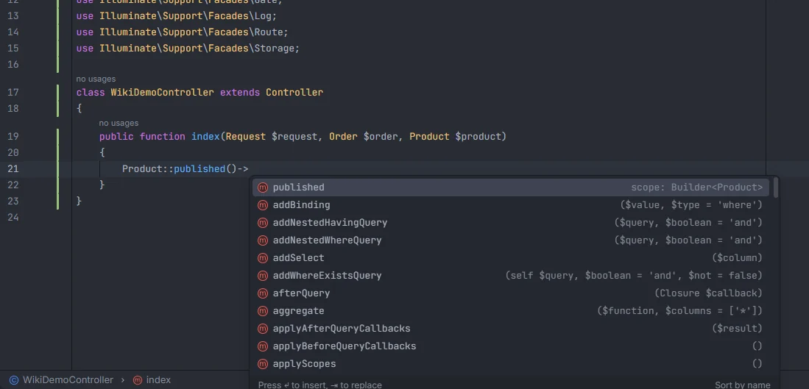
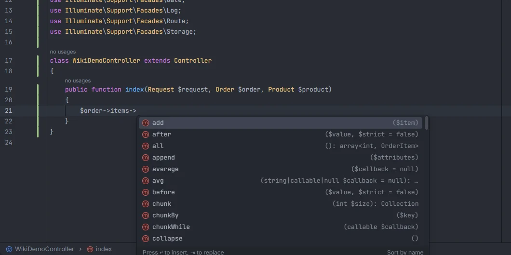
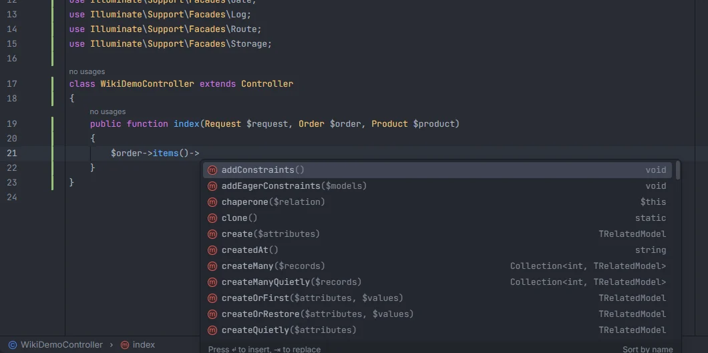

# Eloquent chains

Each step of an Eloquent chain completes what that step returns: after a to-many relation the collection's methods, after a relation call the relation's own methods plus the query ones, after `Product::` or a scope the query methods with the model's local scopes first, and after `first()`, `find()` or `get()` the model or the collection again. The method lists come from the Laravel version installed in your `vendor/`, and every signature shows the real model in place of the generic type.

<p align="center"> with the published scope first, detail scope: Builder<Product>, followed by the query builder methods" width="760"></p>
<p align="center"><sub><code>Product::published()-></code>: the model's scopes first, then the Eloquent and query builder methods</sub></p>

## How to use it

Type `->` (or `::` after a model class) and the list matches where the chain is:

```php
$order->items->                         // Collection methods, typed with OrderItem
$order->items()->                       // HasMany methods + query methods
$order->user()->                        // BelongsTo methods (associate, dissociate…) + query methods
Product::                               // scopes, query methods and factory()
Product::where('active', 1)->latest()-> // scopes and query methods
Product::published()->                  // scopes and query methods
$order->items()->first()->              // the OrderItem model again: columns and relations
$order->items()->get()->                // Collection methods
Order::query()->paid()->get()->         // Collection methods
User::factory()->                       // factory states and Factory methods, see Factories
```

Calls with arguments are followed, closures included: `$order->items()->where(fn ($q) => $q->active())->first()->` still lands on `OrderItem`.

## What you see

There are four shapes a step can have. Each one lists its own items:

| Shape | Reached by | Lists |
| --- | --- | --- |
| **Model** | a model variable, a to-one relation, `first()`, `find()`… | the model's columns and relations ([Model members](Model-Members.md)) |
| **Collection** | a to-many relation as a property, `get()`, `all()`… | the methods of `Illuminate\Database\Eloquent\Collection` and its parents |
| **Query** | `Product::`, a relation call, a scope, `where()`, `latest()`… | the model's local scopes, then the methods of the Eloquent `Builder` and the query `Builder` |
| **Factory** | `Product::factory()` | the factory's states, then the `Factory` methods; see [Factories](Factories.md) |

- Methods use the method icon and insert `name()` with the cursor between the parentheses.
- The detail is the method's signature. `{T}` in a signature is replaced by the model, so `first` on `$order->items->` reads `(?callable $callback = null, $default = null): ?OrderItem` and `get` reads `($columns = ['*']): Collection<int, OrderItem>`.
- **Scopes** sort before everything else in a query and show `scope: Builder<Product>`.
- After a relation call, the relation's own methods come with the query ones:

| Relation | Its own methods (besides the query ones) |
| --- | --- |
| `hasMany`, `morphMany` | `create`, `createMany`, `createQuietly`, `firstOrCreate`, `firstOrNew`, `forceCreate`, `make`, `makeMany`, `save`, `saveMany`, `saveQuietly`, `updateOrCreate` |
| `hasOne`, `morphOne` | the same, plus `latestOfMany`, `ofMany`, `oldestOfMany` |
| `belongsTo`, `morphTo` | `associate`, `dissociate`, `getResults` |
| `belongsToMany`, `morphToMany`, `morphedByMany` | `attach`, `detach`, `sync`, `syncWithPivotValues`, `syncWithoutDetaching`, `toggle`, `updateExistingPivot`, `wherePivot`, `wherePivotIn`, `wherePivotNull`, `withPivot`, `withTimestamps`, `as`, `allRelatedIds`, `create`, `createMany`, `findOrNew`, `firstOrCreate`, `save`, `saveMany`, `updateOrCreate` |

This table is the built-in list used without `vendor/`. With Laravel installed, the list is every public, non-static method of the installed relation class (`HasMany`, `BelongsToMany`…), its traits and parents, plus the query methods.

<p align="center">items-> listing collection methods such as add, after, all with the signature all(): array<int, OrderItem>" width="760"></p>
<p align="center"><sub><code>$order->items-></code>: the installed Eloquent Collection's methods, with <code>OrderItem</code> in the types</sub></p>

<p align="center">items()-> listing relation methods such as create, createMany, createQuietly" width="760"></p>
<p align="center"><sub><code>$order->items()-></code>: the <code>HasMany</code> relation's methods with the query ones</sub></p>

## Details

### How each step moves the chain

The start of the chain is a model (a variable, `$this` in a model, `auth()->user()`; see [Model members](Model-Members.md)) or a query (`Product::`, `static::` and `self::` in a model). Then each step is applied in order:

| From | Step | To |
| --- | --- | --- |
| Model | a relation as a property (`->user`, `->items`) | Model of the target for `hasOne`, `belongsTo`, `morphOne`, `morphTo`, `hasOneThrough`; Collection for `hasMany`, `belongsToMany`, `morphMany`, `morphToMany`, `morphedByMany`, `hasManyThrough` |
| Model | a relation as a call (`->items()`) | Query on the target model |
| Model | `fresh`, `refresh`, `load`, `loadMissing`, `loadCount`, `replicate`, `makeHidden`, `makeVisible`, `setRelation`, `unsetRelation` | the same Model |
| Model or Query | a local scope of the model (`->published()`) | Query |
| Model or Query | `where…`, `orWhere…`, `orderBy…`, `with…`, `whereHas…`, `orWhereHas…`, `whereDoesntHave…`, `having…`, `whereRelation…` (any method starting with these) and `query`, `newQuery`, `latest`, `oldest`, `limit`, `take`, `skip`, `offset`, `select`, `addSelect`, `distinct`, `groupBy`, `having`, `join`, `leftJoin`, `when`, `unless`, `tap`, `has`, `doesntHave`, `withTrashed`, `onlyTrashed`, `withoutTrashed`, `lockForUpdate`, `sharedLock`, `inRandomOrder`, `reorder`, `without`, `withoutGlobalScope`, `withoutGlobalScopes`, `forPage`, `toBase` | Query |
| Query | `first`, `firstOrFail`, `firstOrNew`, `firstOrCreate`, `firstWhere`, `sole`, `find`, `findOrFail`, `findOrNew`, `create`, `createQuietly`, `forceCreate`, `make`, `updateOrCreate`, `getResults` | Model |
| Query | `get`, `all`, `findMany` | Collection |
| Query | `factory` | Factory |
| Collection | `first`, `last`, `sole`, `find`, `firstWhere`, `pop`, `shift`, `random` | Model |
| Collection | `filter`, `reject`, `where`, `whereIn`, `whereNotIn`, `whereNull`, `whereNotNull`, `sortBy`, `sortByDesc`, `values`, `unique`, `take`, `skip`, `slice`, `each`, `load`, `loadMissing`, `loadCount`, `fresh`, `except`, `only`, `diff`, `merge`, `concat`, `push`, `reverse`, `shuffle`, `when`, `unless`, `tap`, `makeHidden`, `makeVisible` | Collection |
| Collection | `toQuery` | Query |
| Factory | `create`, `make`, `createOne`, `makeOne`, `createQuietly`, `createOneQuietly` | Model |
| Factory | `createMany`, `makeMany`, `createManyQuietly` | Collection |
| Factory | any other call except `raw` | Factory |

A step that isn't in the table (for example `->pluck()` or `->count()`) ends the chain: nothing more is completed after it. A property step on a Query or a Collection ends it too, and so does a `morphTo` relation, which has no known target model.

### Where the method lists come from

- With Laravel installed, the lists are read from `vendor/laravel/framework`: the public, non-static methods of `Illuminate\Database\Eloquent\Collection`, of `Illuminate\Database\Eloquent\Builder` together with `Illuminate\Database\Query\Builder`, of each relation class and of `Illuminate\Database\Eloquent\Factories\Factory`, each with its traits and parent classes (up to eight levels). A method the installed version doesn't have is not offered, and a newer one is.
- For the most common methods the plugin keeps a hand-written signature with the generic model type (`first(): ?{T}`, `get(): Collection<int, {T}>`); the installed method uses that signature. Every other method shows the parameter list from the source.
- Without `vendor/` (before `composer install`), a built-in list of those common methods is used instead.
- The framework is read again when `composer.lock` or `vendor/composer/installed.json` changes.

### Other rules

- `Product::` with nothing after it also offers `factory()` when the model has a factory ([Factories](Factories.md)).
- A scope only counts on a Model or a Query, not on a Collection.
- Scopes and relations of a parent model are inherited by models that extend it ([Types and inheritance](Types-and-Inheritance.md)).
- The class before `::` is matched by its short name, so `\App\Models\Product::` and `Product::` are the same.
- Parentheses are matched up to 4000 characters back, so very long arguments inside a chain can stop it from being followed.
- Variables that hold a query (`$q = Product::query();`) are not typed; write the chain on the variable that holds a model or a collection, or use a typed closure parameter.

## Settings and permissions

No setting and no optional permission. The installed framework is read from `vendor/` through the required `project.read` permission ([Permissions](Permissions.md)).

## Related

- [Model members](Model-Members.md)
- [Scopes](Scopes.md)
- [Factories](Factories.md)
- [Casts](Casts.md)
- [Typed closures](Typed-Closures.md)
- [Copy Query as MySQL](Copy-Query-as-MySQL.md): the SQL a chain runs
- [N+1 queries](Inspection-N-Plus-One.md)

---
[← Wiki home](Home.md)
