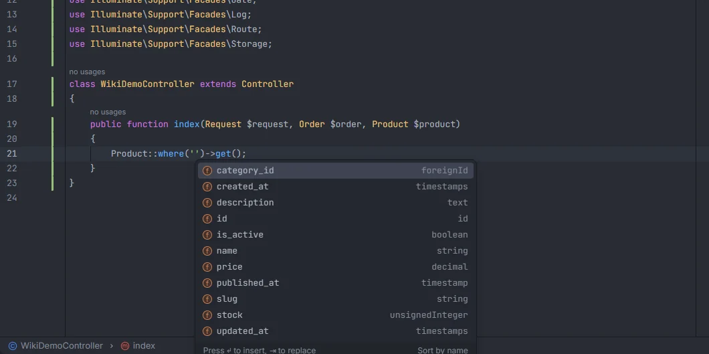
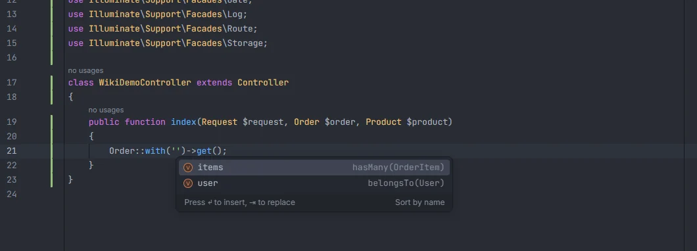
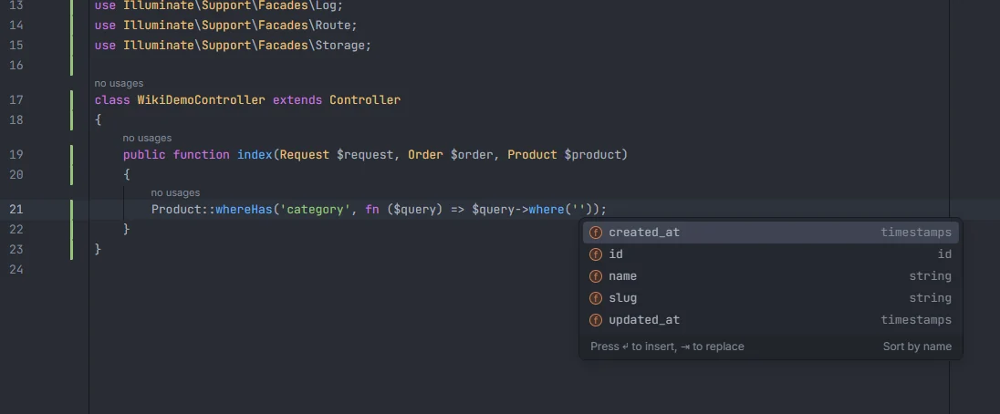

# Eloquent columns and relations

Inside the strings of Eloquent calls, the plugin completes the columns of the model's table (read from your migrations) and the model's relations (read from the model classes). It works on static calls such as `Product::where('…')`, on variables whose model it can infer, through relation chains and inside query closures, and Ctrl+click on a column or relation name opens the migration or the relation method.

<p align="center"></p>
<p align="center"><sub>Columns of the <code>products</code> table in <code>Product::where('')</code>, each with the migration method that created it</sub></p>

## How to use it

Type inside the quotes of a supported call, or press Ctrl+Space there. The list depends on the method and the argument:

```php
Product::where('');                       // columns of products
Product::orderBy('published_at')->pluck('');  // columns
Order::with('');                          // relations of Order
Order::with('items.');                    // relations of OrderItem (the model behind items)
Order::with('user:id,');                  // columns of the users table, after the colon
Product::create(['' => 'Lamp']);          // columns as array keys
Post::whereHas('author', fn ($q) => $q->where(''));  // columns of the related model
```

### Calls that complete columns

The column is the first argument unless the table says otherwise.

| Methods | Argument |
| --- | --- |
| `where`, `orWhere`, `whereNot`, `orWhereNot`, `whereIn`, `orWhereIn`, `whereNotIn`, `orWhereNotIn`, `whereNull`, `orWhereNull`, `whereNotNull`, `orWhereNotNull`, `whereBetween`, `orWhereBetween`, `whereNotBetween`, `whereDate`, `whereMonth`, `whereDay`, `whereYear`, `whereTime`, `whereColumn`, `whereLike`, `orWhereLike`, `firstWhere`, `whereJsonContains` | first |
| `orderBy`, `orderByDesc`, `latest`, `oldest`, `having`, `value`, `increment`, `decrement`, `sum`, `avg`, `average`, `max`, `min` | first |
| `select`, `addSelect`, `groupBy`, `pluck` | first and second, also inside an array (`select(['id', ''])`) |
| `create`, `update`, `fill`, `forceFill`, `firstOrCreate`, `firstOrNew`, `updateOrCreate`, `where`, `make`, `forceCreate` | the keys of an array argument (`create(['name' => …])`), including a key you are still typing before its `=>` |

### Calls that complete relations

`with`, `without`, `withOnly`, `load`, `loadMissing`, `loadCount`, `has`, `orHas`, `doesntHave`, `orDoesntHave`, `whereHas`, `orWhereHas`, `whereDoesntHave`, `orWhereDoesntHave`, `withCount`, `withExists`, `withSum`, `withAvg`, `withMax`, `withMin`, `whereRelation` and `withWhereHas`, on the first argument, as a string or as strings in an array.

- A dot walks into the related model: after `with('items.')` the list shows the relations of the model `items` points to, and so on for every segment.
- A colon switches to columns: after `with('user:')` and after each comma that follows (`'user:id,name'`), the columns of the related model's table are listed.

### Inside the model class

In a model (a class that extends `Model`, `Authenticatable`, `Pivot`, `MorphPivot`, `User`, a class whose name ends in `Model`, or another model), the strings of these members complete too:

| Where | Completes |
| --- | --- |
| `$fillable`, `$guarded`, `$hidden`, `$visible`, `$dates`, `$appends` | columns |
| The keys of `$casts` and of the array returned by `casts()` | columns (the values complete cast types, see [Casts](Casts.md)) |
| `$with`, `$withCount`, `$touches` | relations of the model |
| `#[Fillable([…])]`, `#[Guarded([…])]`, `#[Hidden([…])]`, `#[Visible([…])]`, `#[Appends([…])]` | columns |
| `#[With([…])]`, `#[Touches([…])]`, `#[WithCount([…])]` | relations |
| `#[Table('…')]` | table names from the migrations |
| `#[Connection('…')]` | database connections from `config/database.php` |

## What you see

- **Columns** use the field icon. The detail is the Blueprint method of the migration that created the column: `string`, `foreignId`, `decimal`, `timestamps` (for `created_at` and `updated_at`), `id`, `softDeletes`, `rememberToken`, and so on.
- **Relations** use the reference icon and show their kind and target as written in the model, such as `hasMany(OrderItem)` or `belongsTo(User)`. Picking one inserts only the name, without parentheses.
- Items whose name starts with what you typed come first, then the ones that only contain it. Matching ignores case. At most 500 items are returned.
- Picking an item replaces the whole string value (or, in `'user:id,name'`, the current segment), so a value that was already there is replaced, not extended.

<p align="center"></p>
<p align="center"><sub><code>Order::with('')</code> lists the relations of <code>Order</code> with their kind and target</sub></p>

## Where the model comes from

The model of a call is taken from the start of its chain:

| Code | Model |
| --- | --- |
| `Product::where('…')`, `Product::query()->where('…')`, `\App\Models\Product::with('…')` | `Product` (the class name, without its namespace) |
| `$product->where('…')`, `$order->items()->where('…')` | the model of the variable, followed through the relation methods in the chain (see [Model members](Model-Members.md) for how variables are typed) |
| `$query->where('…')` in a closure | the model the closure works on (see below) |

### Closures

Untyped closure parameters get a model from the call the closure is passed to:

| Call | `$q` is |
| --- | --- |
| `whereHas('posts', fn ($q) => …)`, `orWhereHas`, `whereDoesntHave`, `orWhereDoesntHave`, `withWhereHas`, `has`, `orHas`, `doesntHave`, `orDoesntHave` | the related model (`posts`); a dotted path such as `'posts.comments'` walks every segment |
| `with(['posts' => fn ($q) => …])`, or any array whose key is a relation name and whose value is the closure | the related model |
| `where(fn ($q) => …)`, `orWhere`, `whereNot`, `orWhereNot`, `when`, `unless`, `tap` | the same model |
| `each`, `map`, `filter`, `reject`, `first`, `last`, `sortBy`, `sortByDesc`, `every`, `contains`, `some`, `flatMap`, `groupBy`, `keyBy`, `partition`, `sum`, `mapWithKeys`, `search`, `unique`, `doesntContain` | one item of the collection or query |

Only the closure's first parameter is typed this way, and closures nest: in `User::whereHas('posts', function ($q) { $q->whereHas('author', fn ($a) => $a->where('')); })` the inner `where('')` completes the columns of the author's model.

<p align="center">where('') in a whereHas('category') closure listing the columns of the categories table" width="760"></p>
<p align="center"><sub>In <code>Product::whereHas('category', fn ($query) => $query->where(''))</code> the closure works on <code>Category</code></sub></p>

To get the closure itself written with a typed parameter, see [Typed closures](Typed-Closures.md).

## Details

- **Columns come from the migrations.** Every file under `database/migrations` is read in file name order. `Schema::create('table', …)` and `Schema::table('table', …)` set the current table, and each `$table->method('name')` call whose method is a column type adds a column: `id`, `string`, `text`, `integer` and its variants, `boolean`, `decimal`, `float`, `double`, `date`, `dateTime`, `time`, `timestamp` (and the `Tz` variants), `json`, `jsonb`, `uuid`, `ulid`, `foreignId`, `foreignIdFor`, `foreignUuid`, `foreignUlid`, `enum`, `set`, `year`, `binary`, `char`, `ipAddress`, `macAddress`, `geometry`, `geography`, `vector` and the other Blueprint column types. `morphs('x')` and its variants add `x_id` and `x_type`. Calls without arguments add their implied columns: `id()` adds `id`, `timestamps()` adds `created_at` and `updated_at`, `softDeletes()` adds `deleted_at`, `rememberToken()` adds `remember_token`.
- A column is listed once per table, in the order the migrations add it. Later migrations are followed: `dropColumn()`, `dropMorphs()`, `dropTimestamps()`, `dropSoftDeletes()`, `dropRememberToken()` and `dropConstrainedForeignId()` remove columns, `renameColumn()` renames one, `Schema::drop()` and `Schema::dropIfExists()` remove a table and `Schema::rename()` renames it. The `down()` method of a migration is ignored. See [Database](Hub-Database.md#where-the-tables-come-from).
- **The table of a model** is its `#[Table('…')]` attribute, then its `protected $table = '…'`, then the snake-case plural of the class name (`OrderItem` → `order_items`, `Category` → `categories`, `Address` → `addresses`, `Person` → `people`).
- **Models** are the classes under `app/Models/` and under any `Models` folder inside `app/` (such as `app/Domain/Billing/Models/`). A class counts as a model when it extends `Model`, `Authenticatable`, `Pivot`, `MorphPivot`, `User` or a class whose name ends in `Model`, or when it extends another model.
- **Relations** are the public methods of a model whose body calls `hasOne`, `hasMany`, `belongsTo`, `belongsToMany`, `morphTo`, `morphOne`, `morphMany`, `morphToMany`, `morphedByMany`, `hasOneThrough`, `hasManyThrough` or `hasOneOrMany`. The target is the first argument when it is `Class::class` or a class name string; `morphTo()` has none. A model that extends another model inherits its relations ([Types and inheritance](Types-and-Inheritance.md)).
- A column string that contains a dot, a space or a parenthesis (`'orders.total'`, `DB::raw(…)`) is not completed.
- The second and third arguments of `where()`-style calls complete the values of a backed enum when the column is cast to one; see [Enum values](Inspection-Enum-Values.md).
- In `exists:` and `unique:` validation rules, the table and then its columns complete the same way; see [Validation rules](Validation-Rules.md).
- The indexes are rebuilt when a migration or a model file is saved or changed on disk, not while you type in it.

### Go to definition

- Ctrl+click on a column name in any of these strings opens the line of the migration that created the column.
- Ctrl+click on a relation name opens the relation method in the model. This works for each segment of a dotted path.

See [Go to definition](Go-to-Definition.md) for everything else Ctrl+click opens.

## Settings and permissions

Completion and navigation need no setting and no optional permission. The [unknown columns inspection](Inspection-Unknown-Columns.md) uses the same column index and is controlled by `unknownColumnInspection` (see [Settings](Settings.md)).

## Related

- [Model members](Model-Members.md): `$order->` columns and relations
- [Eloquent chains](Eloquent-Chains.md): what each step of a chain completes
- [Casts](Casts.md): cast values in `casts()` and `$casts`
- [Typed closures](Typed-Closures.md)
- [Unknown columns](Inspection-Unknown-Columns.md) and [Enum values](Inspection-Enum-Values.md)
- [Database](Hub-Database.md) and [Models](Hub-Models.md) in the hub

---
[← Wiki home](Home.md)
