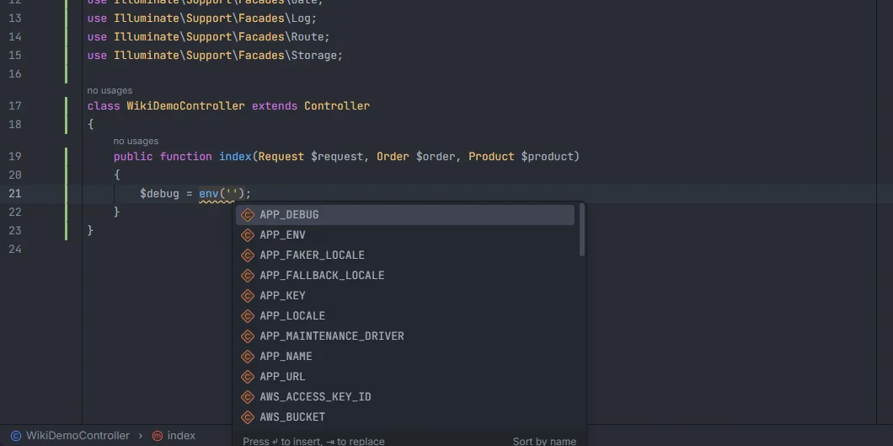
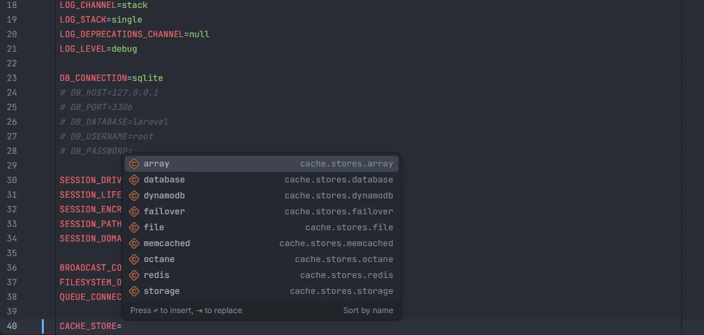

# Environment variables

`env('…')` completes the keys of your `.env` and `.env.example`, and Ctrl+click opens the line that sets one. Inside the `.env` files themselves, the plugin completes the variable names Laravel and your config read, and the values that make sense for each one: connections, stores, disks, log channels, mailers, locales, booleans and more.

<p align="center"></p>
<p align="center"><sub>Keys of <code>.env</code> and <code>.env.example</code> in <code>env('')</code></sub></p>

## How to use it

### In PHP

| Call | Argument |
| --- | --- |
| `env('…')` | 1st |
| `Env::get('…')` | 1st |

```php
'debug' => (bool) env('APP_DEBUG', false),
'key' => Env::get('STRIPE_KEY'),
```

### In `.env` files

In `.env` and any `.env.*` file (`.env.example`, `.env.testing`, `.env.local`…):

- At the start of a line (after optional spaces or `export `), typing a name suggests variable names. Picking one inserts `NAME=`.
- After `=`, typing suggests values for that variable. An opening `"` or `'` is skipped, so the value goes inside the quotes.
- Comment lines (`# …`) get no suggestions.

<p align="center"></p>
<p align="center"><sub>Values for <code>CACHE_STORE=</code>: the stores of <code>config/cache.php</code></sub></p>

## What you see

### `env('…')`

The keys of `.env` first, in file order, then the keys that only `.env.example` has. A key in both files is listed once, from `.env`.

- Keys from `.env` show no detail: their values are never displayed, so secrets such as `APP_KEY` stay off the screen.
- Keys that only `.env.example` has show their example value as detail, when it isn't empty.

Suggestions whose name starts with what you typed come first, then the ones that only contain it, each group in alphabetical order.

### Variable names in `.env` files

Three sources, in this order, each name listed once:

1. Every `env('…')` in your config files, with the config key that reads it as detail (`APP_TIMEZONE` · `app.timezone`).
2. A built-in list of the variables a Laravel app usually has, with a short hint: `APP_NAME`, `APP_ENV`, `APP_KEY`, `APP_DEBUG`, `APP_URL`, `APP_TIMEZONE`, `APP_LOCALE`, `APP_FALLBACK_LOCALE`, `APP_FAKER_LOCALE`, `APP_MAINTENANCE_DRIVER`, `APP_MAINTENANCE_STORE`, `APP_PREVIOUS_KEYS`, `BCRYPT_ROUNDS`, `LOG_CHANNEL`, `LOG_STACK`, `LOG_DEPRECATIONS_CHANNEL`, `LOG_LEVEL`, `DB_CONNECTION`, `DB_HOST`, `DB_PORT`, `DB_DATABASE`, `DB_USERNAME`, `DB_PASSWORD`, `SESSION_DRIVER`, `SESSION_LIFETIME`, `SESSION_ENCRYPT`, `SESSION_PATH`, `SESSION_DOMAIN`, `BROADCAST_CONNECTION`, `FILESYSTEM_DISK`, `QUEUE_CONNECTION`, `CACHE_STORE`, `CACHE_PREFIX`, `MEMCACHED_HOST`, `REDIS_CLIENT`, `REDIS_HOST`, `REDIS_PASSWORD`, `REDIS_PORT`, `MAIL_MAILER`, `MAIL_SCHEME`, `MAIL_HOST`, `MAIL_PORT`, `MAIL_USERNAME`, `MAIL_PASSWORD`, `MAIL_FROM_ADDRESS`, `MAIL_FROM_NAME`, `AWS_ACCESS_KEY_ID`, `AWS_SECRET_ACCESS_KEY`, `AWS_DEFAULT_REGION`, `AWS_BUCKET`, `AWS_USE_PATH_STYLE_ENDPOINT` and `VITE_APP_NAME`.
3. The keys of `.env` and `.env.example`.

Names already set in the file you are editing are left out.

### Values in `.env` files

| Variable | Suggested values | Detail |
| --- | --- | --- |
| `DB_CONNECTION` | the connections of `config/database.php` | `database.connections.…` |
| `CACHE_STORE`, `CACHE_DRIVER`, `APP_MAINTENANCE_STORE`, `SESSION_STORE` | the stores of `config/cache.php` | `cache.stores.…` |
| `QUEUE_CONNECTION`, `QUEUE_FAILED_DRIVER` | the connections of `config/queue.php` | `queue.connections.…` |
| `LOG_CHANNEL`, `LOG_STACK`, `LOG_DEPRECATIONS_CHANNEL` | the channels of `config/logging.php` | `logging.channels.…` |
| `MAIL_MAILER` | the mailers of `config/mail.php` | `mail.mailers.…` |
| `FILESYSTEM_DISK`, `FILESYSTEM_CLOUD` | the disks of `config/filesystems.php` | `filesystems.disks.…` |
| `BROADCAST_CONNECTION`, `BROADCAST_DRIVER` | the connections of `config/broadcasting.php` | `broadcasting.connections.…` |
| `AUTH_GUARD` | the guards of `config/auth.php` (plus `sanctum` when installed) | `auth.guards.…` |
| `AUTH_PASSWORD_BROKER` | the password brokers of `config/auth.php` | `auth.passwords.…` |
| `SESSION_DRIVER` | `file`, `cookie`, `database`, `redis`, `memcached`, `dynamodb`, `apc`, `array` | where each one stores sessions, when useful |
| `SESSION_SAME_SITE` | `lax`, `strict`, `none`, `null` | |
| `LOG_LEVEL` | `debug`, `info`, `notice`, `warning`, `error`, `critical`, `alert`, `emergency` | |
| `APP_ENV` | `local`, `production`, `staging`, `testing` | |
| `APP_MAINTENANCE_DRIVER` | `file`, `cache` | |
| `MAIL_SCHEME` | `smtp`, `smtps` | |
| `REDIS_CLIENT` | `phpredis`, `predis` | |
| `HASH_DRIVER` | `bcrypt`, `argon`, `argon2id` | |
| any name ending in `_LOCALE` | the locales of your `lang/` files, plus `en`, `en_US`, `pt_BR`, `es`, `fr`, `de` and `it` | `locale` |
| any name ending in `_DEBUG`, `_ENCRYPT`, `_ENABLED`, `_SECURE_COOKIE`, `_HTTP_ONLY`, `_PARTITIONED_COOKIE`, `_EXPIRE_ON_CLOSE`, `_VERIFY` or `_ACTIVE` | `true`, `false` | |

Other variables get no value suggestions.

## Where the keys come from

`.env` and `.env.example` at the project root. For each line:

- lines starting with `#` (after spaces) are comments and skipped;
- a leading `export ` is ignored;
- the key is the text before the first `=`, trimmed, and must contain only letters, digits, `_` and `.`;
- the value is the text after `=`, trimmed. Only `.env.example` values are ever shown.

Other `.env.*` files are not read for `env()` completion.

## Ctrl+click

| Ctrl+click on | Opens |
| --- | --- |
| A key in `env('…')` or `Env::get('…')` | The key in `.env`, or in `.env.example` when `.env` doesn't have it |
| A key on a line of a `.env` file | Every config key whose value is `env('THAT_KEY')`, in its config file |

## Details

- Changes to `.env` and `.env.example` are picked up whether they are made in the editor or outside it (a terminal, a script). OpenIDEA doesn't report changes to git-ignored files, so the plugin also compares the files' size and modification time when you use it.
- Nothing here runs PHP; the files are only read.

## Settings and permissions

- `envCallInspection` (on by default) reports `env()` calls outside `config/`, which return `null` once the config is cached. See [`env()` outside config](Inspection-Env-Outside-Config.md).
- `envKeysInspection` (on by default) reports keys that are in `.env` but not in `.env.example`, and the other way around, with a quick fix to copy them. See [`.env` keys](Inspection-Env-Keys.md).
- Only `project.read` is needed. See [Settings](Settings.md) and [Permissions](Permissions.md).

## Related

- [Config keys](Config-Keys.md)
- [`env()` outside config](Inspection-Env-Outside-Config.md)
- [`.env` keys](Inspection-Env-Keys.md)
- [phpunit.xml](PHPUnit-Xml.md): `<env>` names and values
- [Drivers and connections](Drivers-and-Connections.md)
- [Environment in the hub](Hub-Environment.md)
- [Privacy and security](Privacy-and-Security.md)

---
[← Wiki home](Home.md)
