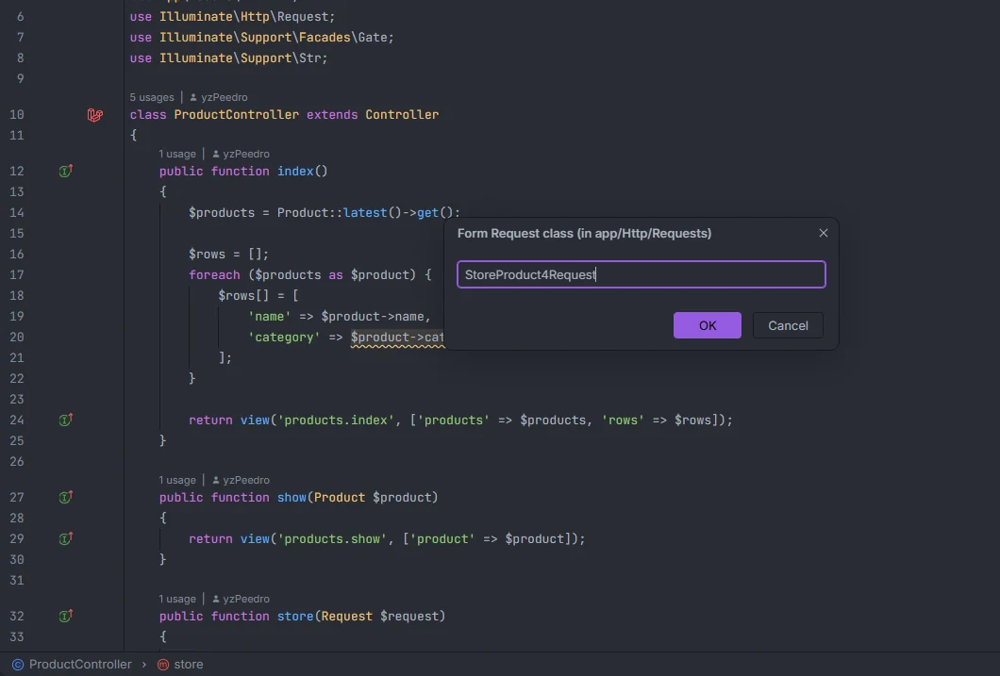
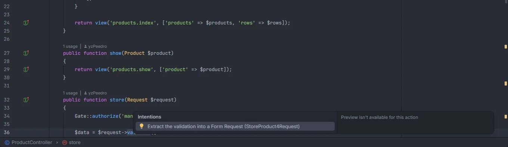

# Extract Form Request

Turn an inline `$request->validate([…])` into a Form Request class: the plugin creates `app/Http/Requests/<Name>.php` with `rules()` (and `messages()` / `attributes()` when you passed them), types the controller parameter with the new class, replaces the call with `validated()` and tidies the imports. Use it from Alt+Enter or from the right-click menu.

<p align="center"></p>
<p align="center"><sub><i>Laravel: Extract Form Request…</i> asks for the class name, filled in with the suggested one</sub></p>

## How to use it

Place the cursor in a validation call inside a controller method (or select it), then either:

- press **Alt+Enter** and pick **Extract the validation into a Form Request (StoreOrderRequest)**: the class gets the suggested name; or
- right-click and pick **Laravel: Extract Form Request…** (also in the action search): a prompt titled **Form Request class (in app/Http/Requests)** asks for the name first.

<p align="center"></p>
<p align="center"><sub>Alt+Enter in <code>ProductController::store()</code>: the intention carries the suggested class name</sub></p>

Before:

```php
namespace App\Http\Controllers;

use App\Models\Order;
use Illuminate\Http\Request;
use Illuminate\Validation\Rule;

class OrderController extends Controller
{
    public function store(Request $request)
    {
        $data = $request->validate([
            'status' => ['required', Rule::in(['paid', 'open'])],
            'total' => 'required|integer',
        ], [
            'status.in' => 'Unknown status.',
        ]);

        return Order::create($data);
    }
}
```

After, in the controller:

```php
namespace App\Http\Controllers;

use App\Models\Order;
use App\Http\Requests\StoreOrderRequest;

class OrderController extends Controller
{
    public function store(StoreOrderRequest $request)
    {
        $data = $request->validated();

        return Order::create($data);
    }
}
```

And the new `app/Http/Requests/StoreOrderRequest.php`:

```php
<?php

namespace App\Http\Requests;

use Illuminate\Foundation\Http\FormRequest;
use Illuminate\Validation\Rule;

class StoreOrderRequest extends FormRequest
{
    public function authorize(): bool
    {
        return true;
    }

    public function rules(): array
    {
        return [
            'status' => ['required', Rule::in(['paid', 'open'])],
            'total' => 'required|integer',
        ];
    }

    public function messages(): array
    {
        return [
            'status.in' => 'Unknown status.',
        ];
    }
}
```

`Illuminate\Http\Request` and `Illuminate\Validation\Rule` left the controller because nothing there uses them anymore; `Rule` moved to the request, which needs it.

## What you see

| Entry point | Shows | Name |
| --- | --- | --- |
| Alt+Enter | *Extract the validation into a Form Request (&lt;Name&gt;)*. The IDE's preview pane says "Preview isn't available for this action": the class and the edits are made when you pick it | The suggested name |
| *Laravel: Extract Form Request…* | The prompt *Form Request class (in app/Http/Requests)*, then "Created app/Http/Requests/&lt;Name&gt;.php" | What you type |

## Details

### Supported calls

| Call | Request variable |
| --- | --- |
| `$request->validate([…], [messages], [attributes])` | `$request` (any variable name) |
| `request()->validate([…], [messages], [attributes])` | None: a `$request` parameter is added |
| `$this->validate($request, […], [messages], [attributes])` | The first argument |

- The rules must be an array literal (`[…]`). A variable or a method call as rules isn't extracted.
- The second and third arguments become `messages()` and `attributes()` when they are array literals; otherwise they are dropped from the class.
- The call must be inside a named method of a class.
- With the cursor, the call is found when the cursor sits anywhere from a few tokens before `validate` (in `$data = $request->validate(`, from `$data` on) to the call's closing parenthesis. The command also accepts a selection that contains `validate(`, or a selection that ends up to 80 characters before it.
- Alt+Enter offers it only in PHP files (not Blade) that contain `validate(`, together with any other fix or refactoring that applies at the cursor.

### The suggested name

`<Method><Base>Request`, where `<Base>` is the controller's name without `Controller` and `<Method>` the method's name with its first letter in upper case:

| Controller and method | Suggested |
| --- | --- |
| `OrderController::store()` | `StoreOrderRequest` |
| `PostController::update()` | `UpdatePostRequest` |
| `UserController::__invoke()` | `UserRequest` |
| `ProductController::store()`, with `StoreProductRequest.php` to `StoreProduct3Request.php` already there | `StoreProduct4Request` |

When `app/Http/Requests/<Name>.php` exists, a number is added before `Request` (`2`, `3`…) until the name is free.

### The name prompt

The command's prompt accepts:

- a class name: `StoreOrderRequest`;
- a subfolder: `Admin/StoreOrderRequest` or `Admin\StoreOrderRequest` creates `app/Http/Requests/Admin/StoreOrderRequest.php` in the namespace `App\Http\Requests\Admin`;
- a path or a full name: `app/Http/Requests/Admin/Store.php` and `App\Http\Requests\Store` are trimmed to `Admin\Store` and `Store`.

Spaces around the name are trimmed and a `.php` suffix is dropped. The prompt stays open, with what you typed, when the name is not valid:

| Problem | Prompt becomes |
| --- | --- |
| Empty | Type a class name, such as StoreOrderRequest. |
| A part that isn't a PHP class name (`1Store`, `Store-Order`, `Admin//Store`) | '&lt;part&gt;' isn't a valid PHP class name: use letters, digits and _, starting with a letter. |
| The file exists | app/Http/Requests/&lt;Name&gt;.php already exists: choose another name |

Cancelling the prompt does nothing. If the file changes while the prompt is open, the command stops with "The file changed while the dialog was open: run Extract Form Request again."

### What changes in the controller

1. **The parameter.** A parameter typed `Request` (imported or written as `\Illuminate\Http\Request`) that holds the request variable gets the new type. An untyped `$request` parameter gets the type in front. With `request()->validate()` and no such parameter, `<Name> $request` is added as the first parameter.
2. **The call.** A `validate()` call that is a statement of its own is removed, with its line when nothing else is on it. A call whose result is used (`$data = …`, `return …`, an argument) becomes `$request->validated()`.
3. **The imports.** `use App\Http\Requests\<Name>;` is added after the last `use` of the file (or after the `namespace` line, or after `<?php`, when there is none). Imports that the controller used only in the extracted code are removed. Grouped imports (`use A\{B, C};`) and `use function` / `use const` are kept as they are.

### What goes into the class

- `namespace App\Http\Requests` (plus the subfolder);
- the controller's imports that the rules, messages or attributes use (such as `Rule`, an enum or a custom rule class), plus `Illuminate\Foundation\Http\FormRequest`, sorted;
- `authorize(): bool` returning `true`;
- `rules(): array` returning your array, re-indented to fit;
- `messages(): array` and `attributes(): array` when you passed them.

The file is created by `php/create_file.php` run with your [runner](Settings.md#artisanrunner) in the project root. It creates missing folders, never overwrites an existing file and refuses paths with `..`. The controller edits are applied only after the file was created.

## Settings and permissions

- Both entry points need **`process:php`** or **`process:docker`** to create the class. Without it: "Allow "process:php" for Laravel OpenIDEA in Settings › Plugins to create the Form Request."
- The command also needs **`editor.read`** and **`editor.write`**, to read the call and edit the controller. The Alt+Enter action doesn't: the IDE applies its edits.
- `artisanRunner` and `dockerService` decide where the file is created.

See [Permissions](Permissions.md) and [Settings](Settings.md).

## Related

- [Validation rules](Validation-Rules.md)
- [Form Requests](Hub-Form-Requests.md)
- [Commands and shortcuts](Commands.md)
- [File templates](File-Templates.md) (an empty Form Request)
- [Helpers](Helpers.md) (`$request->input()` completes the validated fields)

---
[← Wiki home](Home.md)
