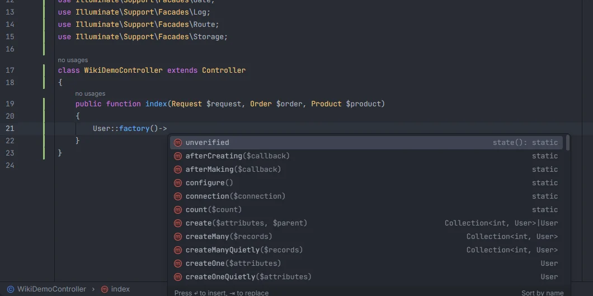

# Factories

Model factories complete along the whole chain: `User::` offers `factory()` when the model has a factory, `User::factory()->` lists the factory's own states first and then the `Factory` methods of your Laravel version, and `create()` or `make()` lead back to the model's columns and relations. Ctrl+click on `factory` or on `HasFactory` opens the model's factory class.

<p align="center"> with the unverified state first, then afterCreating, afterMaking, configure, connection, count, create, createMany" width="760"></p>
<p align="center"><sub><code>User::factory()-></code>: the <code>unverified</code> state of <code>UserFactory</code> first, then the factory's methods</sub></p>

## How to use it

```php
User::fac                                     // factory() is offered when User has a factory
User::factory()->                             // states of UserFactory, then Factory methods
User::factory()->unverified()->count(3)->     // still the factory
User::factory()->create()->                   // the User model: columns and relations
User::factory()->createMany(2)->              // a collection of User
User::factory()->afterCreating(fn            // typed closure: fn (User $user) =>
```

- **Ctrl+click on `factory`** in `User::factory()` (also `static::factory()` and `self::factory()` inside the model) opens the factory class.
- **Ctrl+click on `HasFactory`** in a model (on the `use HasFactory;` line or anywhere the word appears in the model file) opens the model's factory.
- The `hasfactory` snippet in a model's class body writes `use HasFactory;` and adds the import ([Snippets](Snippets.md)).

## What you see

- **States** are the public, non-static methods of the factory class other than `definition`, `configure`, `newModel`, `modelName`, `new` and `times`. They sort first and show `state` followed by their signature, such as `state(): static` or `state(bool $super = false): static`.
- **Factory methods** follow: with Laravel installed, every public, non-static method of `Illuminate\Database\Eloquent\Factories\Factory` and its traits and parents; without `vendor/`, a built-in list (`count`, `state`, `sequence`, `has`, `hasAttached`, `for`, `recycle`, `afterMaking`, `afterCreating`, `trashed`, `create`, `createOne`, `createMany`, `createQuietly`, `make`, `makeOne`, `raw`). The common ones carry signatures with your model, such as `create($attributes = [], ?Model $parent = null): User` and `createMany(iterable|int|null $records = null): Collection<int, User>`.
- **`factory()` after `User::`** shows `($count = null, $state = []): Factory<User>`. It is only offered when the plugin finds a factory for the model.
- Every method inserts `name()` with the cursor inside the parentheses.

## Details

### How the factory of a model is found

In this order:

1. A `#[UseFactory(PostFactory::class)]` attribute on the model.
2. A `newFactory()` method in the model that returns `SomeFactory::new()` (the class before `::new(` is used, within the first 600 characters of the method).
3. `database/factories/{Model}Factory.php`.
4. For a model in a subfolder of `App\Models` (`App\Models\Blog\Post`), the class `Database\Factories\Blog\PostFactory`, located through the PSR-4 map of `composer.json`.

Class names in steps 1 and 2 are resolved with the model's `use` statements and namespace. The model itself must be one the plugin indexes (a class under a `Models` folder in `app/`).

### Where the chain goes

| Step | Leads to |
| --- | --- |
| `Model::factory()` | the factory |
| `create`, `make`, `createOne`, `makeOne`, `createQuietly`, `createOneQuietly` | the model ([Model members](Model-Members.md)) |
| `createMany`, `makeMany`, `createManyQuietly` | a collection of the model ([Eloquent chains](Eloquent-Chains.md)) |
| `raw` | nothing more is completed |
| any other call (`count`, `state`, a state such as `unverified`…) | the factory again |

`create()` and `make()` always lead to a single model, also after `count(3)`.

### Ctrl+click

- On `factory` in `Model::factory()`: the `class` line of the factory file. When the model has no factory, the `factory()` method of `HasFactory` in the installed framework.
- On `HasFactory` in a model: the factory's `class` line, or, when there is none, the `HasFactory` trait declaration in `vendor/laravel/framework` (falling back to its `factory()` method).

### Typed closures

Inside factory calls, `fn` and `function` complete typed closures ([Typed closures](Typed-Closures.md)):

| Call | Closure |
| --- | --- |
| `afterCreating(`, `afterMaking(` | `fn (User $user) =>` |
| `state(` | `fn (array $attributes) =>` |
| `sequence(` | `fn (Sequence $sequence) =>`, with the `Sequence` import |

## Settings and permissions

No setting and no optional permission.

## Related

- [Eloquent chains](Eloquent-Chains.md)
- [Model members](Model-Members.md)
- [Typed closures](Typed-Closures.md)
- [Snippets](Snippets.md): `hasfactory`, `definition`, `state`, `factory`, `factorycount`
- [Factories & Seeders](Hub-Factories.md) in the hub
- [Go to definition](Go-to-Definition.md)

---
[← Wiki home](Home.md)
