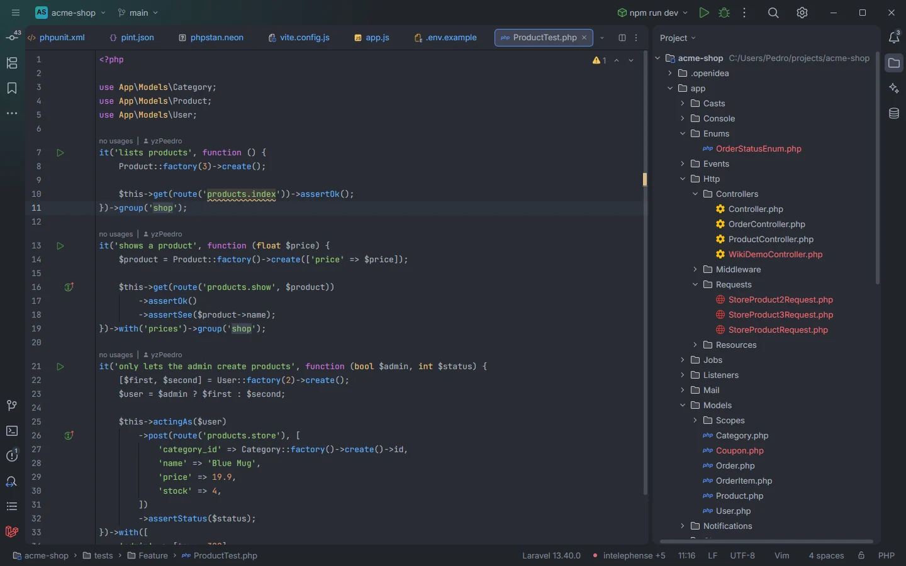

# File icons

Laravel OpenIDEA gives Laravel files their own icons in the project tree, editor tabs and file lists: Blade views and `artisan` get the Laravel logo, route files a routing sign, controllers, migrations, policies, Form Requests and service providers icons of their own. The icons come from the [Material Icon Theme](https://github.com/material-extensions/vscode-material-icon-theme).

Controllers and Form Requests in the project tree, next to models and enums with the plain PHP icon

## How to use it

Nothing to do: once the plugin is installed, the IDE matches each file name against the patterns below and shows the icon in the project tree and on editor tabs.

## What you see

| Pattern | Matches | Icon |
| --- | --- | --- |
| `*.blade.php` | Every Blade view | Laravel logo (`icons/laravel.svg`) |
| `artisan` | The `artisan` script at the project root | Laravel logo |
| `*.laravel-hub` | The hub tab files in `storage/openidea/hub` (see [The hub](Hub.md)) | Laravel logo |
| `web.php`, `api.php`, `channels.php`, `console.php` | Route files | Routing (`icons/routing.svg`) |
| `*Controller.php` | Controllers | Controller (`icons/controller.svg`) |
| `[0-9][0-9][0-9][0-9]_[0-9][0-9]_[0-9][0-9]_[0-9][0-9][0-9][0-9][0-9][0-9]_*.php` | Migrations named like `2025_01_31_120000_create_orders_table.php` | Database (`icons/database.svg`) |
| `*Policy.php` | Policies | Lock (`icons/lock.svg`) |
| `*Request.php` | Form Requests | HTTP (`icons/http.svg`) |
| `*ServiceProvider.php` | Service providers | Settings (`icons/settings.svg`) |

Every other PHP file (models, enums, jobs, tests…) keeps the IDE's PHP icon.

## Details

- **Name only.** The patterns have no folder part, so they match on the file name alone: a file called `web.php` or `UserRequest.php` anywhere in the project gets the icon, and a controller named without the `Controller` suffix doesn't.
- **Migration names** need the full timestamp Laravel writes (`YYYY_MM_DD_HHMMSS_`). Migrations with another naming scheme keep the PHP icon.
- **The plugin's own icons.** The same Laravel logo marks the hub's tool window in the left tool bar, the [gutter usages](Gutter-Usages.md) icon and the hub's editor tabs. `icons/plugin.svg` is the plugin's icon in Settings › Plugins and the marketplace.
- **License.** The icons are MIT-licensed by the Material Icon Theme authors; the license is in `icons/LICENSE-material-icon-theme`.

## Settings and permissions

None. The icons are contributed to the IDE in `plugin.toml` (`[[contributes.fileIcons]]`).

## Related

- [File templates](File-Templates.md)
- [Blade](Blade.md)
- [The hub](Hub.md)
- [Gutter usages](Gutter-Usages.md)

---
[← Wiki home](Home.md)
