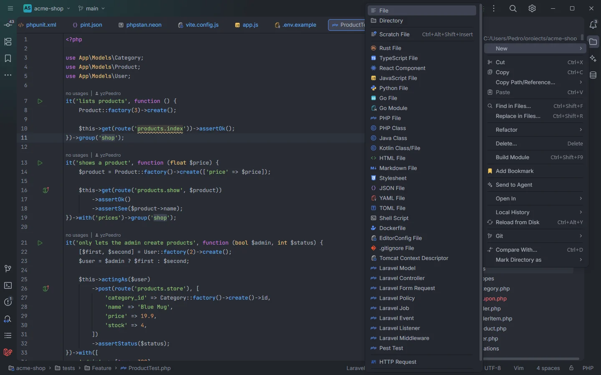

# File templates

Laravel OpenIDEA adds nine templates to the IDE's *New* menu: a model, a controller, a Form Request, a policy, a job, an event, a listener, a middleware and a Pest test. Each one creates a PHP file with a ready-to-fill class skeleton, without running Artisan.

<p align="center"></p>
<p align="center"><sub>Right-click a folder › New: the Laravel templates sit after the IDE's own file types</sub></p>

## How to use it

1. In the project tree, right-click the folder that should hold the class (for example `app/Models`).
2. Pick **New** and one of the templates below.
3. Type the class name, such as `Coupon`. It replaces `$NAME$` in the template, and the cursor lands where the template has `$END$`.

| Template | Creates | Cursor lands in |
| --- | --- | --- |
| **Laravel Model** | A model in `App\Models` with `HasFactory`, `$fillable` and `casts()` | `$fillable` |
| **Laravel Controller** | A controller in `App\Http\Controllers` with an `index()` action | `index()` |
| **Laravel Form Request** | A request in `App\Http\Requests` with `authorize()` returning `true` and `rules()` | The `rules()` array |
| **Laravel Policy** | A policy in `App\Policies` with `viewAny(User $user): bool` | Before `true` in `viewAny()` |
| **Laravel Job** | A queued job in `App\Jobs` implementing `ShouldQueue` with `Queueable` | `handle()` |
| **Laravel Event** | An event in `App\Events` with `Dispatchable` and `SerializesModels` | The constructor |
| **Laravel Listener** | A listener in `App\Listeners` with `handle(object $event): void` | `handle()` |
| **Laravel Middleware** | A middleware in `App\Http\Middleware` with `handle(Request $request, Closure $next): Response` | Before `return $next($request);` |
| **Pest Test** | An `it('…', function () { … })` test | The test's description |

## What you get

The templates are plain PHP files in `templates/`. `$NAME$` is the name you typed and `$END$` is where the cursor goes.

```php
<?php

namespace App\Models;

use Illuminate\Database\Eloquent\Factories\HasFactory;
use Illuminate\Database\Eloquent\Model;

class $NAME$ extends Model
{
    use HasFactory;

    protected $fillable = [
        $END$
    ];

    protected function casts(): array
    {
        return [];
    }
}
```

```php
<?php

namespace App\Http\Controllers;

use Illuminate\Http\Request;

class $NAME$ extends Controller
{
    public function index()
    {
        $END$
    }
}
```

```php
<?php

namespace App\Http\Requests;

use Illuminate\Foundation\Http\FormRequest;

class $NAME$ extends FormRequest
{
    public function authorize(): bool
    {
        return true;
    }

    public function rules(): array
    {
        return [
            $END$
        ];
    }
}
```

```php
<?php

namespace App\Policies;

use App\Models\User;

class $NAME$
{
    public function viewAny(User $user): bool
    {
        return $END$true;
    }
}
```

```php
<?php

namespace App\Jobs;

use Illuminate\Contracts\Queue\ShouldQueue;
use Illuminate\Foundation\Queue\Queueable;

class $NAME$ implements ShouldQueue
{
    use Queueable;

    public function __construct()
    {
    }

    public function handle(): void
    {
        $END$
    }
}
```

```php
<?php

namespace App\Events;

use Illuminate\Foundation\Events\Dispatchable;
use Illuminate\Queue\SerializesModels;

class $NAME$
{
    use Dispatchable, SerializesModels;

    public function __construct()
    {
        $END$
    }
}
```

```php
<?php

namespace App\Listeners;

class $NAME$
{
    public function handle(object $event): void
    {
        $END$
    }
}
```

```php
<?php

namespace App\Http\Middleware;

use Closure;
use Illuminate\Http\Request;
use Symfony\Component\HttpFoundation\Response;

class $NAME$
{
    public function handle(Request $request, Closure $next): Response
    {
        $END$
        return $next($request);
    }
}
```

```php
<?php

it('$END$', function () {
    expect(true)->toBeTrue();
});
```

## Details

- **Fixed namespaces.** Each template writes the namespace of Laravel's default folder (`App\Models`, `App\Http\Controllers`…), whatever folder you create it in. In a subfolder, adjust the namespace, or complete it with `namespace` + Ctrl+Space, which suggests the PSR-4 namespace of the file's folder ([PSR-4 namespaces](Namespaces.md)).
- **Laravel 11 and newer.** The model uses the `casts()` method (Laravel 11+; older versions use the `$casts` property) and the job uses `Illuminate\Foundation\Queue\Queueable`, the trait Laravel 11 introduced. On an older project, adjust these lines or use `php artisan make:…` from the hub's [Artisan](Hub-Artisan.md) section, which follows your version.
- **The controller extends `Controller`** without importing it, which resolves to `App\Http\Controllers\Controller` because both are in the same namespace.
- **The Pest test** has no namespace and starts with a placeholder expectation.
- **No Artisan needed.** The IDE creates the file itself, so templates work without `process:php`.

Once the file exists, the rest of the plugin applies right away: [snippets](Snippets.md) such as `hasmany` or `scope` in a model, member snippets for `$fillable` and `$casts`, [trait and interface completion](Types-and-Inheritance.md) after `use` and `implements`, and [validation rule](Validation-Rules.md) completion in `rules()`.

## Settings and permissions

None. Templates are contributed to the IDE in `plugin.toml` (`[[contributes.fileTemplates]]`) and need no setting or optional permission.

## Related

- [File icons](File-Icons.md)
- [Snippets](Snippets.md)
- [PSR-4 namespaces](Namespaces.md)
- [Types and inheritance](Types-and-Inheritance.md)
- [Artisan](Hub-Artisan.md)

---
[← Wiki home](Home.md)
