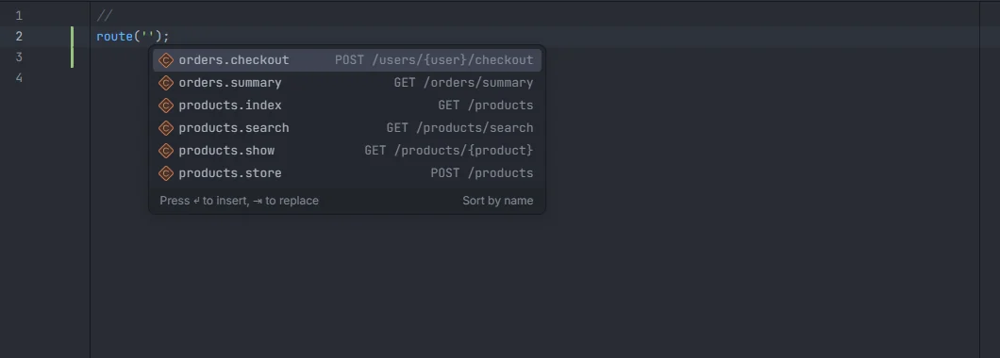
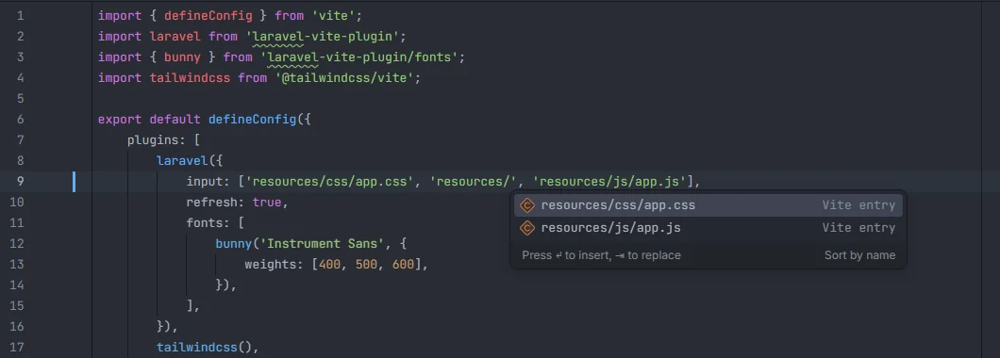

# Front-end files

The plugin completes Laravel strings in your front-end code too: the files under `resources/` in `vite.config.js` (for `input` and `refresh`), route names in Ziggy's `route('…')`, and translation keys in `__('…')`, `trans('…')`, `$t('…')` and the other i18n helpers, in JavaScript, TypeScript, JSX, TSX, Vue and Svelte files.

<p align="center"></p>
<p align="center"><sub>Ziggy's <code>route('')</code> in <code>resources/js/app.js</code>, with the same names and URIs as in PHP</sub></p>

## How to use it

### Files

Files with the extensions `.js`, `.ts`, `.mjs`, `.mts`, `.cjs`, `.jsx`, `.tsx`, `.vue` and `.svelte`, anywhere in the project.

### Route names

Type inside the quotes of `route('…')`:

```js
const url = route('products.show', { product: 42 });
```

```vue
<script setup>
const summary = route('orders.summary');
</script>
```

The list is the same as in PHP ([Route names](Route-Names.md)): named routes from your route files, Folio pages and the route cache, each with its verb and URI.

### Translation keys

Type inside the quotes of any of these calls:

| Call | Usual library |
| --- | --- |
| `__('…')`, `trans('…')`, `trans_choice('…')`, `transChoice('…')`, `wTrans('…')` | laravel-vue-i18n and similar |
| `$t('…')`, `t('…')`, `$tc('…')` | vue-i18n, i18next and similar |

```vue
<h1>{{ $t('shop.title') }}</h1>
```

```ts
const { t } = useI18n();
toast(t('shop.saved'));
```

The keys and their text are the same as in PHP ([Translations](Translations.md)): PHP and JSON language files, with the text in your preferred locale.

### Vite entries

<p align="center"></p>
<p align="center"><sub>Files under <code>resources/</code> in the <code>input</code> of <code>vite.config.js</code></sub></p>

In a file whose name starts with `vite.config.` (`vite.config.js`, `vite.config.ts`, `vite.config.mjs`…), every quoted string suggests the files under `resources/` that Vite can build: `.css`, `.scss`, `.sass`, `.less`, `.js`, `.ts`, `.jsx`, `.tsx`, `.vue` and `.svelte`, with their full path and the detail *Vite entry*. That covers `input: […]` and `refresh: […]` of the Laravel plugin, and any other path you write there.

```js
laravel({
    input: ['resources/css/app.css', 'resources/js/app.js'],
    refresh: true,
}),
```

## Details

- A call is recognised by the name right before `(`, and only its last part counts, so `this.$t('…')`, `i18n.global.t('…')` and `window.route('…')` work. Any function named `route`, `t` and so on is treated the same way, whatever library it comes from.
- The string may use `'`, `"` or backticks, and must open on the same line as the cursor. The plugin looks at the quote that is open at the cursor, so a call inside an attribute value written with the other quote, such as `:href="route('…')"` in a Vue template, isn't recognised.
- Only the first argument is completed.
- Each name is listed once; the suggestion replaces the text between the quotes, up to the closing quote or the end of the line.
- `vite.config.*` reads up to 3000 files under `resources/`.
- The plugin returns the suggestions in index order and leaves filtering by what you typed to the editor.
- Ctrl+click isn't available in front-end files.
- Nothing here needs Ziggy, laravel-vue-i18n or Node to be installed, or runs PHP.

## Settings and permissions

- The `locale` setting chooses which locale's text appears next to translation keys ([Translations](Translations.md#settings-and-permissions)).
- Only `project.read` is needed. See [Settings](Settings.md) and [Permissions](Permissions.md).

## Related

- [Route names](Route-Names.md)
- [Translations](Translations.md)
- [Blade](Blade.md): `@vite` and `asset()`
- [Packages](Packages.md): Inertia pages
- [Frontend in the hub](Hub-Frontend.md)

---
[← Wiki home](Home.md)
