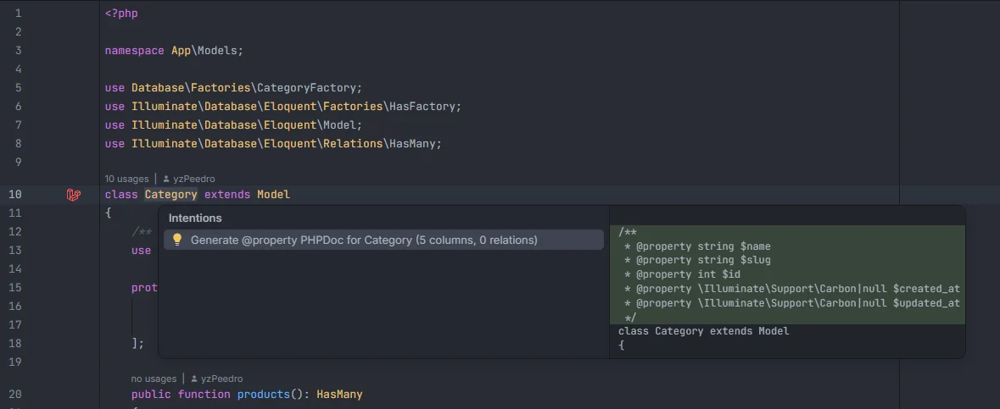

# Generate model PHPDoc

Press Alt+Enter on a model's class declaration and pick *Generate @property PHPDoc*: the plugin writes a docblock with a `@property` tag for every column of the model's table, typed from your migrations and casts, and a `@property-read` tag for every relation. Intelephense and other tools then know `$category->name` is a string and `$order->items` a collection.

<p align="center"></p>
<p align="center"><sub>The intention with its preview: five columns from the <code>categories</code> migration</sub></p>

## How to use it

1. Open a model, for example `app/Models/Category.php`.
2. Put the cursor on the `class Category extends Model` line (or on the attributes or docblock just above it).
3. Press **Alt+Enter** and pick **Generate @property PHPDoc for Category (5 columns, 0 relations)**.

```php
/**
 * @property string $name
 * @property string $slug
 * @property int $id
 * @property \Illuminate\Support\Carbon|null $created_at
 * @property \Illuminate\Support\Carbon|null $updated_at
 */
class Category extends Model
```

Run it again after a new migration or relation: it replaces the tags it wrote before.

## What you see

The intention's title counts what it will write: *Generate @property PHPDoc for &lt;Model&gt; (&lt;N&gt; columns, &lt;M&gt; relations)*. The IDE's preview shows the docblock before you apply it.

## Details

### When it is offered

- The file is a PHP file (not Blade) whose class extends `Model`, `Authenticatable`, `Pivot`, `MorphPivot`, `User` or any class whose name ends in `Model`.
- The cursor is between about 200 characters before the line of `class` and the class's opening `{`: on the declaration line, or on the attributes and docblock right above it.
- No other quick fix or refactoring applies at the cursor (those are listed instead).
- The model has at least one column or relation.

### Where the data comes from

| Data | Source |
| --- | --- |
| Table | The model's table from the model index (its `$table`, `#[Table]`, or Laravel's convention: `Category` → `categories`, `OrderItem` → `order_items`) |
| Columns | The table's columns from your migrations, in index order, with their column type |
| Casts | The model's `$casts` property and `casts()` method |
| Relations | The model's public methods that return a relation, with the related model |

### Column types

A cast wins over the column type. Without a cast:

| Migration column | `@property` type |
| --- | --- |
| Contains `bool` (`boolean`) | `bool` |
| Contains `int` or `increments`, `id`, `foreignId…`, `year` | `int` |
| Contains `decimal`, `float` or `double` | `float` |
| Contains `json` | `array` |
| Contains `date` or `time`, `softDeletes` | `\Illuminate\Support\Carbon\|null` |
| Anything else (`string`, `text`, `uuid`…) | `string` |

With a cast:

| Cast | `@property` type |
| --- | --- |
| `bool`, `boolean` | `bool` |
| `int`, `integer`, `timestamp` | `int` |
| `float`, `double`, `real` | `float` |
| `decimal:2`, `string`, `encrypted`, `hashed` | `string` |
| `array`, `json`, `encrypted:array` | `array` |
| `object`, `encrypted:object` | `object` |
| `collection`, `encrypted:collection` | `\Illuminate\Support\Collection` |
| `date`, `datetime`, `custom_datetime` (with or without a format) | `\Illuminate\Support\Carbon\|null` |
| `immutable_date`, `immutable_datetime` | `\Carbon\CarbonImmutable\|null` |
| `OrderStatus::class` (an enum or a cast class) | `OrderStatus` (the short name) |

A cast the plugin doesn't map falls back to the column type.

### Relation types

| Relation | `@property-read` type |
| --- | --- |
| `hasMany`, `belongsToMany`, `morphMany`, `morphToMany`, `morphedByMany`, `hasManyThrough` | `\Illuminate\Database\Eloquent\Collection<int, Post>` |
| `morphTo` | `\Illuminate\Database\Eloquent\Model\|null` |
| `belongsTo`, `hasOne`, `morphOne`, `hasOneThrough`… | `Team\|null` |

The related model is written with its short name; when the plugin can't tell which model a relation returns, `\Illuminate\Database\Eloquent\Model` is used.

### Where the docblock goes

- **No docblock yet:** a new one is inserted above the class, and above its attributes (`#[ObservedBy(…)]`, `#[Fillable(…)]`…) so they stay attached to the class.
- **A docblock already there:** it is rewritten. Every line with `@property` (including `@property-read`) is dropped, the other lines (a description, `@mixin`, `@method`…) are kept, followed by a ` *` separator and the new tags.

```php
/**
 * User of the app.
 *
 * @property int $id
 * @property string $name
 */
class User extends Model
```

## Settings and permissions

No setting and no optional permission: it reads the indexes and the IDE applies the edit. See [Permissions](Permissions.md).

## Related

- [Model members](Model-Members.md)
- [Eloquent columns and relations](Eloquent-Columns-and-Relations.md)
- [Casts](Casts.md)
- [Models](Hub-Models.md)
- [Database](Hub-Database.md)
- [IDE helpers](IDE-Helpers.md)

---
[← Wiki home](Home.md)
