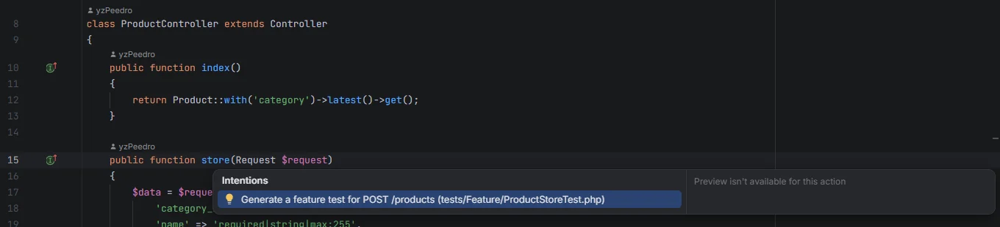

# Generate test

Write a feature test for a route in one click: the plugin reads the route's validation rules, route model bindings and middleware, and writes `tests/Feature/<Controller><Method>Test.php` in Pest or PHPUnit, with a request that passes validation and one case per required field. Use it from the hub's Routes section or with Alt+Enter on a controller method.

<p align="center"></p>
<p align="center"><sub>Alt+Enter on the <code>store</code> method of ProductController</sub></p>

## How to use it

- **From the editor**: place the cursor on the line of a public controller method's signature (the `public function store(…)` line, up to its `{`), press **Alt+Enter** and pick **Generate a feature test for POST /products (tests/Feature/ProductStoreTest.php)**. A method used by several routes offers one action per route. The IDE creates the file and opens it, and one undo (*Undo* on the *Refactoring applied* balloon, or *Edit › Undo*) removes it again. When the file already exists, the action is **Open the feature test (tests/Feature/ProductStoreTest.php)** and only opens it.
- **From the command**: with the cursor in the same place, right-click and pick **Laravel: Generate Feature Test…** (also in the action search). It writes the test and opens it; when several routes call the method, it asks which one first.
- **From the hub**: in [Routes](Hub-Routes.md), click **Test** at the end of a row, or **Generate test** in the [request panel](Send-Request.md).

The new file opens in the editor. An existing file is never overwritten: Alt+Enter and the command open it instead, and the hub says *tests/Feature/ProductStoreTest.php already exists*.

## What it writes

For `POST /products`, handled by `ProductController::store` with an inline `validate()`, behind `can:create,App\Models\Product`, in a project with Pest:

```php
<?php

use App\Models\Category;
use App\Models\User;
use Illuminate\Foundation\Testing\RefreshDatabase;

uses(RefreshDatabase::class);

it('handles POST /products', function () {
    $actor = User::factory()->create();
    $category = Category::factory()->create();

    $this->actingAs($actor)->post(route('products.store'), ['category_id' => $category->id, 'name' => 'Example', 'price' => 1, 'stock' => 1])
        ->assertSessionHasNoErrors();
});

it('requires each field of POST /products', function (string $field) {
    $actor = User::factory()->create();
    $category = Category::factory()->create();
    $payload = ['category_id' => $category->id, 'name' => 'Example', 'price' => 1, 'stock' => 1];
    unset($payload[$field]);

    $this->actingAs($actor)->post(route('products.store'), $payload)
        ->assertSessionHasErrors($field);
});
```

In a project without `pestphp/pest` in `composer.json`, the same cases are written as a PHPUnit class `Tests\Feature\ProductStoreTest extends TestCase` with `use RefreshDatabase;`, a `test_it_handles_the_request()` method and one `test_it_requires_<field>()` method per required field.

## Details

### Where each part comes from

| Part | Source |
| --- | --- |
| File name | The controller's name without `Controller`, plus the method: `ProductController::store` → `ProductStoreTest.php`. A closure route uses the verb and URI (`GetHealthTest.php`) |
| Pest or PHPUnit | `pestphp/pest` in `composer.json` |
| The URL | `route('name', [...])` for a named route, the URI with its parameters filled in otherwise |
| Route model bindings | A parameter type-hinted with a model that has a factory gets `$order = Order::factory()->create();` and `'order' => $order`; other parameters get `1` |
| `actingAs($actor)` | Added when `php artisan route:list --json` lists an `auth`, `verified`, `can:`, `Authenticate…` or `Authorize…` middleware on the route, and `App\Models\User` has a factory |
| Payload | The fields of the Form Request's `rules()` or of the inline `validate([...])`, with the same sample values as [Send request](Send-Request.md#the-prefilled-body). A field with an `exists:table,column` rule gets a model from that table's factory (`exists:categories,id` → `Category::factory()->create()` and `$category->id`). Wildcard and nested fields (`items.*.sku`, `address.city`) are left out |
| `->json` calls | `postJson()`, `getJson()`… and JSON assertions for URIs under `/api` |
| Assertions | `assertSessionHasNoErrors()` / `assertJsonMissingValidationErrors()` for the happy path of a request with a body, `assertSuccessful()` for `GET` and `DELETE`; `assertSessionHasErrors($field)` / `assertJsonValidationErrors($field)` for the required fields |

A `Route::resource()` action gets its own verb and URI: `store` is `POST /products`, `update` is `PUT /products/{product}`, `show` is `GET /products/{product}` and so on.

### What to check after generating

The test is a starting point: it checks that the route accepts a valid request and rejects a missing field, not what the action does. Add assertions on the database or the response. Sample values come from the rules alone, so a rule like `unique:` or a custom rule may need a better value. Without Laravel 9 or newer (`route:list --json`), the auth middleware isn't detected and `actingAs()` isn't added.

## Settings and permissions

From Alt+Enter the IDE writes the file itself, so no permission is needed for that; `process:php` (on Windows `process:php-win` avoids a console window) or `process:docker` runs `route:list` to find the auth middleware, and without it the test has no `actingAs()`. From the hub and the command, the file is written with PHP like [Extract Form Request](Extract-Form-Request.md), so a process permission is needed; the command also reads the cursor with `editor.read`. See [Permissions](Permissions.md).

## Related

- [Routes](Hub-Routes.md)
- [Send request](Send-Request.md)
- [Tests](Hub-Tests.md)
- [Extract Form Request](Extract-Form-Request.md)

---
[← Wiki home](Home.md)
