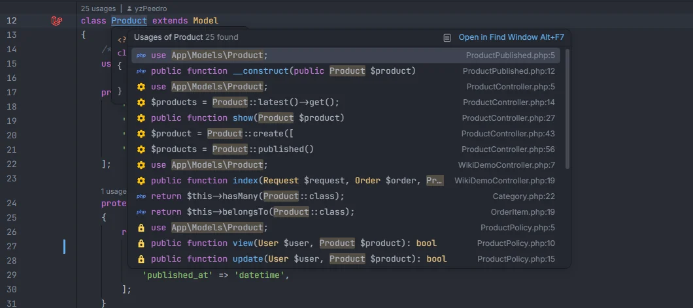

# Go to definition

Ctrl+click (or *Go to Definition*) on a Laravel string, an Eloquent member or a Laravel declaration takes you to where it is defined or used: a route name opens its route, a view its Blade file, a config key its line in `config/`, a relation its model, a scope call its method, and a class or scope declaration lists every place that uses it. This page lists everything the plugin answers, in PHP, Blade and `.env` files.

<p align="center"></p>
<p align="center"><sub>Ctrl+click on the name of a class declaration lists where the class is used</sub></p>

## How to use it

Hold Ctrl and click a name, or put the cursor on it and use the IDE's *Go to Definition*. When there is one target, the IDE opens it; when there are several, it shows a list to pick from.

```php
return redirect()->route('orders.show', $order);   // the route definition
return view('orders.show');                        // resources/views/orders/show.blade.php
config('services.stripe.key');                     // the key's line in config/services.php
$order->user;                                      // the User model
$order->status;                                    // the OrderStatus enum (cast column)
Product::published();                              // scopePublished() in Product
User::factory();                                   // database/factories/UserFactory.php
Cache::get('settings');                            // the hub's Cache section, on that key
```

## What you see

### Strings

The string under the cursor is recognised by the call it is passed to (see each feature's page for the full list of calls). Ctrl+click opens:

| String | Opens |
| --- | --- |
| Route name: `route()`, `to_route()`, `redirect()->route()`, `Route::has()`, `routeIs()`, `URL::signedRoute()`… | the route's definition in `routes/` (or the Folio page) — [Route names](Route-Names.md) |
| Route URI: `url('/orders')`, `redirect('/home')`, `->to('/back')`, swagger-php `path:` | the route's definition |
| View: `view()`, `View::make()`, `Route::view()`, `@include`, `@extends`, `@component`, `@each`… | the Blade file — [Views](Views.md) |
| Config key: `config()`, `Config::get()`… | the key's line in its `config/` file — [Config keys](Config-Keys.md) |
| `env('KEY')`, `Env::get()` | the key's line in `.env` (or `.env.example` when only that file has it) — [Environment variables](Environment-Variables.md) |
| Translation key: `__()`, `trans()`, `trans_choice()`, `Lang::get()`, `@lang`… | the key's line in its `lang/` file — [Translations](Translations.md) |
| Validation rule name: `'required|email'`, rule arrays, `rules()` | the rule's `validate…` method in the installed `vendor/laravel/framework` — [Validation rules](Validation-Rules.md) |
| `exists:` and `unique:` table and column | the migration that creates the table or the column |
| Middleware alias: `->middleware()`, `Route::middleware()`, `$middleware` | where the alias is registered (`bootstrap/app.php`, `app/Http/Kernel.php`) or, for Laravel's own aliases, the framework — [Middleware, gates and policies](Middleware-Gates-and-Policies.md) |
| Ability: `can()`, `authorize()`, `Gate::allows()`, `@can`, `can:` | the `Gate::define()` or the policy method |
| Rate limiter in `throttle:` | its `RateLimiter::for()` |
| Disk, cache store, queue connection, log channel, database connection, mailer, guard, password broker, broadcaster | its entry in the `config/` file — [Drivers and connections](Drivers-and-Connections.md) |
| Column in `where('…')`, `orderBy('…')`, `create(['…' => …])`, `$fillable`… | the migration line that creates the column — [Eloquent columns and relations](Eloquent-Columns-and-Relations.md) |
| Relation in `with('…')`, `whereHas('…')`, `$with`… (each segment of `posts.comments`) | the relation method in the model |
| Controller method in `[OrderController::class, 'show']`, `Route::get(…, [Controller::class, '…'])`, `action()` | the method in the controller |
| Artisan command in `Artisan::call()`, `$schedule->command()` | where the command is declared |
| Broadcast channel, Spatie role or permission, Sanctum token ability, Inertia page, Vite or `asset()` file, path helper argument | where it is defined, or the file itself — [Packages](Packages.md), [Helpers](Helpers.md), [Front-end files](Frontend-Files.md) |
| swagger-php `ref: '#/components/schemas/…'` | the class that declares the schema |

Values that have no definition of their own (fixed lists such as cast types, container ids or OpenAPI `in:` values) open nothing.

### Blade tags

| Tag | Opens |
| --- | --- |
| `<x-alert>`, `<x-forms.input>` | the component's view under `resources/views/components/` or its class under `app/View/Components/` — [Blade](Blade.md) |
| `<livewire:counter>` | the Livewire component |

Click on the name after `<x-` or `<livewire:`.

### Eloquent

| Ctrl+click on | Opens |
| --- | --- |
| A relation after `->` (`$order->user`) | the related model's class |
| A column cast to an enum (`$order->status`) | the enum |
| A column cast to a class (`$coupon->discount`) | the class its cast's `get()` returns, or the cast class — [Casts](Casts.md) |
| Any other column after `->` | the migration line that creates it — [Model members](Model-Members.md) |
| A scope call (`Product::published()`, `$query->published()`) | the scope method — [Scopes](Scopes.md) |
| `factory` in `User::factory()` | the model's factory class, or `HasFactory::factory()` when it has none — [Factories](Factories.md) |
| `HasFactory` in a model | the model's factory class, or the `HasFactory` trait |

### Declarations that list their usages

| Ctrl+click on | Lists |
| --- | --- |
| The name of a class, enum, interface or trait declaration, in a file under `app/` or `database/` | every place in the project that uses it — [Gutter usages](Gutter-Usages.md#ctrlclick-on-the-class-name) |
| The method name of a scope (`scopePublished`, or a `#[Scope]` method) | every call of that scope — [Scopes](Scopes.md) |
| The ability in `Gate::define('…')` | every `Gate::allows()`/`denies()`/…, `authorize()`, `can()`/`cannot()`, `@can` and `can:` middleware that uses it — [Middleware, gates and policies](Middleware-Gates-and-Policies.md) |

### Route files

In a file under `routes/`, Ctrl+click on a route's name (`->name('orders.show')`) or on its URI (`'/orders/{order}'`) opens the controller method the route points to (`[OrderController::class, 'show']`, or `__invoke` for an invokable controller).

### Cache keys

Ctrl+click on the key of `Cache::get('…')`, `Cache::put()`, `has`, `missing`, `pull`, `set`, `add`, `forever`, `forget`, `remember`, `rememberForever`, `sear`, `increment`, `decrement`, `flexible`, `delete`, of `cache('…')`, or of the same methods on `cache()->`, opens the hub's Cache section in an editor tab, searched for that key and with its value and expiry expanded. See [Cache](Hub-Cache.md).

### `.env` files

In `.env`, `.env.example` and the other `.env.*` files, Ctrl+click on a key (also after `export `) lists the lines in `config/` that read it with `env('KEY')`.

## Details

- The plugin answers definitions in PHP, Blade and dotenv files. JSON, NEON, XML and JavaScript files get completion only.
- The checks run in this order, and the first that matches wins: `.env` keys, cache keys, `Gate::define()` abilities, scope declarations, class declarations, factories, scope calls, route files, Eloquent members, then strings and Blade tags. That is why, in a route file, Ctrl+click on a route name opens the controller rather than the route itself.
- Targets come from the plugin's indexes, which follow your saved files and changes on disk. A Blade file, a route or a translation created outside the editor appears once the IDE reports the change (or after *Laravel: Refresh Index*).
- **Cache keys** need the hub's tab files in `storage/openidea/hub` (the plugin writes them with `process:php`, or `process:docker`, when an editor is focused). Without them Ctrl+click on a cache key does nothing. The key must be a plain string (not concatenated), as the first argument.
- **Class declarations** list usages only once the plugin has read the project in the background; until then, the click lists nothing. The list is matched by the class's short name, leaves out comments and `use` imports, skips the file you are in and reads at most 300 files. The IDE's popup can mix in results from its other usage providers (the `use` lines in the screenshot are among them).
- **Validation rules** open the framework method only when `vendor/laravel/framework` is installed.
- Ctrl+click on a member of a collection (`$order->items->first`) opens nothing.

## Settings and permissions

No setting. Navigation needs only the required `project.read` permission, except Ctrl+click on a cache key, which needs the hub tab files written with `process:php` or `process:docker` ([Permissions](Permissions.md)).

## Related

- [Gutter usages](Gutter-Usages.md) and [Gutter markers](Gutter-Markers.md)
- [Route names](Route-Names.md), [Views](Views.md), [Config keys](Config-Keys.md), [Translations](Translations.md)
- [Model members](Model-Members.md), [Casts](Casts.md), [Scopes](Scopes.md), [Factories](Factories.md)
- [Go to Related Class or View](Related-Class-or-View.md)
- [Commands and shortcuts](Commands.md)

---
[← Wiki home](Home.md)
