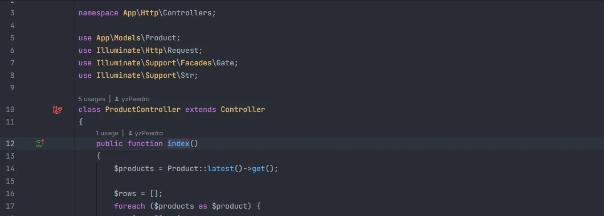

# Gutter markers

Icons in the gutter connect your code to routes and views: a line that names a route (`route('orders.show')`) or a view (`view('orders.index')`) gets an icon that jumps to the route definition or the Blade file, and every controller method that a route points to gets an icon that shows the route's verb, URI and name and opens the route.

<p align="center"></p>
<p align="center"><sub>The route icon next to <code>ProductController::index()</code>, which a route points to</sub></p>

## How to use it

Open a PHP or Blade file. The icons appear in the gutter on their own; hover one to read its tooltip, click it to go to its target.

```php
// app/Http/Controllers/OrderController.php
class OrderController extends Controller
{
    public function index()                         // icon: Route: GET /orders · orders.index
    {
        return view('orders.index');                // icon: Go to view resources/views/orders/index.blade.php
    }

    public function store(Request $request)
    {
        return redirect()->route('orders.index');   // icon: Go to route orders.index (GET /orders)
    }
}
```

## What you see

| Marker | Where | Icon | Tooltip | Click opens |
| --- | --- | --- | --- | --- |
| Route | the line of a route name string | navigate | `Go to route orders.index (GET /orders)` | the route's definition in `routes/` (its `->name()`), the Folio page, or the entry in `bootstrap/cache/routes-v7.php` for routes known only from the route cache |
| View | the line of a view name string | navigate | `Go to view resources/views/orders/index.blade.php` | the Blade file |
| Controller route | the line of a controller method that a route points to | implementing | `Route: GET /orders · orders.index`, one line per route | the definition of the first of those routes |

The class and scope icons that list usages are described in [Gutter usages](Gutter-Usages.md).

## Details

### Route and view markers

- They are placed on the strings the plugin already recognises as route names or view names: `route()`, `to_route()`, `redirect()->route()`, `URL::route()`, `Route::has()`, `routeIs()` and the other route calls ([Route names](Route-Names.md)); `view()`, `View::make()`, `Route::view()`, `->view()`, `->markdown()`, `@include`, `@extends`, `@component`, `@each` and the other view calls ([Views](Views.md)).
- The string must be complete (its closing quote typed) and match a known route name or view exactly. A pattern such as `routeIs('admin.*')`, a name built by concatenation or a misspelled name gets no icon (the misspelled ones can be reported by the [unknown routes](Inspection-Unknown-Routes.md) and [unknown views](Inspection-Unknown-Views.md) inspections).
- The route tooltip shows the route's detail in parentheses: `GET /orders` for a verb route, `resource /photos` for the routes of `Route::resource()`, `GET /users/{user}` for a Folio page.
- The view tooltip shows the view's path relative to the project.
- Both work in PHP files and in Blade templates (in `{{ }}`, `{!! !!}`, `@php` blocks and directive arguments).

### Controller route markers

- Only files whose path contains `/Http/Controllers/` get them, and only the methods of the first class in the file.
- A method gets an icon when a route in `routes/**/*.php` points to it: `[OrderController::class, 'index']`, `OrderController::class` for an invokable controller (`__invoke`), the methods generated by `Route::resource()` (`index`, `create`, `store`, `show`, `edit`, `update`, `destroy`) and `Route::apiResource()` (without `create` and `edit`), with `only()` and `except()` applied.
- The route and the method are matched by the controller's class name and the method name.
- The tooltip lists every route that points to the method, one per line, as `VERB /uri · name` (the name is left out for unnamed routes; resource routes read `resource /photos · photos.index`).
- Routes known only from the route cache (`bootstrap/cache/routes-v7.php`) don't add controller markers.

### When they update

- The markers are computed each time the IDE asks for them (when a file is opened or edited) from the plugin's route and view indexes. Those indexes are rebuilt when files under `routes/`, `resources/views/`, `app/Providers/`, `bootstrap/app.php` or `bootstrap/cache/` change; *Laravel: Refresh Index* rebuilds everything ([Status bar](Status-Bar.md)).
- When the IDE asks for a file's markers, the plugin also refreshes that file's inspections, so warnings follow the text as you type ([Inspections overview](Inspections.md)).

## Settings and permissions

No setting and no optional permission.

## Related

- [Gutter usages](Gutter-Usages.md)
- [Go to definition](Go-to-Definition.md)
- [Route names](Route-Names.md) and [Views](Views.md)
- [Routes](Hub-Routes.md) and [Controllers](Hub-Controllers.md) in the hub
- [Rename route](Rename-Route.md)

---
[← Wiki home](Home.md)
