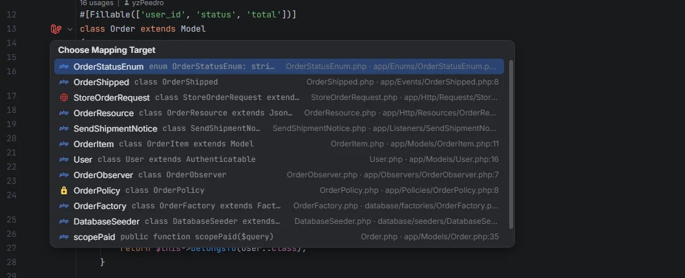
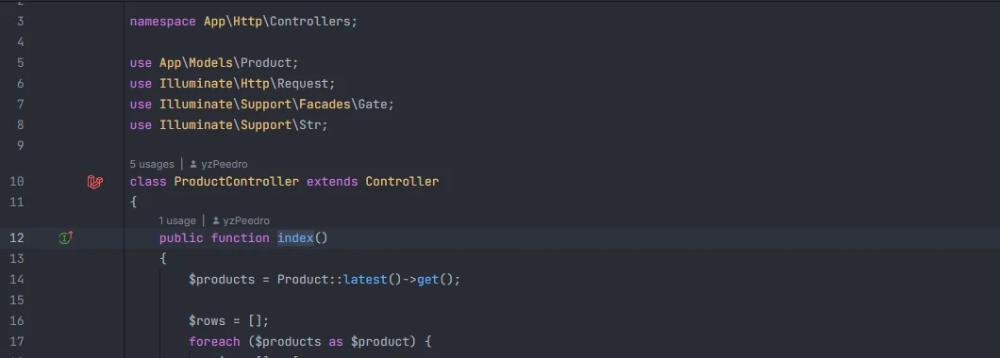
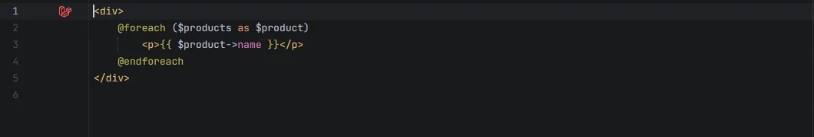

# Related files

A Laravel icon in the gutter of every Laravel class and Blade view that is tied to other files: a model lists its migrations, factory, seeders, scopes, JSON resources, policy, observers, events and their listeners, Form Requests, controller, enum casts and related models; a controller method lists its routes and the tests that call them; a view lists the classes that render it. With several files the icon opens a list to pick from; with one it goes straight there.

The icon next to <code>class Order</code>: everything that belongs to the model

## How to use it

Open a model, a controller, a Blade view or any other file listed below and click the Laravel icon in the gutter: on the line of the class name, of a controller method, of a `Schema::create('orders', …)` in a migration, or on the first line of a view. Hovering it shows *Related files* and the files it leads to. Pick one from the list to open it at that line; when there is only one, it opens right away.

The links come from a document indexer that the IDE runs in the background, so they follow your edits, saved or not, and work in both directions: the model lists its factory, and the factory's icon lists the model and the rest of its family.

## What you see

### Models

The icon on `class Order` lists:

| Related | How it is found |
| --- | --- |
| Migrations | Every `Schema::create('orders', …)` and `Schema::table('orders', …)` for the model's table (the icon sits on that line of the migration) |
| Factory | `database/factories/OrderFactory.php`, or a factory with `protected $model = Order::class` |
| Seeders | `OrderSeeder`, and every seeder that calls `Order::` (`Order::factory()`, `Order::create()`…) |
| Scopes | The model's local scopes (`scopePaid()` or methods with `#[Scope]`) |
| JSON Resources | `OrderResource` and `OrderCollection` in `app/Http/Resources` |
| Policy | `OrderPolicy`, or a policy in `app/Policies` whose methods take an `Order` |
| Observers | `OrderObserver`, or an observer whose methods take an `Order` |
| Form Requests | `StoreOrderRequest`, `UpdateOrderRequest` and the other `<Verb>OrderRequest` (and `OrderRequest`) in `app/Http/Requests` |
| Controller | `OrderController` in `app/Http/Controllers` |
| Events | Events in `app/Events` whose constructor takes an `Order` |
| Listeners | Listeners whose `handle()` takes one of those events |
| Jobs, Mailables, Notifications | Classes in `app/Jobs`, `app/Mail` and `app/Notifications` whose constructor takes an `Order` |
| Casts and enums | Classes and enums the model's `casts()` method points to (`OrderStatus::class`) |
| Related models | Models the model has a relation to (`belongsTo(User::class)`, `hasMany(OrderItem::class)`), and models that have a relation to it |

The model's class line no longer shows the [usages](Gutter-Usages.md) icon: it lists what belongs to the model, not every place that mentions it. Scopes keep their own usages icon.

Every file in that list gets the same icon on its class line (or its `Schema::` line), listing the model and the rest of the family, so you can go from the factory to the policy or from the migration to the resource.

### Controllers

| Where | Related |
| --- | --- |
| Each public method (`public function store(…)`) | The routes that point to it (`Route::post('/orders', [OrderController::class, 'store'])`, `Route::resource()` actions) and the tests that call those routes, by name (`route('orders.store')`) or by URI (`'/orders/7'` matches `/orders/{order}`) |
| The class name | The model of the same name (`OrderController` → `Order`) and its family |

This icon replaces the route icon that controller methods had before.

The icons on <code>ProductController</code>: the class leads to the Product model and its family, each method to its routes and tests

### Views and components

| Where | Related |
| --- | --- |
| The first line of a Blade view | The classes and routes that render it: `view('shop.index')` and `View::make()` in controllers and other classes, `Route::view()`, the `render()` of Livewire and Blade components, and the `view:`, `markdown:` and `text:` of a Mailable's `Content` |
| A Livewire component, a Blade component class, a Mailable or a Notification | The views it renders; a Livewire component without a `render()` leads to its conventional view (`App\Livewire\Shop\CartSummary` → `livewire.shop.cart-summary`) |

The icon on the first line of a view leads to the class that renders it, directly when there is only one

### Events and listeners

An event's icon lists its listeners, and each listener's icon lists the event and the other listeners, read from the type of the listener's `handle()` parameter.

## Details

### Where the icons go

| File | Line |
| --- | --- |
| Classes in `app/` and `database/` | The class name |
| Controller methods | The method name |
| Migrations | The table name of each `Schema::create()` and `Schema::table()` |
| Blade views | The first line |
| Enums | The enum name |

### One icon or several

Each link is recorded by the area of the file it points to (`app` and the other autoloaded folders, `tests/`, `routes/`, `database/migrations/` and `resources/views/`), because OpenIDEA keeps targets of a gutter icon to the same source root when there are any there. OpenIDEA 0.1.41 and newer show the links of one line as a single icon with one list; OpenIDEA 0.1.40 can show one icon per area on the same line.

### Not covered

- Relations declared in another way than the conventions above (a factory named differently without `$model`, a policy registered with `Gate::policy()` for a class with another name) aren't followed.
- `$casts` properties are read from the `casts()` method only.
- Views included from other views (`@include`, `<x-…>`) aren't listed as renderers.

## Settings and permissions

Needs only `project.read`. See [Permissions](Permissions.md).

## Related

- [Gutter usages](Gutter-Usages.md)
- [Gutter markers](Gutter-Markers.md)
- [Go to Definition](Go-to-Definition.md)
- [Models in the hub](Hub-Models.md)

---
[← Wiki home](Home.md)
