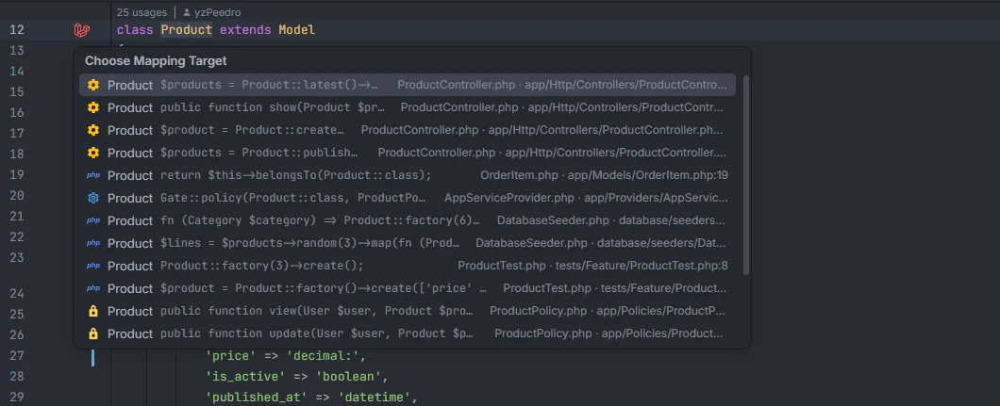
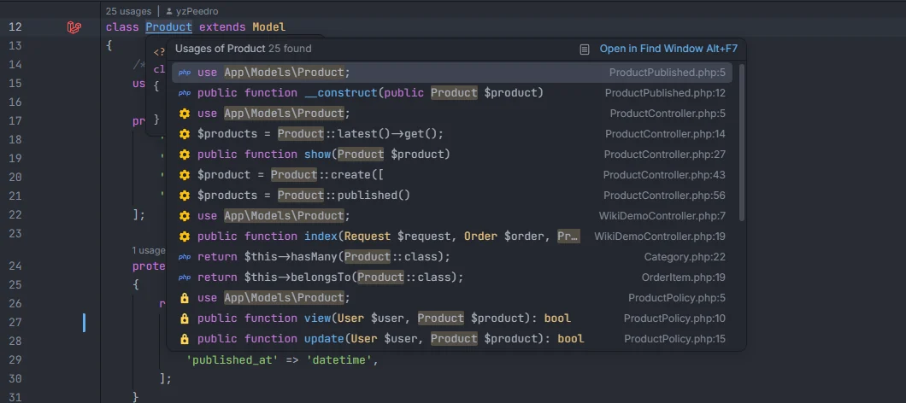

# Gutter usages

A Laravel icon in the gutter, next to every class, enum, interface and trait declared in `app/` and `database/` (models excepted) and next to every local scope of a model, opens the list of every place in the project that uses it, so you can jump to one. A model's class line shows [Related files](Gutter-Related-Files.md) instead: what belongs to the model rather than where it is mentioned. The usages come from a document indexer that the IDE runs in the background, so the list follows your edits, saved or not. Ctrl+click on the class name lists the usages as well.

<p align="center"></p>
<p align="center"><sub>The icon next to <code>class Product</code>: every usage with its line, file and folder</sub></p>

## How to use it

1. Open a class in `app/` or `database/` (a model, controller, Form Request, API Resource, job, event, listener, enum, policy, factory, seeder…).
2. Click the Laravel icon in the gutter on the line of the declaration (`class Product extends Model`), or on the line of a scope (`public function scopePublished(…)`). Hovering it shows the tooltip *Where it's used*.
3. Pick a usage from the list to open it at that line.

```php
class Product extends Model                   // icon: where Product is used
{
    public function scopePublished($query)    // icon: where ->published() and Product::published() are called
    {
        // …
    }
}
```

## What you see

The IDE's chooser (*Choose Mapping Target* in OpenIDEA 0.1.40) lists one row per usage:

- the file's icon (controller, model, policy, provider…, from the plugin's [file icons](File-Icons.md));
- the name that was used;
- the code on that line;
- the file name, its folder and the line number.

## Details

### What gets an icon

- Every `class`, `interface`, `trait` and `enum` declared in a `.php` file under `app/` or `database/` (Blade templates excluded), on the line of its name. The icon is anchored to the class's full name (namespace and name).
- Every local scope of a model: a method named `scope` + an uppercase letter, or a method with the `#[Scope]` attribute, in a file that is one of the plugin's models ([Eloquent columns and relations](Eloquent-Columns-and-Relations.md#details)). The scope is anchored to the model and the scope's call name (`Product.published`).

### What counts as a usage

The indexer reads every `.php` file under `app/`, `database/`, `routes/`, `tests/`, `config/` and `resources/views/` (Blade templates included), plus `bootstrap/app.php` and `bootstrap/providers.php`. Files in `vendor/`, `storage/` and elsewhere are not indexed.

**Classes.** A usage is a capitalised name in the code that resolves to one of your classes:

- type hints of parameters, properties and return types, `new Product`, `Product::query()`, `Product::class`, `extends`, `implements`, `instanceof`, a trait `use` inside a class body, class names inside attributes such as `#[ObservedBy(ProductObserver::class)]`;
- the name is resolved like PHP does: through the file's `namespace`, its `use` imports (aliases and grouped `use App\Models\{Order, Item}` included) or a fully qualified name with a leading `\`;
- only names that resolve into the PSR-4 namespaces of your `composer.json` (`autoload` and `autoload-dev`, or `App\` when there are none) count, so `Illuminate\…` classes and other vendor classes are not tracked.

Not counted:

- comments (`//`, `#`, `/* … */`, docblocks) and Blade comments (`{{-- --}}`);
- strings, such as `'App\Models\Order'`;
- the `use` import lines at the top of a file (the trait `use` in a class body and a closure's `use ($x)` are kept apart and don't hide anything);
- names after `->` or `::` (methods, properties and constants), names in all capitals (`PHP_EOL`), the declaration itself and the `namespace` line;
- function calls (`Product(…)` without `new`).

**Scopes.** In PHP files (not Blade), a call to the scope's name followed by `(` counts when it is preceded by `->` (any object), or by `Product::`, `static::` or `self::`. Because `->published()` counts whatever the object is, two models that both have a `published` scope share those calls. Comments are left out.

### Kept current by the IDE

- The plugin declares a document indexer for PHP files (`contributes.documentIndexers` with `extensions = ["php"]`, plugin API 1.3 and newer). The IDE calls it for each file and keeps its results in its own background index, re-indexing a file when it changes in the editor (saved or not) or on disk.
- Each usage is published as an edge whose key starts with `laravel-usages#`: `laravel-usages#App\Models\Product` for a class and `laravel-usages#scope:Product.published` for a scope. The plugin's `markerIcons` entry (`markers = ["laravel-usages#"]`, tooltip *Where it's used*) tells the IDE to draw the Laravel icon on the declarations with those keys.
- This needs OpenIDEA 0.1.40 or newer: it is the first release that accepts the marker icon's `markers` and `tooltip`, refuses half renames of indexed code identifiers and finds indexed usages on Windows.
- In OpenIDEA 0.1.40, *Rename* (Shift+F6) on an indexed class usage is refused when the language server can't rename it, instead of renaming only part of the usages.
- The list of models and scopes used to mark scopes comes from the plugin's model index, which follows the saved model files.

### Ctrl+click on the class name

Ctrl+click on the name in a `class`, `enum`, `interface` or `trait` declaration (in a file under `app/` or `database/`) lists the usages too. This list comes from the plugin's own project store rather than the IDE's index:

- it is read in the background the first time a feature touches the project, then updated when a file is saved or changed on disk (not while you type);
- it covers the same folders as the indexer and matches the class by its short name, so a class with the same short name in another namespace is listed as well;
- comments and `use` imports are left out; the file you are in is skipped;
- at most 300 files are read.

Until the store has been read, the click lists nothing. The IDE's popup may also show results from its other usage providers, such as the PHP language server.

<p align="center"></p>
<p align="center"><sub>Ctrl+click on <code>Product</code> in its declaration</sub></p>

## Settings and permissions

No setting and no optional permission. The indexer and the icon are declared in `plugin.toml` and need OpenIDEA 0.1.40 or newer ([Installation](Installation.md)).

## Related

- [Gutter markers](Gutter-Markers.md): route, view and controller icons
- [Go to definition](Go-to-Definition.md)
- [Scopes](Scopes.md)
- [Models](Hub-Models.md) in the hub: everything that defines or uses a model
- [How it works](How-It-Works.md)

---
[← Wiki home](Home.md)
