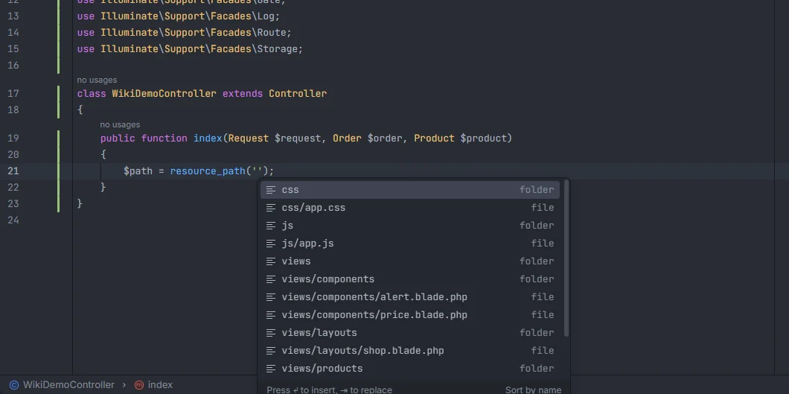
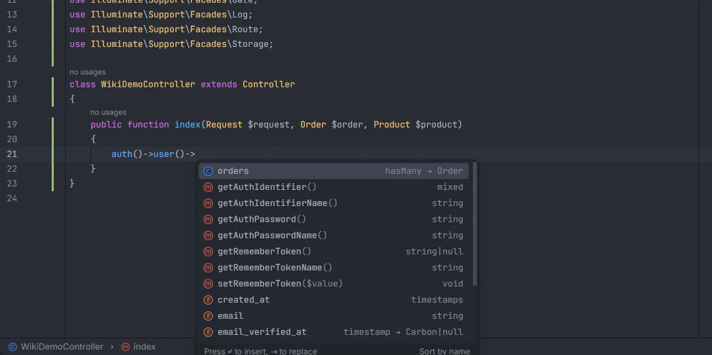

# Helpers

Laravel's global helpers and their facade twins complete their string arguments: file and folder paths in `base_path()`, `storage_path()` and the other path helpers, files on a disk in `Storage` calls, container ids in `app()` and `resolve()`, route URIs in `url()` and `redirect()`, request fields in `request()` and `old()`, log channels in `logs()`, guards in `auth()`, and Artisan command names in `Artisan::call()`. `auth()->user()->` completes your user model.

<p align="center"></p>
<p align="center"><sub>Files and folders under <code>resources/</code> in <code>resource_path('')</code></sub></p>

## Path helpers

### How to use it

| Call | Lists what is under |
| --- | --- |
| `base_path('…')`, `app()->basePath('…')`, `App::basePath('…')` | the project root, three levels deep |
| `app_path('…')`, `app()->path('…')`, `$app->path('…')`, `->appPath('…')` | `app/` |
| `config_path('…')`, `->configPath('…')` | `config/` |
| `database_path('…')`, `->databasePath('…')` | `database/` |
| `lang_path('…')`, `->langPath('…')` | `lang/`, or `resources/lang/` when `lang/` is empty and `resources/lang/` isn't |
| `public_path('…')`, `->publicPath('…')` | `public/` |
| `resource_path('…')`, `->resourcePath('…')` | `resources/` |
| `storage_path('…')`, `->storagePath('…')` | `storage/` |
| `->bootstrapPath('…')` | `bootstrap/` |

The `…Path()` methods work on any object (`app()->storagePath()`, `$this->app->langPath()`…) and as static calls on the `App` facade (`App::publicPath()`).

```php
$log = storage_path('logs/laravel.log');
$icon = public_path('img/logo.svg');
$file = App::langPath('en/shop.php');
```

### What you see

Every file below the folder, with its path relative to that folder and the detail `file`, then every folder, with the detail `folder`. Suggestions whose path starts with what you typed come first, then the ones that only contain it, each group in alphabetical order. Picking one replaces the whole string.

- For `base_path()`, the listing stops at three levels and skips `vendor/`, `node_modules/`, `.git/` and `storage/framework/`.
- For the other helpers, the whole tree is listed, up to 3000 files.
- `storage_path()` always offers `app`, `app/private`, `app/public`, `framework`, `framework/cache`, `framework/sessions`, `framework/views` and `logs`, and `base_path()` always offers `app`, `bootstrap`, `config`, `database`, `lang`, `public`, `resources`, `routes`, `storage` and `tests`, even when they are empty or git-ignored.
- The listing is kept for 15 seconds, so a burst of completions reads the disk once.

Ctrl+click on a file opens it; a folder entry points at the folder itself.

## Storage paths

`Storage` calls complete paths from the root folder of the disk they use:

| Methods | Argument |
| --- | --- |
| `get`, `put`, `exists`, `missing`, `delete` (arrays too), `url`, `temporaryUrl`, `path`, `download`, `size`, `lastModified`, `mimeType`, `files`, `allFiles`, `directories`, `allDirectories`, `makeDirectory`, `deleteDirectory`, `prepend`, `append`, `readStream`, `writeStream`, `json`, `setVisibility`, `getVisibility`, `putFile`, `putFileAs`, `response`, `checksum` | 1st |
| `copy`, `move` | 1st and 2nd |

They work as `Storage::put('…')` and chained after the facade, as in `Storage::disk('public')->exists('…')`.

```php
Storage::disk('public')->exists('avatars/1.png');
Storage::copy('exports/a.csv', 'archive/a.csv');
```

The disk is the one named in `Storage::disk('…')` right before the call, or the `default` disk of `config/filesystems.php` (`local` when it can't be read). The root is read from that disk in `config/filesystems.php`:

- only disks with the `local` driver have paths to suggest; an `s3` or `ftp` disk gets nothing;
- `'root' => storage_path('app/public')`, `public_path(…)`, `base_path(…)`, `app_path(…)`, `resource_path(…)` or a plain string is understood;
- when the file or the `root` key can't be read, `local` falls back to `storage/app/private/` and `public` to `storage/app/public/`.

## Container ids

`app('…')`, `resolve('…')`, `App::make('…')`, `App::makeWith('…')`, `App::bound('…')`, `App::has('…')`, `App::get('…')` and `app()->make('…')`, `->makeWith('…')`, `->bound('…')` (also on `$app`) complete the container's core aliases, each with the class it resolves to:

```php
$cache = app('cache');          // Illuminate\Cache\CacheManager
$files = resolve('files');      // Illuminate\Filesystem\Filesystem
```

With `vendor/laravel/framework` installed, the list is read from `Application::registerCoreContainerAliases()` of the installed version. Without it, a built-in list of 38 ids is used, from `app`, `auth` and `blade.compiler` to `url` and `validator`. These ids have no Ctrl+click target.

## Route URIs

`url('…')`, `redirect('…')`, `URL::to('…')`, `Redirect::to('…')`, `url()->to('…')` and `redirect()->to('…')` complete the URIs of your routes, each with its verb as detail:

```php
return redirect('/orders/summary');
$link = url('/products');
```

The URIs come from the same sources as [route names](Route-Names.md): named routes (route files, Folio pages and the route cache) and every route that calls a controller, named or not. Each URI is listed once; a resource shows its base URI with `resource` as detail. Unnamed routes with a closure action aren't included. Ctrl+click opens the route definition.

## Request fields

`request('…')`, `old('…')`, `$request->input('…')` and the other request readers complete the fields your code validates. See [Validation rules](Validation-Rules.md#request-fields) for the full list of methods and where the fields come from.

## `logs()` and `auth()`

- `logs('…')` completes log channels, like `Log::channel()`.
- `auth('…')` completes guards, like `Auth::guard()`.

See [Drivers and connections](Drivers-and-Connections.md).

<p align="center">user()-> listing the orders relation (hasMany to Order), the Authenticatable methods and the columns created_at, email and email_verified_at with their types" width="760"></p>
<p align="center"><sub><code>auth()->user()-></code> completes the columns, relations and methods of the <code>User</code> model</sub></p>

After `auth()->user()->`, `Auth::user()->`, `$request->user()->`, `request()->user()->` and `$this->user()->`, the plugin completes the columns, casts and relations of the `User` model, and keeps following the chain (`auth()->user()->orders->`). See [Model members](Model-Members.md).

For Intelephense, the plugin also keeps a stub in `storage/openidea/ide-helpers.php` that types `auth()` as the auth manager and `user()` as the user model of `config/auth.php`, so `auth()->user()` and `auth()->check()` don't show *Undefined method*. See [IDE helpers](IDE-Helpers.md).

## Artisan command names

| Call | Argument |
| --- | --- |
| `Artisan::call('…')`, `Artisan::queue('…')`, `Artisan::callSilent('…')`, `Artisan::callSilently('…')` | 1st |
| `Schedule::command('…')`, `$schedule->command('…')` | 1st |
| `$this->artisan('…')`, `$this->call('…')`, `$this->callSilent('…')`, `$this->callSilently('…')` (tests and commands) | 1st |

```php
Artisan::call('cache:clear');
Schedule::command('digest:send --force')->daily();
$this->artisan('inspire')->assertSuccessful();
```

The names come from:

1. your commands: the `$signature` or `$name` of each class in an `app/**/Commands/` folder, `#[AsCommand(name: '…')]`, and `Artisan::command('…')` in `routes/console.php`. The name is the first word of the signature, and the detail is the whole signature (`digest:send {--force}`);
2. a built-in list of 29 common commands with a short description: `about`, `cache:clear`, `config:cache`, `config:clear`, `db:seed`, `down`, `event:cache`, `horizon`, `horizon:terminate`, `key:generate`, `migrate`, `migrate:fresh`, `migrate:rollback`, `model:prune`, `optimize`, `optimize:clear`, `queue:flush`, `queue:restart`, `queue:retry`, `queue:work`, `reverb:start`, `route:cache`, `route:clear`, `schedule:run`, `storage:link`, `telescope:prune`, `up`, `view:cache` and `view:clear`.

Ctrl+click on one of your commands opens its signature. The built-in ones have no target. The full list of commands, with a form for each, is in the hub's [Artisan](Hub-Artisan.md) section.

## Details

- Facade, function and method names are matched case-insensitively; fully qualified names work.
- Only the arguments listed count: in `Storage::put('a.txt', 'x')` the contents `'x'` isn't a path.
- Nothing on this page runs PHP, except the IDE helper stub, which is written by a short PHP script (see [IDE helpers](IDE-Helpers.md)).

## Settings and permissions

- `ideHelpers` (on by default) writes the `auth()` stub. It needs `process:php` or `process:docker` to write the file.
- Everything else only needs `project.read`. See [Settings](Settings.md) and [Permissions](Permissions.md).

## Related

- [Drivers and connections](Drivers-and-Connections.md)
- [Validation rules](Validation-Rules.md): request fields
- [Route names](Route-Names.md)
- [Model members](Model-Members.md)
- [IDE helpers](IDE-Helpers.md)
- [Static completion](Static-Completion.md): `Cache::`, `Storage::` and the other facades after `::`

---
[← Wiki home](Home.md)
