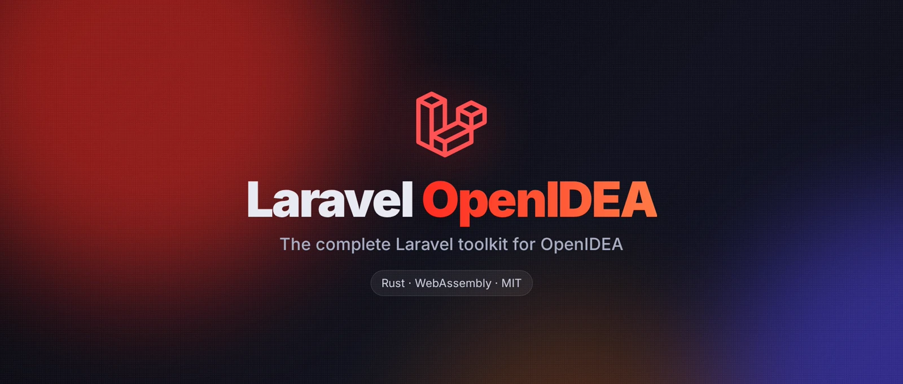

  

# Laravel OpenIDEA wiki

The complete documentation of Laravel OpenIDEA, the Laravel toolkit for [OpenIDEA](https://github.com/l0ng-ai/openidea). There is one page per feature: what it does, where it works, where its data comes from, the settings and permissions it needs, and its edge cases. Every screenshot was taken in OpenIDEA 0.1.40 on a Laravel 13 demo shop.

New here? Start with [Installation](Installation.md), then open the [hub](Hub.md) and type `route('` in a controller.

## Getting started

| Page | What it covers |
| --- | --- |
| [Installation](Installation.md) | Requirements, installing the package, linking a checkout for development, updating |
| [Permissions](Permissions.md) | Every permission the plugin asks for, what needs it and what works without it |
| [Settings](Settings.md) | All 19 settings, their defaults and the per-project override |
| [Commands and shortcuts](Commands.md) | Every `Laravel:` command, the right-click menu entries and how to bind keys |
| [Status bar](Status-Bar.md) | The Laravel version item and *Refresh Index* |
| [Privacy and security](Privacy-and-Security.md) | What runs, what is read and written, masking, what never leaves your machine |
| [How it works](How-It-Works.md) | The WebAssembly plugin, its indexes, time budgets and the PHP scripts it runs |
| [Troubleshooting and logs](Troubleshooting.md) | The IDE log, common problems and how to report a bug |
| [Development](Development.md) | Building from source, linking, tests and the end-to-end checks |

## Editor: completion and navigation

| Page | What it covers |
| --- | --- |
| [Route names](Route-Names.md) | `route()`, `to_route()`, `redirect()->route()`, `Route::has()`, `routeIs()`, Ziggy, Folio and cached routes |
| [Views](Views.md) | `view()`, `View::make()`, `@include`, `@extends`, `@component` and friends |
| [Config keys](Config-Keys.md) | `config()`, `Config::get()` and the values behind each key |
| [Environment variables](Environment-Variables.md) | `env()` and `.env` / `.env.example` keys and values |
| [Translations](Translations.md) | `__()`, `trans()`, `trans_choice()`, `@lang`, JSON files, locales and JavaScript |
| [Validation rules](Validation-Rules.md) | Rule names in strings and arrays, custom rules, `$request->input()` fields |
| [Middleware, gates and policies](Middleware-Gates-and-Policies.md) | `middleware()`, `can:`, `Gate::allows()`, `@can`, `authorize()` and where abilities are used |
| [Drivers and connections](Drivers-and-Connections.md) | Disks, cache stores, log channels, database connections, mailers, queues, guards, rate limiters |
| [Eloquent columns and relations](Eloquent-Columns-and-Relations.md) | Columns and relations in `where`, `with`, `has`, `orderBy`, `create`, `pluck` and closures |
| [Model members](Model-Members.md) | `$model->` columns with types, relations, the related model, `auth()->user()` |
| [Eloquent chains](Eloquent-Chains.md) | Collections, relation methods, query builders and scopes through whole chains |
| [Casts](Casts.md) | Cast values and arguments, enum and value-object members, Ctrl+click on cast columns |
| [Scopes](Scopes.md) | Local and `#[Scope]` scopes in completion, navigation and the gutter |
| [Factories](Factories.md) | Factory chains, states, `factory()` on models and Ctrl+click to factories |
| [Typed closures](Typed-Closures.md) | `fn` / `function` completed with the parameter typed and imported |
| [Static completion](Static-Completion.md) | `::` on facades, enums and static classes, `::class` in casts |
| [Types and inheritance](Types-and-Inheritance.md) | Classes after `extends`, `implements` and `use`, model inheritance |
| [PSR-4 namespaces](Namespaces.md) | `namespace` from `composer.json` autoload |
| [Snippets](Snippets.md) | About 200 PHP, Laravel and Blade snippets, relation snippets from migrations |
| [Helpers](Helpers.md) | `auth()`, path helpers, `app()`, `request()`, `old()`, `url()`, `logs()` |
| [Blade](Blade.md) | Highlighting, folding, structure, directives, components, sections, stacks, assets |
| [Packages](Packages.md) | Livewire, Inertia, Folio, Sanctum, Spatie Permission, Socialite, OpenAPI, Pivot attributes |
| [composer.json](Composer-Json.md) | Keys, packages, versions, autoload, scripts and plugins |
| [phpunit.xml](PHPUnit-Xml.md) | Elements, attributes from your PHPUnit, `<env>` names and values |
| [Pint, PHP CS Fixer and PHPStan configs](Tool-Configs.md) | `pint.json`, `.php-cs-fixer.php`, `phpstan.neon` (with NEON highlighting) |
| [Front-end files](Frontend-Files.md) | Vite entries, Ziggy route names and translation keys in JS, TS, Vue and Svelte |
| [Pest](Pest.md) | Datasets and groups |
| [Go to definition](Go-to-Definition.md) | Everything Ctrl+click opens |
| [Gutter usages](Gutter-Usages.md) | The Laravel icon that lists every place a class or scope is used |
| [Gutter markers](Gutter-Markers.md) | Route, view and controller icons in the gutter |

## Inspections and quick fixes

| Page | What it reports |
| --- | --- |
| [Inspections overview](Inspections.md) | How inspections run, their settings and quick fixes |
| [Unknown views](Inspection-Unknown-Views.md) | Views that don't exist, with the closest view as fix |
| [Unknown route names](Inspection-Unknown-Routes.md) | Route names nobody defines |
| [Unknown validation rules](Inspection-Unknown-Rules.md) | Rules your Laravel version doesn't have |
| [Unknown columns](Inspection-Unknown-Columns.md) | Columns missing from the model's table |
| [Enum values](Inspection-Enum-Values.md) | `where()` values a backed enum doesn't have |
| [N+1 queries](Inspection-N-Plus-One.md) | Relations loaded once per item in a `foreach` |
| [`env()` outside config](Inspection-Env-Outside-Config.md) | `env()` calls that break with a config cache |
| [Keys `$fillable` leaves out](Inspection-Fillable.md) | `create()`, `firstOrCreate()`, `updateOrCreate()` and similar keys that won't be saved |
| [Duplicate array keys](Inspection-Duplicate-Keys.md) | Keys repeated in the same array |
| [`.env` keys](Inspection-Env-Keys.md) | Keys missing between `.env` and `.env.example` |
| [Unknown middleware and abilities](Inspection-Unknown-Middleware.md) | Middleware aliases and abilities nobody defines |
| [Unknown OpenAPI refs](Inspection-Unknown-OpenAPI-Refs.md) | swagger-php `$ref`s to missing components |

## Refactorings and actions

| Page | What it does |
| --- | --- |
| [Rename route](Rename-Route.md) | Updates every usage after you change a route's name |
| [Rename translation](Rename-Translation.md) | Updates every usage and the other locales after you change a key |
| [Extract Form Request](Extract-Form-Request.md) | Turns `$request->validate([…])` into a Form Request class |
| [Copy Query as MySQL](Copy-Query-as-MySQL.md) | Copies the SQL an Eloquent chain runs |
| [Run Selection in Tinker](Run-Selection-in-Tinker.md) | Runs the selected PHP in an `artisan tinker` terminal |
| [Generate model PHPDoc](Generate-Model-PHPDoc.md) | Writes `@property` tags from migrations, casts and relations |
| [Go to Related Class or View](Related-Class-or-View.md) | Jumps between a Livewire or Blade component class and its view |
| [Tools on save](Tools-on-Save.md) | Pint, PHP CS Fixer and PHPStan (with Larastan) when you save |
| [IDE helpers](IDE-Helpers.md) | The stub that types `auth()` and your user model for Intelephense |
| [File templates](File-Templates.md) | *New File* templates for models, controllers, requests and more |
| [File icons](File-Icons.md) | Material icons for Laravel files |
| [Run configurations](Run-Configurations.md) | `artisan serve` and `artisan test` in the run menu |

## The hub

| Page | Section |
| --- | --- |
| [The hub](Hub.md) | Opening it, the tool window, editor tabs, search, filters, sorting and paging |
| [Overview](Hub-Overview.md) | Your app at a glance and the quick actions |
| [Ecosystem](Hub-Ecosystem.md) | Starter kit, first-party and popular packages |
| [AI Agents](Hub-AI-Agents.md) | The MCP server, access levels and Laravel Boost |
| [Artisan](Hub-Artisan.md) | Every command as a form, run in the terminal or captured |
| [Tinker](Hub-Tinker.md) | PHP in tabs with Tinker-style output |
| [SQL to Laravel](Hub-SQL-to-Laravel.md) | SQL to Eloquent or the query builder, and Laravel back to MySQL |
| [Routes](Hub-Routes.md) | Every route with method, URI, name, action and tests |
| [Controllers](Hub-Controllers.md) | Controllers and their actions |
| [Form Requests](Hub-Form-Requests.md) | Requests and their validated fields |
| [API Resources](Hub-API-Resources.md) | JSON resources and collections |
| [Middleware](Hub-Middleware.md) | Aliases and groups |
| [Models](Hub-Models.md) | Models, tables, relations, scopes and everything about one model |
| [Scopes](Hub-Scopes.md) | Local and global scopes |
| [Observers](Hub-Observers.md) | Observers, their models and hooks |
| [Casts](Hub-Casts.md) | Custom casts |
| [Enums](Hub-Enums.md) | Enums and their cases |
| [Database](Hub-Database.md) | Tables and columns from your migrations |
| [Cache](Hub-Cache.md) | Keys and values of every store |
| [Factories & Seeders](Hub-Factories.md) | Factories and seeders |
| [Views](Hub-Views.md) | Blade views by name |
| [Components](Hub-Components.md) | Blade and Livewire components |
| [Frontend](Hub-Frontend.md) | Vite assets, Inertia pages and components |
| [Translations](Hub-Translations.md) | Keys per locale |
| [All Classes](Hub-Classes.md) | Every class, interface, trait and enum |
| [Service Providers](Hub-Providers.md) | Providers and what they bind |
| [Container Bindings](Hub-Bindings.md) | `bind`, `singleton`, `scoped` and `instance` |
| [Validation Rules](Hub-Rules.md) | Custom rules |
| [Macros](Hub-Macros.md) | Macros and mixins |
| [Config](Hub-Config.md) | Every config key and its value |
| [Environment](Hub-Environment.md) | `.env` and `.env.example` |
| [Drivers & Connections](Hub-Drivers-and-Connections.md) | Databases, caches, disks, mailers, logs, guards, broadcasting, rate limiters |
| [Auth & Policies](Hub-Auth-and-Policies.md) | Gates, policies, roles, permissions, abilities and guards |
| [Queues & Workers](Hub-Queues.md) | Connections, queued jobs and workers |
| [Scheduling](Hub-Scheduling.md) | Scheduled tasks and the scheduler |
| [Events](Hub-Events.md) | Events and their listeners |
| [Listeners](Hub-Listeners.md) | Listeners and their events |
| [Mail & Notifications](Hub-Mail.md) | Mailables and notifications |
| [Tests](Hub-Tests.md) | Test files and running them |
| [Live Audit](Hub-Live-Audit.md) | Requests, queries, events, jobs and more, with N+1 and slow query insights |
| [Logs](Hub-Logs.md) | `storage/logs`, live |
| [Profiles](Hub-Profiles.md) | Clockwork and Debugbar profiles |
| [Debug Calls](Hub-Debug-Calls.md) | `dd()`, `dump()`, `ray()` and friends left in the code |
| [Debug Tools](Hub-Debug-Tools.md) | The installed debug toolbox |

## AI agents

| Page | What it covers |
| --- | --- |
| [AI agents and MCP](AI-Agents.md) | The `laravel-openidea` MCP server, every tool, the three access levels and client setup |

---

Laravel is a trademark of Taylor Otwell. This project is not affiliated with Laravel, JetBrains or the OpenIDEA authors.
