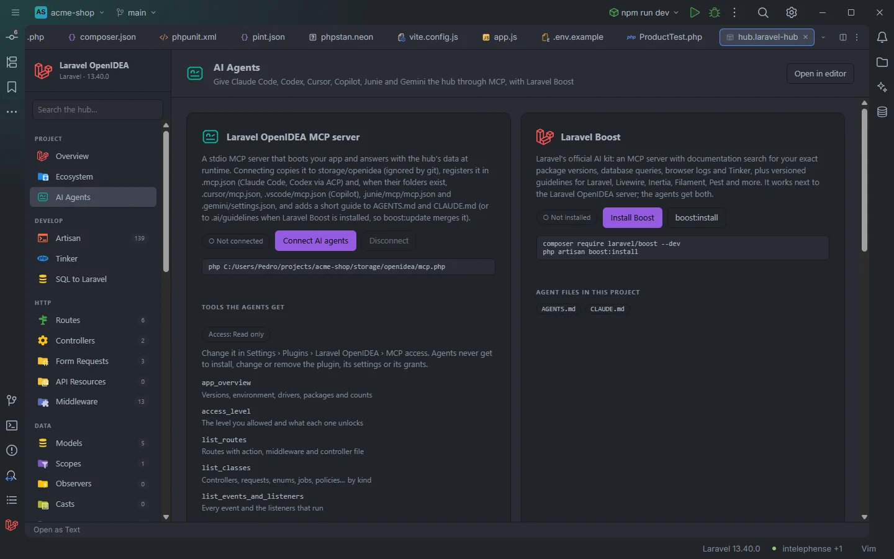

# AI Agents

The hub page that connects AI coding agents (the agents that read `.mcp.json`, Codex, Cursor, GitHub Copilot, Junie and Gemini) to the plugin's `laravel-openidea` MCP server in one click, shows the tools they get at the current access level, and installs and updates Laravel Boost next to it. The server itself, its tools and its access levels are documented in [AI agents and MCP](AI-Agents.md).

The AI Agents page before connecting

## How to use it

1. Click **AI Agents** under **Project** in the sidebar (or open `storage/openidea/hub/ai.laravel-hub`).
2. Click **Connect AI agents**.
3. When the toast says `AI agents connected. Restart the agent session to load the laravel-openidea MCP server.`, start a new session in your agent.

To change what agents may do, set **MCP access** in **Settings › Plugins › Laravel OpenIDEA**; to remove everything again, click **Disconnect**.

## What you see

The page is three cards.

### Laravel OpenIDEA MCP server

- A short description of what connecting does.
- The state: **● Connected** (green) or **○ Not connected**. The page counts as connected when `storage/openidea/mcp.php` exists and at least one agent config file has a `laravel-openidea` entry.
- **Connect AI agents** (highlighted) before connecting, **Update connection** after. Both write everything again with the current access level and plugin version. While the plugin works the button reads **Working…**.
- **Disconnect**, enabled once connected.
- The command the agents run, for example `php /path/to/project/storage/openidea/mcp.php`, or the `docker compose … run … php storage/openidea/mcp.php` form with a Compose runner.
- Chips with the config files that register the server (`.mcp.json`, `.cursor/mcp.json`…).
- `Guidelines in AGENTS.md, …` (or `.ai/guidelines/laravel-openidea.md` with Laravel Boost): where the short guide for agents was written.
- An **Error** line when the PHP setup script failed, with its message.
- **Tools the agents get**: a chip with the level (`Access: Read only`, `Access: Write` or `Access: Full access`), the reminder `Change it in Settings › Plugins › Laravel OpenIDEA › MCP access. Agents never get to install, change or remove the plugin, its settings or its grants.`, and the 25 tools with a one-line description. Write and full tools are prefixed with `Write ·` or `Full access ·`, and tools above the current level are dimmed.
- A closing note: every call boots the app again; full access runs any PHP like Tinker and can't be fenced in; an agent with its own file tools can edit the project anyway, so the level decides what this server offers, not what the agent could do by other means.

The tool list on the page:

| Tool | Level | Description on the page |
| --- | --- | --- |
| `app_overview` | read | Versions, environment, drivers, packages and counts |
| `access_level` | read | The level you allowed and what each one unlocks |
| `list_routes` | read | Routes with action, middleware and controller file |
| `list_classes` | read | Controllers, requests, enums, jobs, policies… by kind |
| `list_events_and_listeners` | read | Every event and the listeners that run |
| `list_models` | read | Tables, fillable, casts, relations, scopes, observers |
| `list_container_bindings` | read | Abstract → concrete, singleton or not |
| `list_schedule` | read | Cron, command, next run, overlap flags |
| `list_queues` | read | Connections, job classes, failed jobs |
| `list_artisan_commands` | read | Commands with usage |
| `run_artisan` | read | Read-only commands; more with write or full |
| `get_config` | read | Config values, secrets masked |
| `database_schema` | read | Tables, columns, indexes, foreign keys |
| `missing_translations` | read | Keys missing per locale |
| `check_env_keys` | read | Keys missing between .env and .env.example |
| `list_tests` | read | Pest and PHPUnit tests |
| `run_phpstan` | read | PHPStan and Larastan errors |
| `read_logs` | read | Latest log entries by level |
| `audit_recent` | read | Live Audit records plus N+1, slow query and failure insights |
| `hub_sections` | read | Where things are in the hub |
| `format_code` | write | Pint or PHP CS Fixer on files |
| `run_tests` | write | Pest or PHPUnit |
| `query_to_sql` | write | The SQL a query runs, captured without running it |
| `audit_recorder` | write | Turn Live Audit on or off |
| `run_tinker` | full | Run any PHP in the booted app |

### Laravel Boost

Laravel's official AI kit, which works next to this server (agents get both).

- The state: **● Installed** followed by the version from `composer.lock`, or **○ Not installed**. Boost counts as installed when `vendor/laravel/boost` exists or the lock file has a version.
- **Install Boost** (only when not installed) opens a terminal running `composer require laravel/boost --dev`.
- **boost:install** opens a terminal running `php artisan boost:install`, where Boost asks which agents and editors to set up. It is the highlighted button once Boost is installed.
- **boost:update** (only when installed) runs `php artisan boost:update` with its output in the hub's drawer. It refreshes Boost's guidelines, including `.ai/guidelines/laravel-openidea.md` written by **Connect AI agents**.
- The matching commands as a reminder.
- **Agent files in this project**: chips for whichever of `boost.json`, `.mcp.json`, `AGENTS.md` and the other agents' guideline files, `.cursor/mcp.json`, `.vscode/mcp.json`, `.junie/mcp/mcp.json`, `.github/copilot-instructions.md` and `.ai/guidelines` exist.

### Debug with an agent

A three-step recipe: turn the recorder on in [Live Audit](Hub-Live-Audit.md), reproduce the bug, then ask the agent to call `audit_recent`, which shows the requests, SQL with the calling line, events with payloads and listeners, exceptions and N+1 patterns, and to confirm with `list_models`, `list_routes` and `run_tinker`.

## Details

- The first visit asks for the state, which runs the plugin's setup script (`install.php agents-status`) with the project's runner. It also brings the server files in `storage/openidea` up to date if they are already there.
- **Connect AI agents** runs the same script with `agents` and passes it the server, the access level and the guide; **Disconnect** runs it with `agents-off`. What exactly each one writes and removes is listed in [AI agents and MCP](AI-Agents.md#what-connecting-writes).
- **Install Boost** goes through Composer in a terminal: `php -r "passthru('composer …')"` with the php runner (so `composer` must be on the PATH), or `docker compose run --rm --no-deps --entrypoint composer <service> …` / `docker compose exec <service> composer …` with a Compose runner. The hub only allows the Composer commands `require`, `update`, `install`, `remove`, `dump-autoload`, `show` and `outdated`.
- The header has no **Filter…** box on this page.
- The tool list is part of the page; it reflects the server shipped with this plugin version.

## Settings and permissions

| Setting | Effect |
| --- | --- |
| `mcpAccess` (**MCP access**) | `read` (default), `write` or `full`: which tools the server offers. The page shows the level and dims the rest |
| `artisanRunner`, `dockerService` | How the setup script, Boost commands and the MCP server command run |

Connecting needs `process:php` (or `process:docker` with a Compose runner); without it the card shows the permission error. See [Settings](Settings.md) and [Permissions](Permissions.md).

## Related

- [AI agents and MCP](AI-Agents.md)
- [Live Audit](Hub-Live-Audit.md)
- [Ecosystem](Hub-Ecosystem.md)
- [Privacy and security](Privacy-and-Security.md)
- [The hub](Hub.md)

---
[← Wiki home](Home.md)
