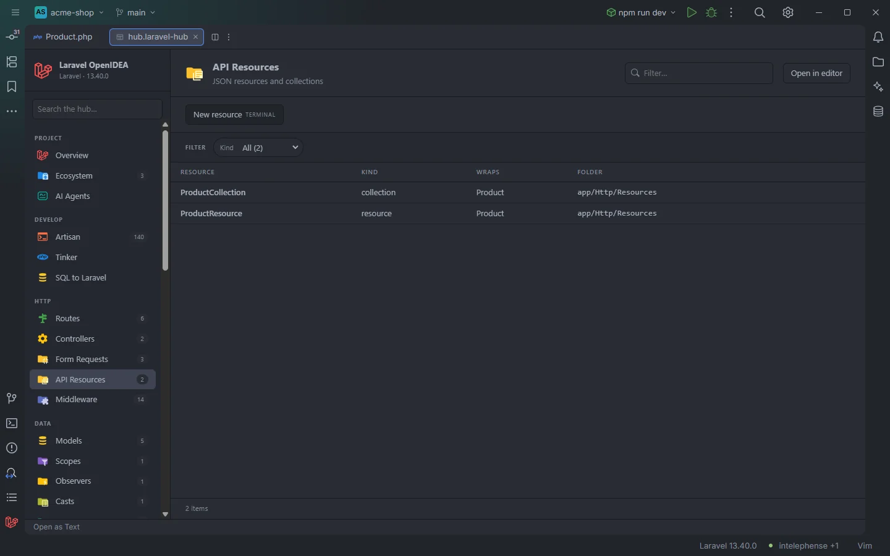

# API Resources

Every JSON resource and resource collection of the app, with the model each one most likely wraps. A click opens the class.

A resource and its collection

## How to use it

Click **API Resources** under **HTTP** in the sidebar, or open `storage/openidea/hub/api-resources.laravel-hub`. Type a model name in **Filter…** to find its resources, or pick a **Kind**.

## What you see

### Columns

| Column | Content |
| --- | --- |
| Resource | The class name |
| Kind | `collection` when the class extends `ResourceCollection` or its name ends in `Collection`; `resource` otherwise |
| Wraps | The class name without its `Collection` and `Resource` suffixes: `ProductCollection` and `ProductResource` both read `Product` |
| Folder | The folder of the file |

**Wraps** is derived from the name only; it doesn't read `$collects` or `@mixin`.

### Facets

**Kind** and **Folder**.

### Actions

| Button | Command | Mode |
| --- | --- | --- |
| **New resource** | `make:resource` | Terminal |

Artisan asks for the name in the terminal; a name ending in `Collection` gives a resource collection.

## Details

- A class is an API resource when it extends `JsonResource` or `ResourceCollection`, or its file is under a `/Http/Resources/` folder. Abstract classes are included.
- Classes come from the plugin's token scan of `app/`, `database/factories/`, `database/seeders/`, `routes/` and the bootstrap files; see [Controllers](Hub-Controllers.md#details).
- A click opens the file at the class name.
- With no resource the section reads `Nothing found in this project yet.`
- A model's detail page in [Models](Hub-Models.md) also lists the resources that mention the model.

## Settings and permissions

The table needs only `project.read`. **New resource** needs `process:php` or `process:docker`. See [Permissions](Permissions.md).

## Related

- [Models](Hub-Models.md)
- [Controllers](Hub-Controllers.md)
- [All Classes](Hub-Classes.md)
- [The hub](Hub.md)

---
[← Wiki home](Home.md)
