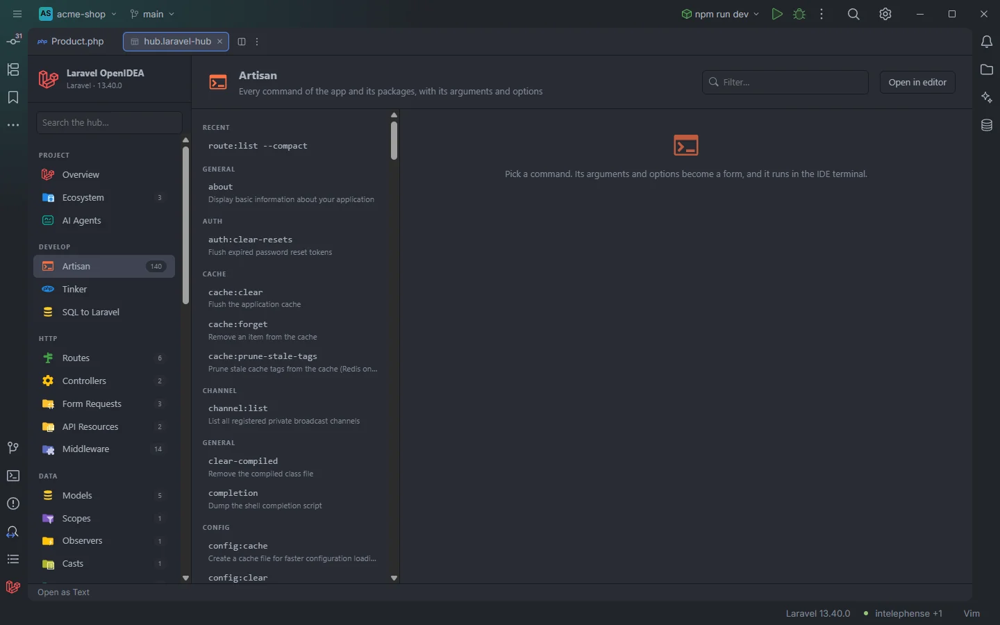
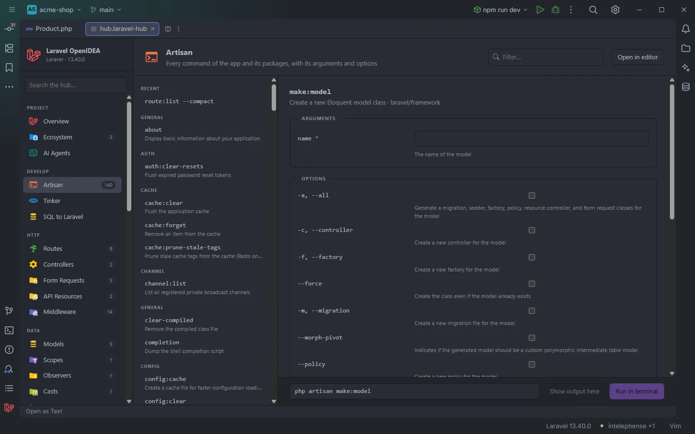
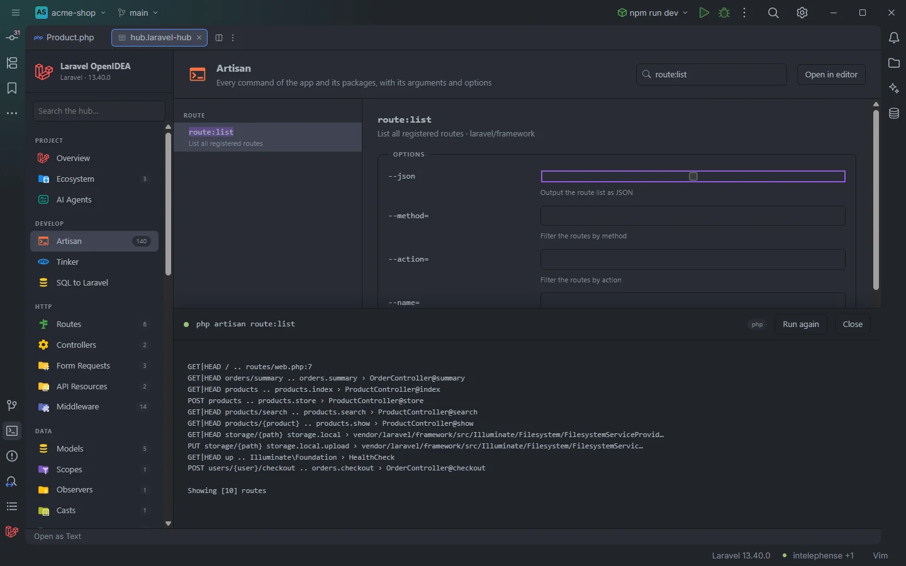

# Artisan

Every Artisan command of the app and its packages in one list, each turned into a form with its arguments and options. Fill it in, check the command line at the bottom and run it in an IDE terminal or see its output right in the hub.

The command list, with the last command run under Recent

## How to use it

1. Click **Artisan** under **Develop** in the sidebar, or the **Artisan commands** card on Overview.
2. Type in **Filter…** to find a command by name or description.
3. Click a command. Its form opens on the right with the first field focused.
4. Fill in the arguments and options. The command line at the bottom follows every keystroke.
5. Click **Run in terminal** (or press Enter in any field) to run it in an IDE terminal tab, or **Show output here** to run it in the background and read the output in the hub.

The form of <code>make:model</code>

## What you see

### The command list

- **Recent** comes first: the last 6 commands you ran from the hub, with their arguments (`route:list --compact`). Clicking one runs it again in a terminal. Recent is hidden while the filter box has text.
- Then every command, sorted by name and grouped by the part before the colon: `auth`, `cache`, `config`, `make`, `migrate`, `queue`… Commands without a colon go under **general**. Because the list is sorted by name, **general** can appear more than once (`about` comes before `auth:clear-resets`, `clear-compiled` after `channel:list`).
- Each entry shows the name in monospace and the description under it. Commands of your app (from `app/` or `routes/console.php`) carry a red **app** tag.
- While filtering, the matches in the names are highlighted. Matching is case-insensitive on the name and the description.
- The selected command is highlighted. Until you pick one, the right side says `Pick a command. Its arguments and options become a form, and it runs in the IDE terminal.`

The badge next to **Artisan** in the sidebar and the Overview card show how many commands were found.

### The form

- The command name as a title. When the plugin knows its file, the title is a link: clicking it opens the command's class (in `vendor/` for package commands) or `routes/console.php`.
- The description and its source after a `·`: the Composer package (`laravel/framework`), `app` or `routes/console.php`. `No description` when there is none.
- **Arguments**: one text field per argument, labelled with its name. A required argument has a red `*`; an array argument ends in `…`. The hint under the field is the argument's description and `default: …` when it has one.
- **Options**: a checkbox for a flag, a text field for an option that takes a value (labelled `--name=`). The shortcut comes first when there is one (`-m, --migration`).
- Array arguments show `space separated` as placeholder, array options `comma separated`, matching how each is split (below).
- **Global options**: `--env=` (text), `--no-interaction`, `--verbose`, `--quiet` and `--ansi` (checkboxes), for every command.

### The run bar

At the bottom: the full command line, then **Show output here** and **Run in terminal**.

- The command line reads `php artisan make:model Post --migration`. Values with characters other than letters, digits and `_ . : / @ = , -` are shown in single quotes.
- Both buttons are disabled while a required argument is empty, and so is Enter.
- Your values are cleared when you pick another command.

### Output in the hub

**Show output here** runs the command in the background and opens the output drawer over the lower half of the section.

<code>route:list</code> with its output in the drawer

The drawer shows a status dot (pulsing while running, green on success, red on failure), the command, the runner, **Run again** and **Close**, and the output with Artisan's colours (the plugin adds `--ansi` unless you set `--ansi` or `--no-ansi`). Output written to stderr is appended, and output beyond 400,000 bytes is cut.

## Details

### Where the commands come from

The list is read from files, without running Artisan:

1. **Package commands**: every class whose name ends in `Command` in `vendor/composer/autoload_classmap.php` that lives under `vendor/`. Abstract classes are skipped. The source shown is the Composer package (`vendor/<vendor>/<package>`). A package whose classes aren't in the classmap doesn't contribute its commands.
2. **App commands**: every PHP file under `app/` whose class extends a class ending in `Command`, or that contains `AsCommand(` or `#[Signature(`. An app command with the same name as a package command replaces it.
3. **Closure commands**: `Artisan::command('name {args}', …)` in `routes/console.php`, with the text of a following `->purpose('…')` as description.

Each command is read the way Laravel declares it:

| Declaration | Read from |
| --- | --- |
| `protected $signature = 'mail:send {user} {--queue=}'` | Name, arguments and options from the signature |
| `#[Signature('…')]` and `#[Description('…')]` attributes | The same, from the attributes |
| `protected $name = 'make:model'` with `getArguments()` and `getOptions()` | Name, then each `[name, shortcut, InputOption::VALUE_*, description]` row |
| `#[AsCommand(name: 'about', description: '…')]` | Name and description |
| `protected $description = '…'` | Description |

Signature details: `{user}` is required, `{user?}` and `{user=default}` optional, `{ids*}` an array argument; `{--force}` is a flag, `{--queue=}` takes a value, `{--delay=5}` has a default, `{--tag=*}` is an array; `{--Q|queue=}` declares the shortcut `Q`; ` : ` separates the description. With `getArguments()`, `REQUIRED` and `IS_ARRAY` set the argument's mode; with `getOptions()`, `VALUE_REQUIRED` or `VALUE_OPTIONAL` make an option take a value.

The list is kept between visits, and read again from the files when a PHP file under `app/`, `composer.lock`, `vendor/composer/installed.json` or `vendor/composer/autoload_classmap.php` changes (a new command class, `composer require`). The section asks the plugin for the list each time it opens, so a command added since then appears there. **Refresh**, in the toolbar above the list, reads every command again.

### How values become the command

- Arguments come first, in their declared order; an empty argument is left out. An array argument is split on spaces into several arguments.
- A flag adds `--name` when checked.
- A value option adds `--name=value`; an array option is split on commas and repeated, `--tag=a --tag=b`.
- Global options come last.

### Running

- **Run in terminal** opens an IDE terminal tab titled `artisan <command and arguments>`. With the php runner it runs `php artisan …` in the project folder; with Docker Compose, `docker compose run --rm --no-deps --entrypoint php <service> artisan …` (or `docker compose exec <service> php artisan …`), interactive. In OpenIDEA 0.1.40 the terminal tab closes when the command exits, so for commands that only print something, **Show output here** is the way to read it.
- **Show output here** runs the same command without a terminal (on Windows through `php-win` when allowed) and shows the IDE task `php artisan …` while it runs.
- Both add the command line to the history: the last 20 distinct commands, newest first, saved in the plugin's storage so they survive restarts. A command run again moves to the top. The history also records the commands run from section buttons and Overview's quick actions.
- When the run can't start, a toast explains why, for example `Allow "process:php" for Laravel OpenIdea in Settings › Plugins to run Artisan with php`.

## Settings and permissions

| Setting | Effect |
| --- | --- |
| `artisanRunner` | `auto`, `php`, `docker-run` or `docker` |
| `dockerService` | The Compose service (empty: detect) |

Running needs `process:php`, or `process:docker` with a Compose runner. The history needs `storage`. Reading the list needs nothing more than `project.read`. See [Settings](Settings.md) and [Permissions](Permissions.md).

## Related

- [The hub](Hub.md)
- [Overview](Hub-Overview.md)
- [Tinker](Hub-Tinker.md)
- [Commands and shortcuts](Commands.md)
- [Run configurations](Run-Configurations.md)

---
[← Wiki home](Home.md)
