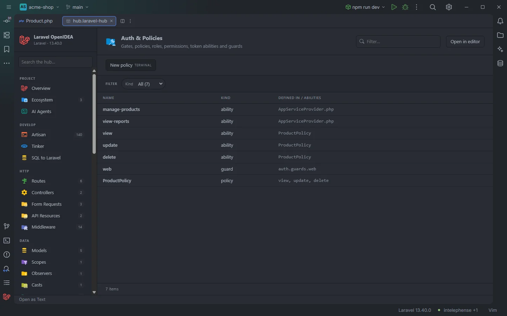

# Auth & Policies

The **Auth & Policies** section puts the authorization vocabulary of the project in one table: gate abilities, policy abilities, Spatie roles and permissions, Sanctum token abilities, auth guards and the policy classes with their methods. These are the names that `can()`, `@can`, `authorize()`, `can:` middleware and `hasRole()` accept.

Two gates, a policy and its abilities, and the web guard in the acme-shop demo

## How to use it

Open the hub and pick **Auth & Policies** in the **Configure** group of the sidebar. The badge counts the abilities.

- Click a row to open the `Gate::define()` call, the policy method, the role or permission, or the config key.
- Use **Kind** to list only abilities, roles, permissions, token abilities, guards or policies.
- Type in **Filter…** to find an ability or the policy that defines it.

Search, filters, sorting and paging are described in [The hub](Hub.md).

## What you see

| Column | Content |
| --- | --- |
| **Name** | The ability, role, permission, guard or policy class. |
| **Kind** | `ability`, `role`, `permission`, `token ability`, `guard` or `policy`. |
| **Defined in / abilities** | For a gate ability, the file that defines it; for a policy ability, the policy class; for roles, permissions and token abilities, the file they were found in; for a guard, its config key; for a policy row, its abilities. |

| Kind | Source |
| --- | --- |
| `ability` | The first argument of `Gate::define('…')` in `app/**/*.php`, then the public methods of classes under an `app/**/Policies/` folder, except `before`, `after` and `__construct`. Each name is listed once: when two policies both have `update`, the first one found is shown. |
| `role`, `permission` | Spatie Permission: `Role::create(['name' => '…'])`, `firstOrCreate`, `updateOrCreate` and `findOrCreate('…')`, and the same on `Permission`, in `database/seeders/`, `database/migrations/` and `app/`, in files that mention `Permission\`. |
| `token ability` | The abilities array of `createToken('name', ['…'])` in `app/` and `routes/` (Sanctum). |
| `guard` | Keys of `auth.guards` in `config/auth.php`, plus `sanctum` when the project requires `laravel/sanctum`. |
| `policy` | Every policy class (in a `/Policies/` folder, or named `…Policy`), with its public methods except those starting with `__`. `before` and `after` are included here. |

Rows are grouped in that order: abilities, roles, permissions, token abilities, guards, policies.

### Filters

| Filter | Values |
| --- | --- |
| **Kind** | Each kind, with its count. |

### Toolbar buttons

| Button | Runs | Where it runs |
| --- | --- | --- |
| **New policy** | `php artisan make:policy` | IDE terminal (*TERMINAL*) |

The button opens an IDE terminal tab titled `artisan make:policy`, where recent Laravel versions ask for the name and the model. In OpenIDEA 0.1.40 the tab closes when the command exits. See [The hub](Hub.md).

## Details

- **Data source:** the plugin's ability, role, permission, token ability and guard indexes (the ones the editor uses to complete these names), plus its scan of the project's classes for the policy rows. No PHP is run.
- Policies registered for models in `vendor/` packages, abilities defined with a variable name, and roles created from a loop over an array are not found, since only literal names are read.
- The ability index is rebuilt when a file under `app/` changes; roles and permissions when `app/` or `database/` changes; guards when `config/` changes.
- Each row opens its definition. The `sanctum` guard has no file and does not open.
- Empty state: *Nothing found in this project yet.*

## Settings and permissions

The table needs only the required permissions. **New policy** runs Artisan and needs `process:php` or `process:docker`. The `unknownAuthInspection` setting (*Report unknown middleware and abilities*, off by default) checks your code against the same abilities; see [Settings](Settings.md) and [Permissions](Permissions.md).

## Related

- [The hub](Hub.md)
- [Middleware, gates and policies in the editor](Middleware-Gates-and-Policies.md)
- [Unknown middleware and abilities](Inspection-Unknown-Middleware.md)
- [Packages](Packages.md): Sanctum and Spatie Permission
- [Drivers & Connections](Hub-Drivers-and-Connections.md)

---
[← Wiki home](Home.md)
