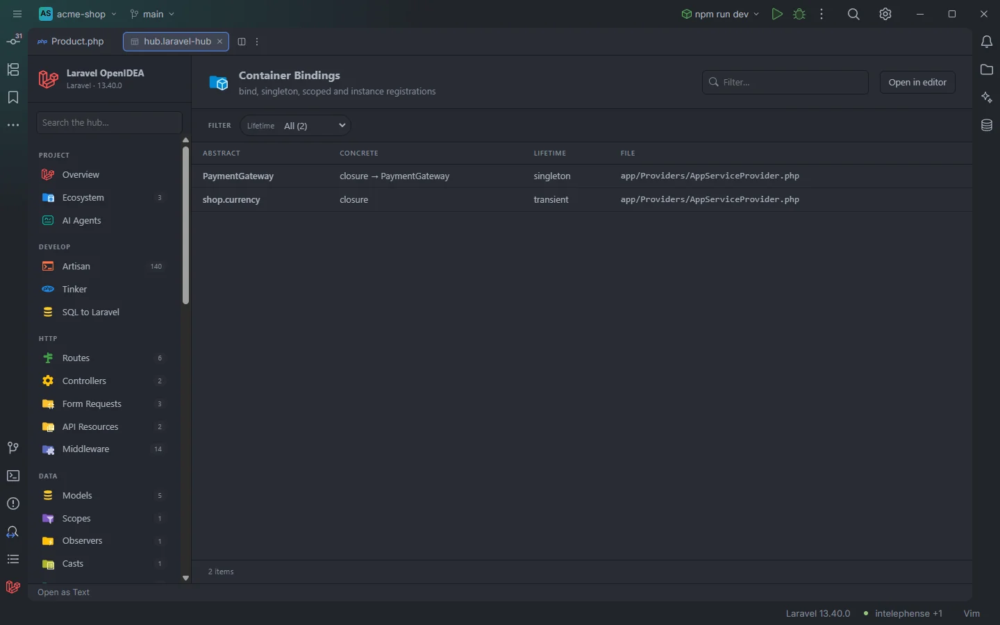

# Container Bindings

The **Container Bindings** section lists what the project registers in the service container: every `bind`, `singleton`, `scoped` and `instance` call, and the container attributes on classes, with the abstract, what it resolves to and its lifetime.

Bindings of the acme-shop demo

## How to use it

Open the hub and pick **Container Bindings** in the **App** group of the sidebar. The badge counts the bindings.

- Click a row to open the line that registers the binding.
- Use **Lifetime** to list only singletons, scoped bindings and so on.
- Type in **Filter…** to find an interface or class.

Search, filters, sorting and paging are described in [The hub](Hub.md).

## What you see

| Column | Content |
| --- | --- |
| **Abstract** | The first argument: a class name (`PaymentGateway`, from `PaymentGateway::class`) or the string id (`'cart'`). |
| **Concrete** | What the binding resolves to (see below). |
| **Lifetime** | `transient`, `singleton`, `scoped` or `instance`, with ` (if)` for the `…If` methods and ` (#[Attribute])` for attributes. |
| **File** | The file that registers it, relative to the project root. |

### Concrete

| Second argument | Shown as |
| --- | --- |
| None, `$this->app->singleton(Cart::class)` | `itself` |
| `Stripe::class` or `new Stripe` | `Stripe` |
| A closure that creates classes, `fn () => new StripeGateway(...)` | `closure → StripeGateway` (every class created or named with `::class` in the closure) |
| A closure with no class in it | `closure` |
| Anything else, `$gateway` | The argument as written |

### Lifetime

| Registration | Lifetime |
| --- | --- |
| `bind()`, `bindIf()` | `transient`, `transient (if)` |
| `singleton()`, `singletonIf()` | `singleton`, `singleton (if)` |
| `scoped()`, `scopedIf()` | `scoped`, `scoped (if)` |
| `instance()` | `instance` |
| `#[Bind(Concrete::class)]` on an interface or class | `transient (#[Bind])`, the abstract is the annotated type and the concrete the attribute argument |
| `#[Singleton]` on a class | `singleton (#[Singleton])`, the class binds itself |
| `#[Scoped]` on a class | `scoped (#[Scoped])`, the class binds itself |

### Filters

| Filter | Values |
| --- | --- |
| **Lifetime** | Each lifetime found. |

The section has no toolbar buttons.

## Details

- **Data source:** the plugin's scan of the project's PHP files (`app/`, `database/factories/`, `database/seeders/`, `routes/`, `bootstrap/app.php`, `bootstrap/providers.php`). Nothing is run.
- A call counts only when it is made on the container: `App::bind()`, `app()->bind()`, `$this->app->bind()`, `$app->bind()`, `Container::bind()` or `$container->bind()`. Calls on other objects that happen to be named `bind` are ignored.
- Contextual bindings (`when()->needs()->give()`), tagged services and bindings made by packages are not listed.
- Each row opens the file at the registering line (for attributes, the class declaration).
- Empty state: *Nothing found in this project yet.*

## Settings and permissions

Nothing beyond the plugin's required permissions. See [Permissions](Permissions.md).

## Related

- [The hub](Hub.md)
- [Service Providers](Hub-Providers.md): the **Bindings** count per provider
- [Helpers](Helpers.md): `app('…')` and `resolve('…')` completion of container ids
- [All Classes](Hub-Classes.md)

---
[← Wiki home](Home.md)
