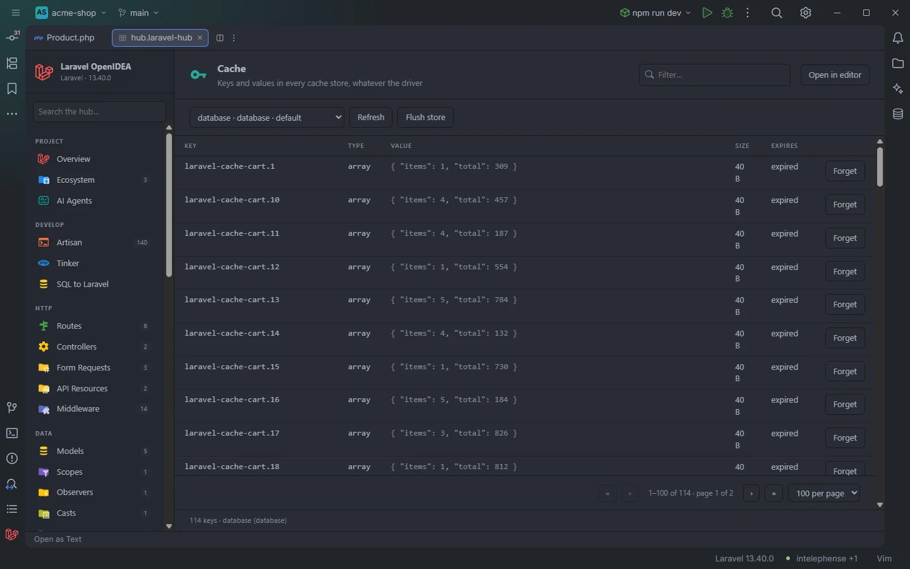
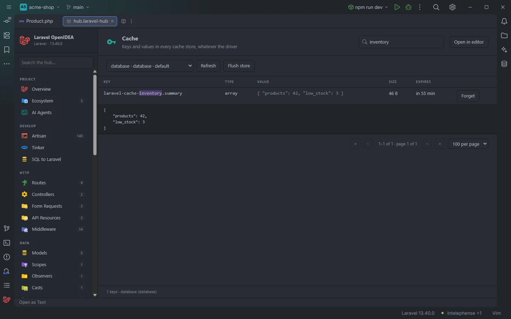

# Cache

The keys and values in your app's cache stores, page by page, with their type, size and expiry. Click a key to see its whole value, forget one key or flush a store. It works with the file, database and redis drivers.

The <code>database</code> store, 114 keys over two pages

## How to use it

1. Click **Cache** under **Data** in the sidebar, or open `storage/openidea/hub/cache.laravel-hub`.
2. Choose a store in the drop-down. It starts on the default store (`cache.default`).
3. Type in **Filter…** to search the keys. The search runs in the app 300 ms after you stop typing.
4. Click a row to show its whole value under it; click again to hide it.
5. **Forget** removes one key; **Flush store** empties the store after a second click.

Ctrl+click on a cache key in PHP code also gets you here: on the key of `Cache::get('cart.42')`, `cache('cart.42')` or `cache()->remember('cart.42', …)`, the plugin opens this section in an editor tab, searched for that key, with its value expanded.

One key, found by search, with its whole value

## What you see

### The toolbar

- The store drop-down, one entry per store in `config/cache.php`: `name · driver`, with ` · default` for the default store and ` · can't list` for drivers whose keys can't be listed.
- **Refresh** reads the store again; it reads **Loading…** while a request runs.
- **Flush store** turns into **Click again to flush database** for 4 seconds; a second click flushes it, otherwise it goes back.

### Columns

| Column | Content |
| --- | --- |
| Key | The key without the cache prefix, with the search highlighted |
| Type | The PHP type of the value: `array`, `int`, `string`, `bool`, `null`, a class name… |
| Value | The value as text: strings as they are, everything else as pretty JSON on one line, cut at 300 characters with `…` |
| Size | The stored size: `40 B`, `1.2 KB`, `3.4 MB` |
| Expires | `never`, `expired`, or `in 55 min`, `in 3 h`, `in 2 d`, `in 30 s` |
| | **Forget** |

Clicking a row adds a line under it with the whole value, pretty-printed (up to 360 px high, scrollable). A value longer than the preview is fetched when you open it (`Loading the whole value…`).

The pager is always there, with 100 keys per page by default; the count line reads `114 keys · database (database)`. Toasts confirm `Removed the key.` and `Flushed the database store.`

### Notes and empty states

- `The file store keeps only a hash of each key, so keys show as their hash unless you search for the whole key.`
- `The array store lives only for one request or command, so there is nothing to list.`
- `Listing keys isn't possible with the memcached driver.`, with the store's driver name, for any driver other than `file`, `database`, `redis` and `array`.
- `This store holds more keys than the hub reads at once: search to narrow it down.` when the store has more than 20,000 keys (file and redis).
- `This store is empty.`, `No key matches the search.`, `Reading the cache…`.
- When the app doesn't boot: `The app did not boot: …`. Other errors appear in a red box above the table.

## Details

Each request runs a small PHP script in the app with the project's runner: it boots the app (`vendor/autoload.php`, `bootstrap/app.php`, the console kernel), reads `config('cache.stores')` and works on the chosen store. The IDE shows the task **Reading the cache** meanwhile.

### Per driver

| Driver | Listing | Value | Expiry | Forget |
| --- | --- | --- | --- | --- |
| `database` | Rows of the store's table (`cache` by default) on its connection, ordered by key, paged in SQL; the search is a case-insensitive `LIKE` on the key | The `value` column | The `expiration` column | Deletes the row |
| `redis` | `SCAN` over the store's prefix (the client prefix plus the cache prefix), 1,000 at a time, up to 20,000 keys, sorted; the search is a case-insensitive substring | `GET` | `TTL` | `DEL` |
| `file` | Every file under the store's path (`storage/framework/cache/data`), up to 20,000, sorted | The file's content after its 10-character timestamp | That timestamp; `9999999999` means forever | Deletes the file |

The file store names its files after a SHA-1 hash of the key, so the original key can't be shown. Searching for the exact key computes its hash and shows that entry under its real name; any other search matches against the hashes.

### How values are shown

Stored values are decoded the way Laravel stores them: numbers stay numbers, serialized PHP is unserialized (also when it is base64-encoded) with objects not instantiated, so a serialized model or DTO shows as its properties with an `@class` entry instead of running any of its code. Strings are shown as they are, everything else as pretty JSON.

### Forget and flush

- **Forget** removes the key from the store directly (the row, the redis key or the file), then the list is read again.
- **Flush store** calls `Cache::store('<name>')->flush()`, which works for any driver, including those that can't be listed.

Both change the cache of the app the runner reaches: with a Compose runner, the container's.

### Paging

The page and page size travel to the script, which clamps the size between 10 and 500. Changing store, searching or changing page reads the store again.

## Settings and permissions

| Setting | Effect |
| --- | --- |
| `artisanRunner`, `dockerService` | Where the script runs, and so which cache it sees |

Reading the cache needs `process:php` (on Windows, `process:php-win` avoids a console window) or `process:docker`. The Ctrl+click from a cache key needs the hub's tab files in `storage/openidea/hub`, which the plugin writes when you focus an editor (see [The hub](Hub.md#the-laravel-hub-files)). See [Settings](Settings.md) and [Permissions](Permissions.md).

## Related

- [Drivers and connections](Drivers-and-Connections.md) (cache store names in `Cache::store('…')`)
- [Drivers & Connections in the hub](Hub-Drivers-and-Connections.md)
- [Go to definition](Go-to-Definition.md)
- [The hub](Hub.md)

---
[← Wiki home](Home.md)
