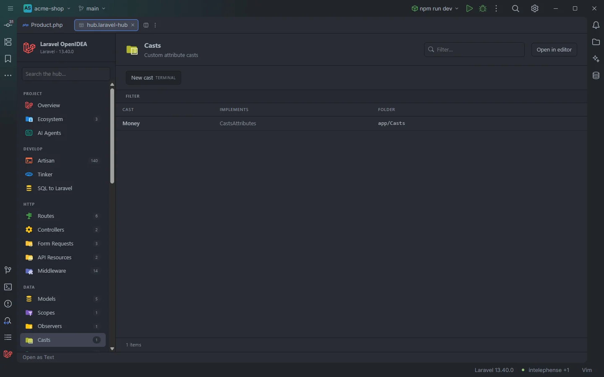

# Casts

The custom attribute casts of the app: the classes your models can use in `casts()` or `$casts`, with the cast interfaces they implement. A click opens the class.

A custom cast class

## How to use it

Click **Casts** under **Data** in the sidebar, or open `storage/openidea/hub/casts.laravel-hub`. Pick an **Implements** value to separate, for example, inbound-only casts from full ones.

## What you see

### Columns

| Column | Content |
| --- | --- |
| Cast | The class name |
| Implements | The interfaces the class declares, comma separated, or `—` |
| Folder | The folder of the file, such as `app/Casts` |

### Facets

**Implements** (split, one count per interface) and **Folder**.

### Actions

| Button | Command | Mode |
| --- | --- | --- |
| **New cast** | `make:cast` | Terminal |

## Details

- A class is a cast when it implements `CastsAttributes`, `CastsInboundAttributes`, `Castable` or `SerializesCastableAttributes`, or lives in a `/Casts/` folder, unless an earlier rule already gave it another role (a model, controller, middleware, form request, resource, provider, command, mailable, notification, listener, event, observer, policy, job or rule).
- Only the interfaces written on the class itself are shown, not inherited ones.
- Classes come from the plugin's token scan of `app/`, `database/factories/`, `database/seeders/`, `routes/` and the bootstrap files.
- Built-in casts (`datetime`, `encrypted`, `AsCollection`…) and enum casts aren't listed here; enums have their own section, [Enums](Hub-Enums.md), and a model's detail page in [Models](Hub-Models.md) shows its enum casts. For completion of cast values and arguments in the editor, see [Casts](Casts.md).
- With no cast class the section reads `Nothing found in this project yet.`

## Settings and permissions

The table needs only `project.read`. **New cast** needs `process:php` or `process:docker`. See [Permissions](Permissions.md).

## Related

- [Casts in the editor](Casts.md)
- [Enums](Hub-Enums.md)
- [Models](Hub-Models.md)
- [All Classes](Hub-Classes.md)
- [The hub](Hub.md)

---
[← Wiki home](Home.md)
