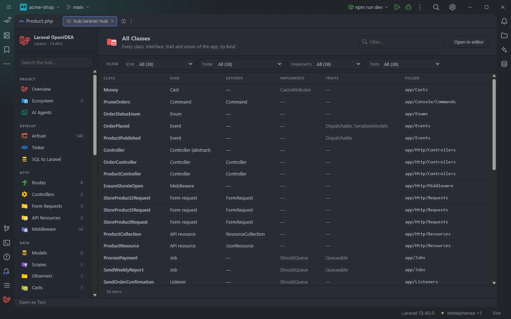

# All Classes

The **All Classes** section lists every class, interface, trait and enum the plugin finds in the project, each with the Laravel role it plays (model, controller, job, policy…), what it extends, implements and uses. It is a map of the codebase that you can slice by kind, folder, interface or trait.

Every class of the acme-shop demo, by kind

## How to use it

Open the hub and pick **All Classes** in the **App** group of the sidebar. The badge shows the number of classes, interfaces, traits and enums.

- Click a row to open the file at the class declaration.
- Use **Kind** to list only the jobs (or only the abstract controllers, which have their own `Controller (abstract)` value), **Folder** to list one directory, and **Implements** or **Traits** to find every class that implements `ShouldQueue` or uses `HasFactory`.
- Type in **Filter…** to search every column.

Search, filters, sorting and paging are described in [The hub](Hub.md).

## What you see

| Column | Content |
| --- | --- |
| **Class** | The short name. |
| **Kind** | The role, from the table below, followed by ` (abstract)` for abstract classes. |
| **Extends** | The parent class (short name), or `—`. |
| **Implements** | The interfaces, comma separated, or `—`. |
| **Traits** | The traits used in the class body, or `—`. |
| **Folder** | The directory of the file, `app/Models`. |

### Kinds

The kind is decided by the first rule that matches, in this order:

| Kind | Rule |
| --- | --- |
| `Trait`, `Interface`, `Enum` | The declaration keyword. |
| `Model` | Extends `Model`, `Authenticatable`, `Pivot`, `MorphPivot` or `User`, outside `/Http/`. |
| `Controller` | In `/Http/Controllers/`, or extends `Controller`. |
| `Middleware` | In `/Http/Middleware/`. |
| `Form request` | Extends `FormRequest`, or in `/Http/Requests/`. |
| `API resource` | Extends `JsonResource` or `ResourceCollection`, or in `/Http/Resources/`. |
| `Provider` | Extends `ServiceProvider`, `EventServiceProvider`, `AuthServiceProvider` or `RouteServiceProvider`. |
| `Command` | Extends `Command`, or in `/Console/Commands/`. |
| `Mailable`, `Notification` | Extends `Mailable` or `Notification`. |
| `Listener`, `Event` | In `/Listeners/` or `/Events/`. |
| `Observer` | In `/Observers/`, or the name ends in `Observer`. |
| `Policy` | In `/Policies/`, or the name ends in `Policy`. |
| `Job` | Implements `ShouldQueue`, or in `/Jobs/`. |
| `Rule` | Implements `ValidationRule`, `Rule`, `InvokableRule`, `DataAwareRule` or `ValidatorAwareRule`, or in `/Rules/`. |
| `Cast` | Implements `CastsAttributes`, `CastsInboundAttributes`, `Castable` or `SerializesCastableAttributes`, or in `/Casts/`. |
| `Scope` | Implements `Scope`, or in `/Scopes/`. |
| `Factory`, `Seeder` | Extends `Factory` / `Seeder`, or in `database/factories/` / `database/seeders/`. |
| `Blade component` | In `/View/Components/`, or extends `Component` outside `/Livewire/`. |
| `Livewire` | In `/Livewire/`. |
| `Exception` | Extends a class ending in `Exception`, or `Error`, or in `/Exceptions/`. |
| `Action`, `Service` | In `/Actions/` or `/Services/`. |
| `Data object` | In `/Data/` or a `/DTO…` folder, or extends `Data`. |
| `Channel` | In `/Broadcasting/`. |
| `Class` | Anything else. |

Names are compared without their namespace, so a class extending `\App\Support\Model` counts as a model too.

### Filters

| Filter | Values |
| --- | --- |
| **Kind** | Each kind, with ` (abstract)` variants. |
| **Folder** | Each directory. |
| **Implements** | Each interface; a class implementing several is counted under each. |
| **Traits** | Each trait; a class using several is counted under each. |

The section has no toolbar buttons.

## Details

- **Data source:** the plugin's scan of the project's PHP files, the same scan that feeds the other code sections of the hub (providers, bindings, rules, macros, events, listeners). It covers `app/`, `database/factories/`, `database/seeders/`, `routes/`, `bootstrap/app.php` and `bootstrap/providers.php` (Blade files excluded), up to 20,000 files per folder pattern. Classes in `vendor/`, `tests/`, `config/` and migrations are not listed.
- The scan reads source text; nothing is run and Composer's classmap is not needed, so a class shows up as soon as its file is saved.
- On a very large project the first visit can come before the scan has read every file; the scan continues in the background and the next visit lists the rest.
- Up to 20,000 rows are shown.
- Each row opens the file at the line of the class name.
- Empty state: *Nothing found in this project yet.*

## Settings and permissions

Nothing beyond the plugin's required permissions. See [Permissions](Permissions.md).

## Related

- [The hub](Hub.md)
- [Types and inheritance](Types-and-Inheritance.md)
- [Gutter usages](Gutter-Usages.md): where each class is used
- [Service Providers](Hub-Providers.md), [Validation Rules](Hub-Rules.md), [Events](Hub-Events.md), [Listeners](Hub-Listeners.md)

---
[← Wiki home](Home.md)
