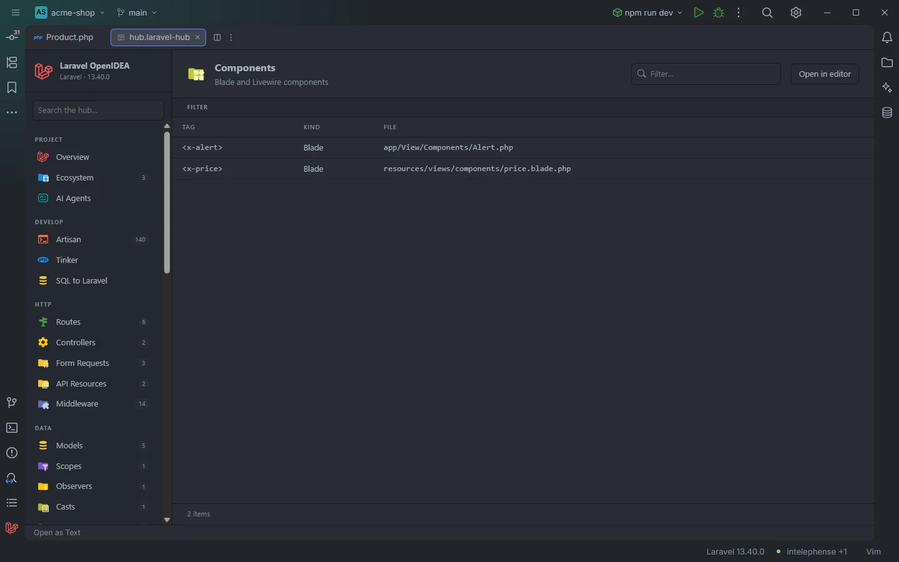

# Components

The **Components** section lists the Blade and Livewire components of the project as the tags you write in a template, `<x-alert>` or `<livewire:cart>`, each with the file that defines it.

A class component and an anonymous component in the acme-shop demo

## How to use it

Open the hub and pick **Components** in the **Views** group of the sidebar. The badge counts Blade and Livewire components together.

- Click a row to open the component's class or view.
- Type in **Filter…** to search tags and file paths.
- Use the **Kind** select to show only Blade or only Livewire components, and click a header to sort.

Search, filters, sorting and paging are described in [The hub](Hub.md).

## What you see

| Column | Content |
| --- | --- |
| **Tag** | `<x-name>` for a Blade component, `<livewire:name>` for a Livewire component. |
| **Kind** | `Blade` or `Livewire`. |
| **File** | The class or view that defines the component, relative to the project root. |

Blade components come first, then Livewire components, each sorted by name.

### Filters

| Filter | Values |
| --- | --- |
| **Kind** | `Blade`, `Livewire` (shown when both kinds exist). |

The section has no toolbar buttons.

## Details

**Data source:** the plugin's component indexes, the same ones that complete `<x-` and `<livewire:` in Blade. Nothing is run.

| Kind | Read from | Name |
| --- | --- | --- |
| Blade (class) | `app/View/Components/**/*.php` | Path in kebab case with `.` between folders: `Forms/TextInput.php` is `<x-forms.text-input>`. |
| Blade (anonymous) | `resources/views/components/**/*.blade.php` | Dotted path; a trailing `.index` is dropped, so `card/index.blade.php` is `<x-card>`. |
| Livewire (class) | `app/Livewire/**/*.php`, then `app/Http/Livewire/**/*.php` | Kebab case, dotted: `Cart/MiniCart.php` is `<livewire:cart.mini-cart>`. |
| Livewire (view) | `resources/views/livewire/**/*.blade.php` | Dotted path, `.index` dropped. |

- When a class and a view produce the same name (a class component and its view, for example), one row is listed, pointing at the class: the class folders are read first.
- Components registered by packages or under other paths (Flux, Filament, components registered with `Blade::component()` from a custom folder) are not indexed.
- Up to 5,000 files are read per source and the section shows at most 5,000 components of each kind.
- The indexes are rebuilt when files under `resources/views/components/`, `app/View/Components/`, `app/Livewire/`, `app/Http/Livewire/` or `resources/views/livewire/` change.
- Each row opens its file at line 1.
- Empty state: *Nothing found in this project yet.* when there are no components.

## Settings and permissions

Nothing beyond the plugin's required permissions. See [Permissions](Permissions.md).

## Related

- [The hub](Hub.md)
- [Blade](Blade.md): component tag completion, attributes and Ctrl+click
- [Go to Related Class or View](Related-Class-or-View.md)
- [Views](Hub-Views.md) and [Frontend](Hub-Frontend.md)
- [Packages](Packages.md): Livewire

---
[← Wiki home](Home.md)
