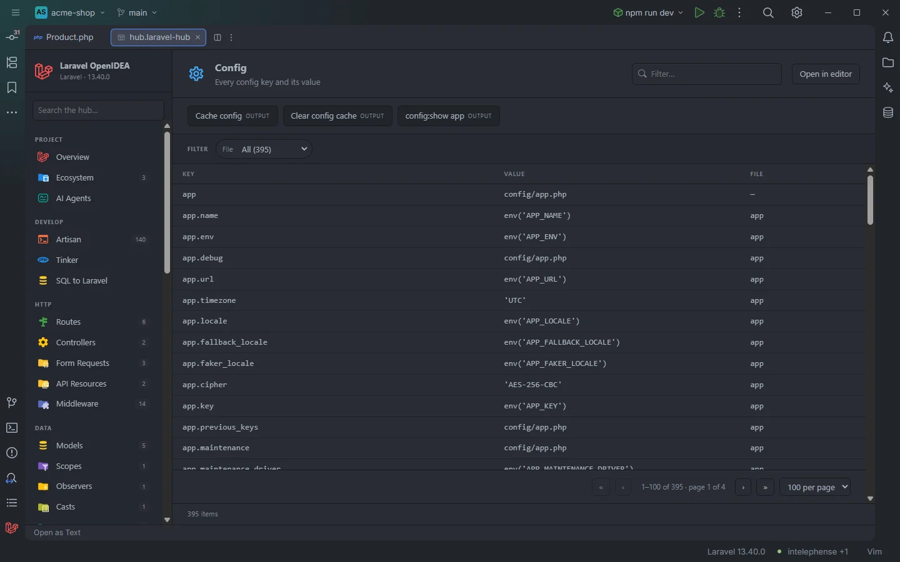

# Config

The **Config** section lists every key of the project's `config/` files, nested keys included, with the value written in the file. It answers "which config key is this?" and "where does it read its value from?" without opening each file.

395 keys of the acme-shop demo, with the config cache buttons

## How to use it

Open the hub and pick **Config** in the **Configure** group of the sidebar. The badge counts the keys.

- Click a row to open the config file at the key.
- Use **File** to see the keys of one file (`app`, `database`, `queue`…).
- Type in **Filter…** to search keys and values: `APP_URL` finds every key that reads that variable, `redis` every key that mentions it.

Search, filters, sorting and paging are described in [The hub](Hub.md).

## What you see

| Column | Content |
| --- | --- |
| **Key** | The dotted key as used in `config()`: `app.name`, `database.connections.sqlite.database`. The first row of each file is the file itself (`app`). |
| **Value** | The value as written in the file (see below). |
| **File** | The config file the key belongs to, without `.php`: `app`, `services`. The row of the file itself shows `—`. |

### Value

The file is read as source, not executed, so the column shows what the file says, not what the running app resolves:

| Written in the file | Shown |
| --- | --- |
| A string, `'timezone' => 'UTC'` | `'UTC'` |
| A number, `'lifetime' => 120` | `120` |
| A bare identifier, `true`, `false`, `null` or a constant | the identifier |
| `env('APP_NAME', 'Laravel')` | `env('APP_NAME')` (the default is left out) |
| A nested array | the file path, `config/app.php`; its keys have their own rows |
| Anything else, such as a cast (`(bool) env(…)`) or a function call (`storage_path(…)`) | the file path |

A value that starts with a literal shows only that literal: `'prefix' => 'shop_'.env('APP_ENV')` shows `'shop_'`.

Rows follow the order of the keys in each file.

### Filters

| Filter | Values |
| --- | --- |
| **File** | Each config file, with its number of keys. |

### Toolbar buttons

| Button | Runs | Where the output goes |
| --- | --- | --- |
| **Cache config** | `php artisan config:cache` | Output drawer (*OUTPUT*) |
| **Clear config cache** | `php artisan config:clear` | Output drawer (*OUTPUT*) |
| **config:show app** | `php artisan config:show app` | Output drawer (*OUTPUT*) |

`config:show app` prints the resolved values of `config/app.php` from the running app, the counterpart of the static values in the table. To see another file, run `config:show <file>` from the [Artisan](Hub-Artisan.md) section. The drawer is described in [The hub](Hub.md).

## Details

- **Data source:** the plugin's config index, the one behind `config('…')` completion. It reads `config/**/*.php` (up to 2,000 files); a file in a sub-folder is dotted, so `config/services/mail.php` gives `services.mail.*`. No PHP is run to build the table.
- Config that packages merge in without a published file is not listed, because only the project's files are read.
- The index is rebuilt when a file under `config/` changes.
- Up to 5,000 keys are shown.
- Each row opens the file at the key (the row of a file opens it at line 1).
- Empty state: *Nothing found in this project yet.*

## Settings and permissions

The table needs only the required permissions. The three buttons run Artisan and need `process:php` or `process:docker`. See [Settings](Settings.md) and [Permissions](Permissions.md).

## Related

- [The hub](Hub.md)
- [Config keys in the editor](Config-Keys.md)
- [Environment](Hub-Environment.md)
- [Drivers & Connections](Hub-Drivers-and-Connections.md): the connections, stores and disks defined in config
- [`env()` outside config](Inspection-Env-Outside-Config.md)

---
[← Wiki home](Home.md)
