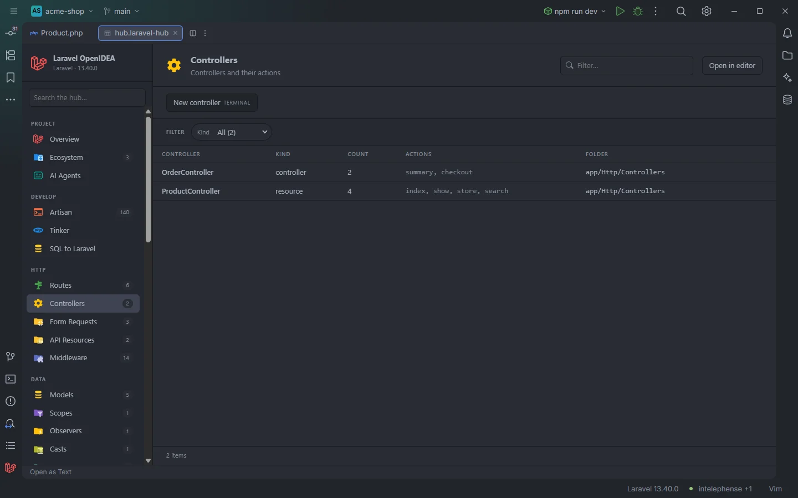

# Controllers

Every controller of the app with its kind (invokable, resource or plain), how many public actions it has and their names. A click opens the class.

Two controllers of the demo shop

## How to use it

Click **Controllers** under **HTTP** in the sidebar, or open `storage/openidea/hub/controllers.laravel-hub`. Type an action name in **Filter…** (`destroy`, `__invoke`) to find the controllers that have it, or pick a **Kind** or **Folder**.

## What you see

### Columns

| Column | Content |
| --- | --- |
| Controller | The class name |
| Kind | `invokable` when the class has `__invoke`; `resource` when it has at least three of `index`, `store`, `show`, `update` and `destroy`; `controller` otherwise |
| Count | The number of actions |
| Actions | The actions, in the order they are declared |
| Folder | The folder of the file, such as `app/Http/Controllers/Admin` |

An action is a public method whose name doesn't start with `__` and isn't `middleware`. Methods without a visibility keyword count as public.

### Facets

**Kind** and **Folder**.

### Actions

| Button | Command | Mode |
| --- | --- | --- |
| **New controller** | `make:controller` | Terminal |

The command runs without a name, so Artisan asks for it (and for the controller type) in the terminal.

## Details

- A class is a controller when its file is under a `/Http/Controllers/` folder or it extends `Controller`. Abstract classes and the base class named `Controller` are left out.
- Classes come from the plugin's reading of the PHP files under `app/`, `database/factories/`, `database/seeders/` and `routes/`, plus `bootstrap/app.php` and `bootstrap/providers.php`. It is a token scan, not PHP: nothing runs, and a file with a syntax error is still read as far as possible.
- The scan follows every save and change on disk. On a large project the first visit may show part of the classes; reading continues on later visits and while you work.
- A click opens the file at the class name.
- To go from a route to its controller method, use [Routes](Hub-Routes.md); the controller's own gutter icons are described in [Gutter markers](Gutter-Markers.md).
- With no controller the section reads `Nothing found in this project yet.`

## Settings and permissions

The table needs only `project.read`. **New controller** needs `process:php` or `process:docker`. See [Permissions](Permissions.md).

## Related

- [Routes](Hub-Routes.md)
- [Form Requests](Hub-Form-Requests.md)
- [All Classes](Hub-Classes.md)
- [Gutter markers](Gutter-Markers.md)
- [Gutter usages](Gutter-Usages.md)
- [The hub](Hub.md)

---
[← Wiki home](Home.md)
