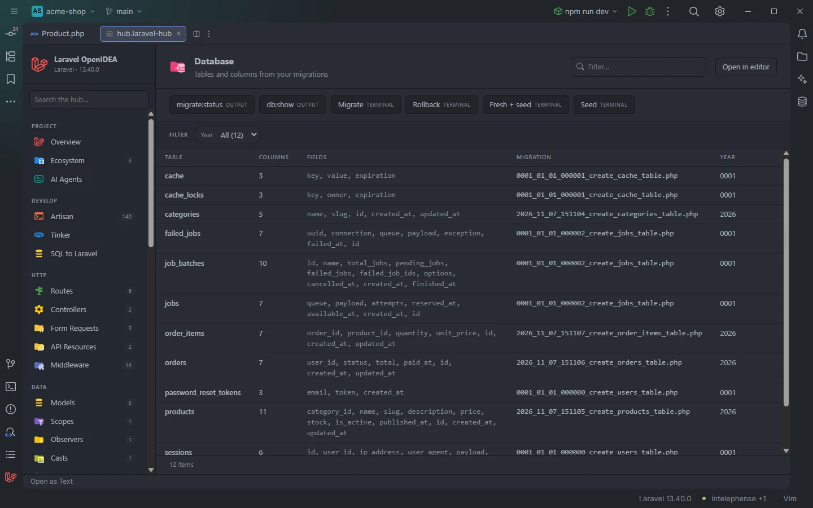
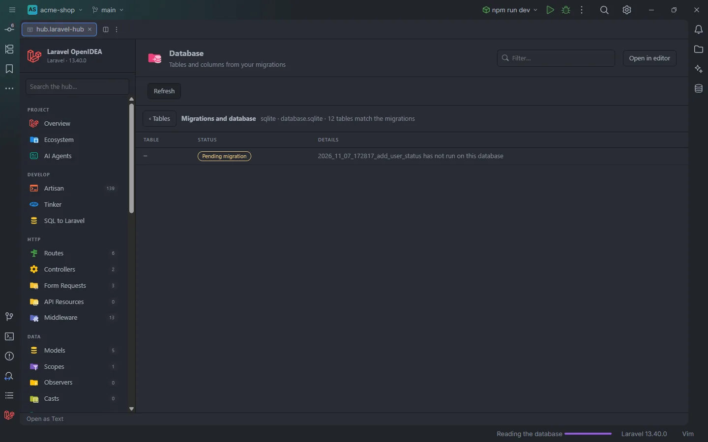
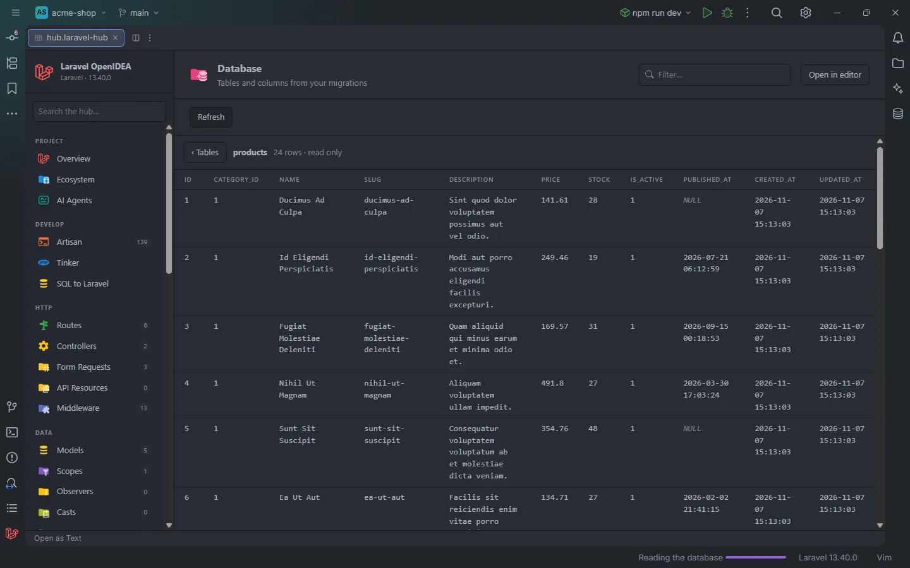

# Database

Every table your migrations create, with its columns, indexes, foreign keys, the migration that creates it and the year of that migration, plus buttons for `migrate`, `migrate:status`, `db:show` and seeding. **Compare with database** shows where the live database and the migrations disagree, and **Rows** shows the first rows of a table, read only, with secrets and personal data masked. A click opens the `Schema::create` call.

Tables, columns, indexes and foreign keys read from the migrations

## How to use it

Click **Database** under **Data** in the sidebar, the **Tables** card on Overview, or open `storage/openidea/hub/database.laravel-hub`. Type a column name in **Filter…** (`user_id`) to see every table that has it, or pick a **Year** to see what a period of migrations created.

## What you see

### Columns

| Column | Content |
| --- | --- |
| Table | The table name |
| Columns | How many columns were found |
| Fields | The columns, comma separated, in the order the migrations add them |
| Indexes | The indexes other than the primary key: `email (unique)`, `status+email (index)`, `body (fulltext)` |
| Foreign keys | `user_id → users.id`, one per foreign key |
| Migration | The file name of the migration that creates the table |
| Year | The first four characters of that file name when they are digits (`2026`), else `—`. Laravel's own stub migrations (`0001_01_01_…`) read `0001` |

### Facets

**Year**.

### Actions

| Button | Command | Mode |
| --- | --- | --- |
| **migrate:status** | `migrate:status` | Output |
| **db:show** | `db:show` | Output |
| **Migrate** | `migrate` | Terminal |
| **Rollback** | `migrate:rollback` | Terminal |
| **Fresh + seed** | `migrate:fresh --seed` | Terminal |
| **Seed** | `db:seed` | Terminal |

The terminal ones run where Artisan can ask its questions, such as the confirmation it asks before migrating in production. **Fresh + seed** drops every table before migrating and seeding.

**Compare with database** comes first in the bar, and each row has a **Rows** link next to **Open ›**.

### Compare with database

**Compare with database** boots the app, reads the default connection and lists what doesn't match, with **‹ Tables** to go back and **Refresh** to read again:

| Status | Meaning |
| --- | --- |
| **Pending migration** | A migration file that hasn't run on this database (it isn't in the `migrations` table) |
| **Only in migrations** | A migration creates the table but the database doesn't have it, usually because a migration is pending |
| **Differs** | The table is in both, with `Missing columns: …` (in the migrations, not in the database), `Columns only in the database: …` and `Missing indexes: …` (an index of the migrations, other than the primary key, that the database doesn't have with the same columns) |
| **Only in the database** | A table no migration of the app creates, often from a package's own migrations or raw SQL. Laravel's `migrations` table and SQLite's `sqlite_sequence` are left out |

Everything matches except one migration that hasn't run

The header names the connection, the driver and the database file or name, and how many tables match. Tables that match aren't listed. A row of a table the migrations create opens that migration.

The database is read with `Schema::getTables()`, `getColumns()` and `getIndexes()` where the installed Laravel has them (10.x and newer). On older versions the table list comes from the driver (`SHOW TABLES`, `sqlite_master`, `pg_tables`, `sys.tables`) and the columns from `getColumnListing()`, without indexes, so **Missing indexes** isn't reported there.

### Rows

The rows of <code>products</code>, read only

**Rows** on a table shows its rows 50 or 100 at a time (at most 200 per page), with paging, the total count and **Refresh**. It only reads: the query is `select *` with `limit` and `offset` on the default connection, and the table name must be one the database lists.

Values are masked as `•••` when a word of the column name is a secret or personal data word, with the same rules as [Live Audit](Hub-Live-Audit.md#masking): `password`, `remember_token`, `api_key`, `email`, `email_verified_at`, `phone`, `cpf`, `address`, `ip_address`… The header lists the masked columns. `OPENIDEA_AUDIT_SHOW_PII=true` in `.env` shows personal data, never secrets. Text longer than 300 characters is cut, binary values show their size, and `NULL` is shown as such.

## Details

### Where the tables come from

The plugin reads every PHP file under `database/migrations/` (up to 10,000), in file name order, without running them:

- A **table** is the first argument of `Schema::create('…')`. When two migrations create the same table, the first one wins. Tables are sorted by name.
- **Columns** come from every migration, `Schema::create` and `Schema::table` alike, in file order: each `$table->type('name')` call with one of the Blueprint column types (`string`, `integer`, `foreignId`, `foreignIdFor`, `json`, `enum`, `uuid`, `ulid`, `timestamp`, `decimal`, `boolean`, `text` and the rest of the 62 types the plugin knows), then the columns implied by `id()` (`id`), `timestamps()`, `timestampsTz()` and `nullableTimestamps()` (`created_at`, `updated_at`), `softDeletes()` and `softDeletesTz()` (`deleted_at`) and `rememberToken()` (`remember_token`). `morphs('commentable')` and its nullable, UUID and ULID variants give `commentable_id` and `commentable_type`.
- A column is listed once per table even when several migrations add it, in the order the migrations add it.
- Later migrations are followed: `dropColumn('a')`, `dropColumn(['a', 'b'])`, `dropConstrainedForeignId('user_id')`, `dropMorphs('x')`, `dropTimestamps()`, `dropSoftDeletes()` and `dropRememberToken()` remove columns, `renameColumn('a', 'b')` renames one, `Schema::drop()` and `Schema::dropIfExists()` remove a table and `Schema::rename('a', 'b')` renames it. A table created again after being dropped opens its new migration.
- Only the `up()` method counts: the `Schema::dropIfExists()` and `dropColumn()` calls of `down()` are ignored.
- **Indexes** come from `->index()`, `->unique()`, `->primary()`, `->fullText()` and `->spatialIndex()` after a column, from `$table->index('a')`, `$table->index(['a', 'b'])` and the other table methods, from `id()` and the `increments` types (primary), and from the `morphs` types (an index on `x_type` and `x_id`). A dropped or renamed column takes its indexes with it.
- **Foreign keys** come from `foreignId('user_id')->constrained()` (the table is the plural of the name without `_id`, `users`), `constrained('authors')`, and `foreign('user_id')->references('id')->on('users')`.

### What it doesn't read

The table itself doesn't query the live database: tables created outside migrations, by raw SQL or by a package's own migrations under `vendor/` aren't listed, and pending migrations are listed as if they had run. **Compare with database**, **migrate:status** and **db:show** show the database's own view. Columns and indexes added by raw SQL (`DB::statement(…)`) aren't followed.

### Opening and freshness

A click opens the migration at the table name in `Schema::create`. The tables and columns are rebuilt after a change under `database/migrations/` or `app/Models/`. They are the same columns the plugin completes in `where('…')` and checks with the unknown column inspection.

With no migration the section reads `Nothing found in this project yet.`

## Settings and permissions

The table needs only `project.read`. The buttons, **Compare with database** and **Rows** run with the project's runner and need `process:php` or `process:docker`; with a Compose runner they run in the container, against the database it sees. **Compare with database** and **Rows** run `php/schema.php`, which boots the app. See [Settings](Settings.md) and [Permissions](Permissions.md).

## Related

- [Schema diagram](Hub-Schema-Diagram.md)
- [Live Audit](Hub-Live-Audit.md) (missing index insights)
- [Models](Hub-Models.md)
- [Eloquent columns and relations](Eloquent-Columns-and-Relations.md)
- [Unknown columns](Inspection-Unknown-Columns.md)
- [Factories & Seeders](Hub-Factories.md)
- [AI agents and MCP](AI-Agents.md) (`database_schema` reads the live connection)
- [The hub](Hub.md)

---
[← Wiki home](Home.md)
