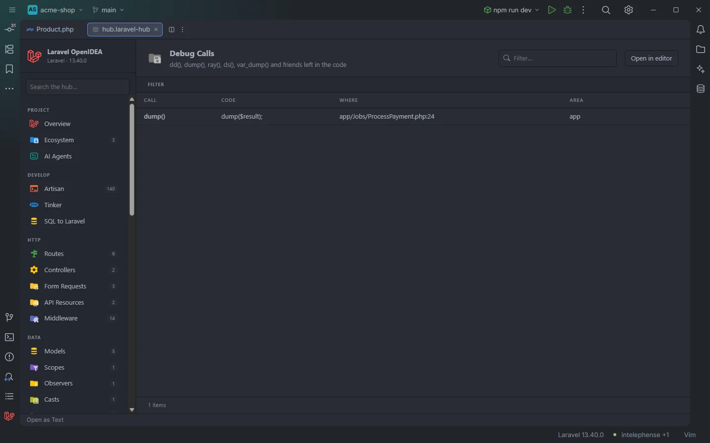

# Debug Calls

The **Debug Calls** section finds the debugging calls left in the code: `dd()`, `dump()`, `ray()`, `ds()`, `var_dump()`, `print_r()` and the rest, plus the Blade `@dd` and `@dump` directives. Check it before a commit or a release so nothing dumps in production.

A dump() left in a job of the acme-shop demo

## How to use it

Open the hub and pick **Debug Calls** in the **Observe** group of the sidebar.

- Click a row to open the file at the call.
- Use **Call** to see one function and **Area** to see one part of the project.
- Type in **Filter…** to search calls, code and paths.

Search, filters, sorting and paging are described in [The hub](Hub.md).

## What you see

| Column | Content |
| --- | --- |
| **Call** | `dd()`, `dump()`, `->dump()` for a method call, or `@dump` for a Blade directive. Names are lowercased. |
| **Code** | The trimmed source line, cut at 140 characters. |
| **Where** | `path:line`, relative to the project root. |
| **Area** | `view` (Blade files), `routes`, `database`, `config` or `app`. |

Rows are sorted by file path, then by position in the file.

### What is reported

| Kind | Calls |
| --- | --- |
| Function calls | `dd`, `dump`, `ddd`, `ray`, `rd`, `ds`, `dsd`, `dsq`, `dsr`, `var_dump`, `print_r`, `var_export`, `clock`, `debug`, `error_log`, `dump_server`, with or without a leading `\` |
| Method calls | `->dd()`, `->dump()`, `->ddd()`, `->ray()` (on collections, query builders, requests…) |
| Blade directives | `@dd(`, `@dump(`, `@ray(`, `@ds(` |

Not reported:

- Static calls such as `Log::debug()` or `Debugbar::debug()`, and calls through `@` (error suppression) on a PHP line.
- Function and method declarations (`function dump()`).
- Other method calls with these names, such as `->debug()` or `->print_r()`.
- `debug()` as a plain function, unless the file mentions `Debugbar` (the Debugbar helper).
- Calls inside comments and strings of PHP code.

### Filters

| Filter | Values |
| --- | --- |
| **Call** | Each call found, with its count. |
| **Area** | Each area. |

The section has no toolbar buttons.

## Details

- **Data source:** every `*.php` file under `app/`, `routes/`, `resources/views/`, `database/` and `config/` (up to 20,000 per folder), read each time the section opens. Files that contain none of the names are skipped quickly. No PHP is run.
- Blade directives are found line by line in `.blade.php` files, so a directive inside a `{{-- --}}` comment is reported too.
- `tests/` and `vendor/` are not searched.
- Each row opens the file at the line of the call.
- Empty state: *Nothing found in this project yet.* when the code is clean.

## Settings and permissions

Nothing beyond the plugin's required permissions. See [Permissions](Permissions.md).

## Related

- [The hub](Hub.md)
- [Debug Tools](Hub-Debug-Tools.md): Ray, LaraDumps, the dump server and the rest of the toolbox
- [Live Audit](Hub-Live-Audit.md): `dump()` output captured at runtime
- [Tinker](Hub-Tinker.md)

---
[← Wiki home](Home.md)
