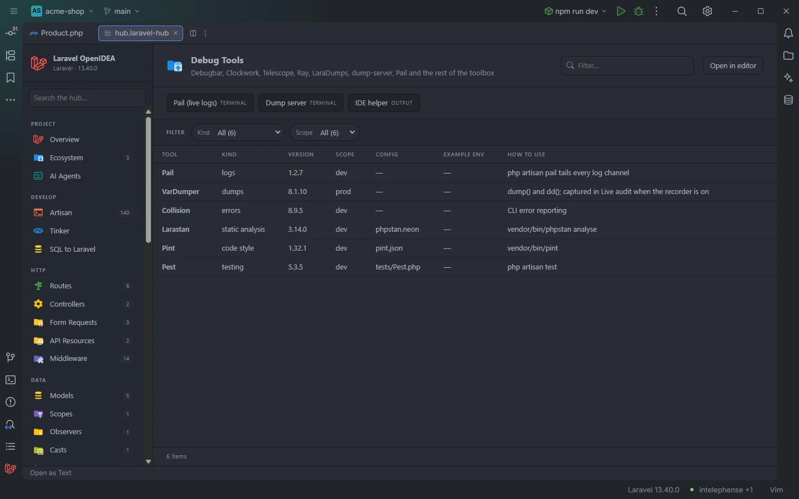

# Debug Tools

The **Debug Tools** section lists the debugging, profiling, logging, code quality and testing packages installed in the project, with their version, whether they are dev dependencies, their config file, the `.env` switch that controls them and a one-line reminder of how to use them.

The toolbox of the acme-shop demo

## How to use it

Open the hub and pick **Debug Tools** in the **Observe** group of the sidebar.

- Click a row that has a config file to open it.
- Use **Kind** and **Scope** to narrow the list.
- Use the toolbar to start Pail or the dump server, or to generate IDE helper files.

Search, filters, sorting and paging are described in [The hub](Hub.md).

## What you see

| Column | Content |
| --- | --- |
| **Tool** | The tool's name. |
| **Kind** | `profiler`, `monitoring`, `queues`, `logs`, `dumps`, `errors`, `tooling`, `static analysis`, `code style`, `refactoring`, `AI` or `testing`. |
| **Version** | The installed version from `composer.lock` (without a leading `v`), or `required` when the package is in `composer.json` but not in the lock file. |
| **Scope** | `dev` when the package is listed under `require-dev` in `composer.json`, `prod` otherwise (including packages that are only installed as a dependency of another one). |
| **Config** | The tool's config file when it exists in the project, or `—`. |
| **Example env** | The tool's switch from `.env.example`, `TELESCOPE_ENABLED=true`, when the file has it, or `—`. |
| **How to use** | A short hint. |

### Tools that are recognised

| Tool | Package | Kind | Config | How to use |
| --- | --- | --- | --- | --- |
| Debugbar | `barryvdh/laravel-debugbar` or `fruitcake/laravel-debugbar` | profiler | `config/debugbar.php` | `DEBUGBAR_ENABLED`; stored requests in `storage/debugbar` are listed in [Profiles](Hub-Profiles.md) |
| Clockwork | `itsgoingd/clockwork` | profiler | `config/clockwork.php` | `CLOCKWORK_ENABLE`; requests in `storage/clockwork` are listed in Profiles; UI at `/clockwork` |
| Telescope | `laravel/telescope` | profiler | `config/telescope.php` | `TELESCOPE_ENABLED`; UI at `/telescope` |
| Pulse | `laravel/pulse` | monitoring | `config/pulse.php` | Dashboard at `/pulse` |
| Horizon | `laravel/horizon` | queues | `config/horizon.php` | Dashboard at `/horizon`; run with `php artisan horizon` |
| Pail | `laravel/pail` | logs | — | `php artisan pail` tails every log channel |
| Ray | `spatie/laravel-ray` | dumps | `ray.php` | `ray()` sends to the Ray app; `RAY_ENABLED`, `RAY_HOST` for Docker |
| LaraDumps | `laradumps/laradumps` | dumps | `laradumps.yaml` | `ds()` sends to the LaraDumps app; `ds:init` configures it |
| Dump Server | `beyondcode/laravel-dump-server` | dumps | `config/debug-server.php` | `php artisan dump-server` collects `dump()` output |
| VarDumper | `symfony/var-dumper` | dumps | — | `dump()` and `dd()`; captured in Live audit when the recorder is on |
| Ignition | `spatie/laravel-ignition` | errors | `config/ignition.php` | Error pages with solutions |
| Collision | `nunomaduro/collision` | errors | — | CLI error reporting |
| IDE Helper | `barryvdh/laravel-ide-helper` | tooling | `config/ide-helper.php` | `ide-helper:generate`, `ide-helper:models`, `ide-helper:meta` |
| Larastan | `larastan/larastan` or `nunomaduro/larastan` | static analysis | `phpstan.neon` | `vendor/bin/phpstan analyse` |
| Pint | `laravel/pint` | code style | `pint.json` | `vendor/bin/pint` |
| Rector | `rector/rector` | refactoring | `rector.php` | `vendor/bin/rector` |
| Laravel Boost | `laravel/boost` | AI | `boost.json` | MCP server and AI guidelines: `php artisan boost:install` |
| Pest | `pestphp/pest` | testing | `tests/Pest.php` | `php artisan test` |
| Dusk | `laravel/dusk` | testing | — | `php artisan dusk` |

A tool is listed when its package is in `composer.lock` or named in `composer.json`, in the order of this table.

### Filters

| Filter | Values |
| --- | --- |
| **Kind** | Each kind present. |
| **Scope** | `dev`, `prod`. |

### Toolbar buttons

| Button | Runs | Where |
| --- | --- | --- |
| **Pail (live logs)** | `php artisan pail` | Terminal |
| **Dump server** | `php artisan dump-server` | Terminal |
| **IDE helper** | `php artisan ide-helper:generate` | Output drawer |

The buttons are always shown; when the package behind one is not installed, Artisan reports that the command is not defined. Pail and the dump server keep running in their terminal tab until you stop them. See [The hub](Hub.md) for terminal tabs and the drawer.

## Details

- **Data source:** `composer.lock`, `composer.json`, `.env.example` and the config files listed above, read each time the section opens. No PHP is run.
- **Example env** uses the first upper-case name with an underscore in the hint (`DEBUGBAR_ENABLED`, `CLOCKWORK_ENABLE`, `TELESCOPE_ENABLED`, `RAY_ENABLED`) and shows its line from `.env.example`. Your `.env` is never read here.
- **Scope** is a text check: the package name must appear after `"require-dev"` in `composer.json`.
- Rows open the config file at line 1; rows without a config file don't open.
- Empty state: *Nothing found in this project yet.* when none of these packages is installed.

## Settings and permissions

The table needs only the required permissions. The buttons run Artisan and need `process:php` or `process:docker`. See [Settings](Settings.md) and [Permissions](Permissions.md).

## Related

- [The hub](Hub.md)
- [Profiles](Hub-Profiles.md), [Debug Calls](Hub-Debug-Calls.md), [Logs](Hub-Logs.md), [Live Audit](Hub-Live-Audit.md)
- [Ecosystem](Hub-Ecosystem.md): first-party and popular packages
- [Tools on save](Tools-on-Save.md): Pint, PHP CS Fixer and PHPStan
- [IDE helpers](IDE-Helpers.md): the plugin's own `auth()` stub

---
[← Wiki home](Home.md)
