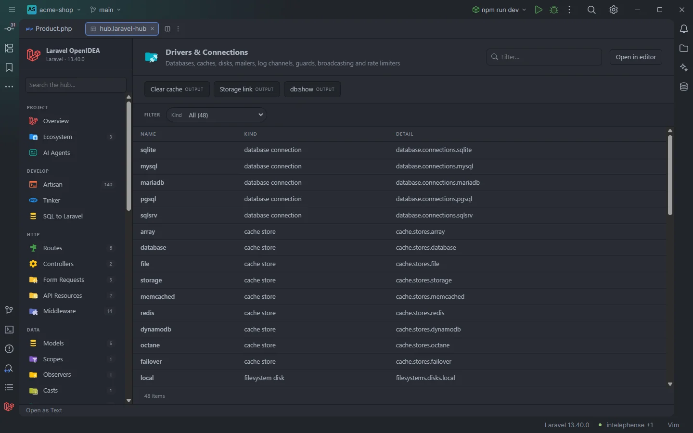

# Drivers & Connections

The **Drivers & Connections** section lists every named connection, store and driver the project defines: database connections, cache stores, filesystem disks, queue connections, mailers, log channels, auth guards, password brokers, broadcasters, broadcast channels and rate limiters. These are the names you pass to `DB::connection()`, `Cache::store()`, `Storage::disk()` and friends.

48 connections, stores and drivers of the acme-shop demo

## How to use it

Open the hub and pick **Drivers & Connections** in the **Configure** group of the sidebar.

- Click a row to open the config file at the connection, or the line that registers a channel or rate limiter.
- Use **Kind** to list one kind, say only the disks.
- Type in **Filter…** to find a name.

Search, filters, sorting and paging are described in [The hub](Hub.md).

## What you see

| Column | Content |
| --- | --- |
| **Name** | The name you use in code: `sqlite`, `redis`, `local`, `web`. |
| **Kind** | What it is (see below). |
| **Detail** | Where it is defined: the config key, or the file of a channel or rate limiter. |

| Kind | Source | Detail |
| --- | --- | --- |
| `database connection` | Keys of `database.connections` | `database.connections.sqlite` |
| `cache store` | Keys of `cache.stores` | `cache.stores.redis` |
| `filesystem disk` | Keys of `filesystems.disks` | `filesystems.disks.local` |
| `queue connection` | Keys of `queue.connections` | `queue.connections.redis` |
| `mailer` | Keys of `mail.mailers` | `mail.mailers.smtp` |
| `log channel` | Keys of `logging.channels` | `logging.channels.daily` |
| `auth guard` | Keys of `auth.guards`, plus `sanctum` when `composer.json` requires `laravel/sanctum` and no guard has that name | `auth.guards.web`, or `Laravel Sanctum` |
| `password broker` | Keys of `auth.passwords` | `auth.passwords.users` |
| `broadcaster` | Keys of `broadcasting.connections` | `broadcasting.connections.reverb` |
| `broadcast channel` | `Broadcast::channel('…')` in `routes/**/*.php` | The file name, `channels.php` |
| `rate limiter` | `RateLimiter::for('…')` in `app/**/*.php` | The file name, `AppServiceProvider.php` |

Rows are grouped in the order of this table.

### Filters

| Filter | Values |
| --- | --- |
| **Kind** | Each kind, with its count. |

### Toolbar buttons

| Button | Runs | Where the output goes |
| --- | --- | --- |
| **Clear cache** | `php artisan cache:clear` | Output drawer (*OUTPUT*) |
| **Storage link** | `php artisan storage:link` | Output drawer (*OUTPUT*) |
| **db:show** | `php artisan db:show` | Output drawer (*OUTPUT*) |

`db:show` prints the default connection's database, version, size and tables. The drawer is described in [The hub](Hub.md). To browse the keys of a cache store, use the [Cache](Hub-Cache.md) section.

## Details

- **Data source:** the same indexes that complete connection, store, disk, channel, mailer, guard and rate limiter names in the editor. The config kinds are read from the project's own `config/*.php` files: only the direct children of each key are listed, so nested options are not rows. No PHP is run.
- A config file the project hasn't published (on Laravel 11 and later, `broadcasting.php` until `install:broadcasting`, for example) contributes nothing, because the framework's defaults in `vendor/` are not read.
- Broadcast channels and rate limiters are matched as static calls with a literal first argument; channel names with placeholders (`orders.{order}`) are listed as written. Each name is listed once.
- The config-based kinds are rebuilt when a file under `config/` changes, channels when `routes/` changes, rate limiters when `app/` changes.
- Each row opens its definition. The `sanctum` guard added for Sanctum has no file and does not open.
- Empty state: *Nothing found in this project yet.*

## Settings and permissions

The table needs only the required permissions. The three buttons run Artisan and need `process:php` or `process:docker`. See [Settings](Settings.md) and [Permissions](Permissions.md).

## Related

- [The hub](Hub.md)
- [Drivers and connections in the editor](Drivers-and-Connections.md)
- [Config](Hub-Config.md)
- [Queues & Workers](Hub-Queues.md), [Logs](Hub-Logs.md), [Cache](Hub-Cache.md)
- [Auth & Policies](Hub-Auth-and-Policies.md): guards next to gates and policies

---
[← Wiki home](Home.md)
