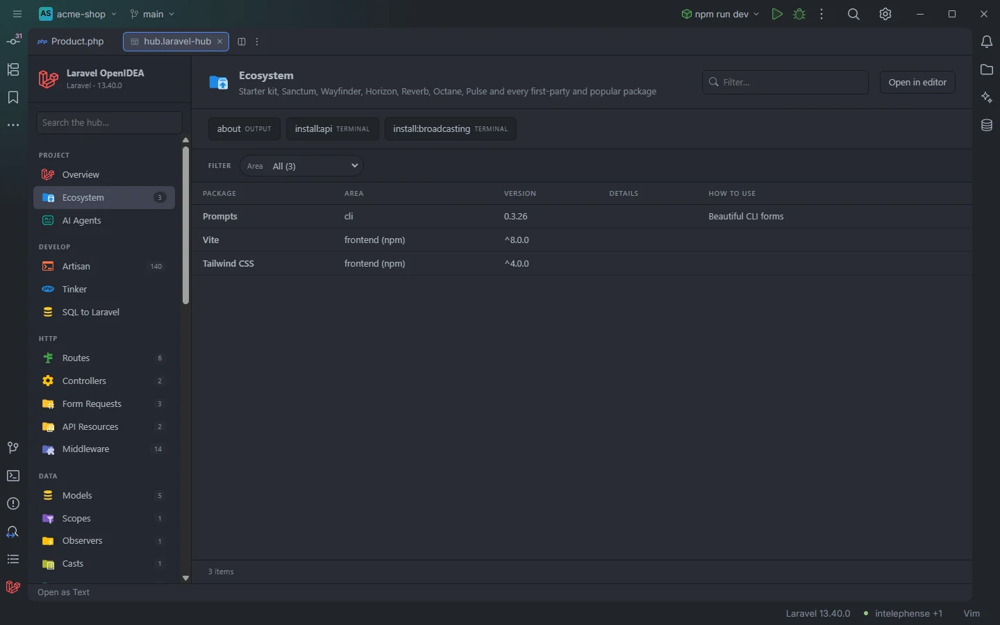

# Ecosystem

Which starter kit, first-party Laravel packages, popular community packages and front-end tools the project uses, with their installed version, a line of live details (token abilities, Horizon environments, Livewire components…) and how to use each one. The buttons above the table start the servers and generators that come with them.

Ecosystem of a project with Laravel Prompts, Vite and Tailwind CSS

## How to use it

Click **Ecosystem** under **Project** in the sidebar, or open `storage/openidea/hub/ecosystem.laravel-hub`. Use the **Filter…** box and the **Area** facet to narrow the list, and the buttons above the table to run the package commands.

## What you see

### Columns

| Column | Content |
| --- | --- |
| Package | The display name: `Sanctum`, `Horizon`, `Media Library`, `Vite`… |
| Area | `auth`, `frontend`, `queues`, `realtime`, `server`, `monitoring`, `search`, `billing`, `features`, `cli`, `AI`, `starter kit`, `admin`, `data`, `API docs` or `frontend (npm)` |
| Version | The version in `composer.lock` (without the leading `v`), `required` when the package is in `composer.json` but not in the lock file, the range from `package.json` for npm tools, `—` for the starter kit |
| Details | Live details for the packages listed below, empty for the rest |
| How to use | A short hint, often with the command to run |

Facet: **Area**.

### The starter kit row

When the project looks like one of Laravel's starter kits, the first row names it:

| Detected from | Row |
| --- | --- |
| `@inertiajs/react` in `package.json` | React starter kit (Inertia, TypeScript) |
| `@inertiajs/vue3` in `package.json` | Vue starter kit (Inertia, TypeScript) |
| `@inertiajs/svelte` in `package.json` | Svelte starter kit (Inertia) |
| `livewire/flux` in `composer.json` | Livewire starter kit (Flux, Volt) |

Its details read `auth via WorkOS AuthKit` (with `laravel/workos`), `auth via Fortify` (with `laravel/fortify`) or `auth via built-in auth`, plus ` · shadcn/ui` when `components.json` exists. Its hint is `laravel new --react / --vue / --livewire`.

### Packages

A package is listed when it is in `composer.lock` or named in `composer.json`.

| Package | Name, area | Details | How to use |
| --- | --- | --- | --- |
| `laravel/sanctum` | Sanctum, auth | `N token abilities · stateful <SANCTUM_STATEFUL_DOMAINS or default> · published config` (or `package config` without `config/sanctum.php`) | API tokens and SPA auth · php artisan install:api |
| `laravel/passport` | Passport, auth | | OAuth2 server |
| `laravel/fortify` | Fortify, auth | `features N` (keys under `fortify.features`) | Headless auth backend |
| `laravel/socialite` | Socialite, auth | `N drivers` | OAuth logins |
| `laravel/workos` | WorkOS AuthKit, auth | | WorkOS sign-in for the starter kits |
| `laravel/wayfinder` | Wayfinder, frontend | `N action files · N route files generated` (`.ts` files under `resources/js/actions` and `resources/js/routes`) | Typed TS functions for routes and actions · php artisan wayfinder:generate |
| `inertiajs/inertia-laravel` | Inertia, frontend | `N pages` | Server-driven SPA |
| `livewire/livewire` | Livewire, frontend | `N components` | Reactive Blade components |
| `livewire/volt` | Volt, frontend | | Single-file Livewire |
| `livewire/flux` | Flux, frontend | | Livewire UI kit |
| `laravel/folio` | Folio, frontend | | Page-based routing |
| `laravel/precognition` | Precognition, frontend | | Live validation |
| `laravel/horizon` | Horizon, queues | `environments <keys of horizon.environments> · path /<HORIZON_PATH or horizon>` | Redis queue dashboard · php artisan horizon |
| `laravel/reverb` | Reverb, realtime | `host <REVERB_HOST> · port <REVERB_PORT>` | WebSocket server · php artisan reverb:start |
| `laravel/octane` | Octane, server | `server <OCTANE_SERVER>` | FrankenPHP, Swoole or RoadRunner · php artisan octane:start |
| `laravel/sail` | Sail, server | | Docker environment · vendor/bin/sail up |
| `laravel/pulse` | Pulse, monitoring | | Performance dashboard at /pulse |
| `laravel/telescope` | Telescope, monitoring | `TELESCOPE_ENABLED=<value>` | Debug assistant at /telescope |
| `laravel/nightwatch` | Nightwatch, monitoring | | Hosted monitoring · php artisan nightwatch:agent |
| `laravel/scout` | Scout, search | `driver <SCOUT_DRIVER>` | Full-text search |
| `laravel/cashier` | Cashier (Stripe), billing | | Subscriptions |
| `laravel/cashier-paddle` | Cashier (Paddle), billing | | Subscriptions |
| `laravel/pennant` | Pennant, features | | Feature flags |
| `laravel/prompts` | Prompts, cli | | Beautiful CLI forms |
| `laravel/boost` | Boost, AI | | MCP server and AI guidelines · php artisan boost:install |
| `laravel/mcp` | Laravel MCP, AI | | Build MCP servers in the app |
| `laravel/breeze` | Breeze, starter kit | | Legacy starter kit |
| `laravel/jetstream` | Jetstream, starter kit | | Legacy starter kit |
| `filament/filament` | Filament, admin | | Admin panels |
| `laravel/nova` | Nova, admin | | Admin panels |
| `spatie/laravel-permission` | Permission, auth | `N roles · N permissions` | Roles and permissions |
| `spatie/laravel-data` | Laravel Data, data | | Data objects |
| `spatie/laravel-medialibrary` | Media Library, data | | Files on models |
| `darkaonline/l5-swagger` | L5 Swagger, API docs | | OpenAPI from attributes · php artisan l5-swagger:generate |
| `dedoc/scramble` | Scramble, API docs | | OpenAPI from code, at /docs/api |

Environment values in the details come from `.env.example`, never from `.env`, and show `—` when missing. The counts (token abilities, Socialite drivers, roles, permissions, Livewire components, Inertia pages) are the same ones the plugin uses for completion.

### Front-end tools

After the packages, one row per npm package found in `package.json`, with the area `frontend (npm)` and the version range written there: **Vite** (`vite`), **Tailwind CSS** (`tailwindcss`), **TypeScript** (`typescript`), **Laravel Echo** (`laravel-echo`) and **Ziggy** (`ziggy-js`). These rows open `package.json`; the others have no file.

### Actions

| Button | Command | Shown |
| --- | --- | --- |
| **about** | `about`, output | Always |
| **Horizon** | `horizon`, terminal | With `laravel/horizon` in `composer.json` |
| **horizon:status** | `horizon:status`, output | With `laravel/horizon` |
| **Reverb** | `reverb:start --debug`, terminal | With `laravel/reverb` |
| **Octane** | `octane:start --watch`, terminal | With `laravel/octane` |
| **wayfinder:generate** | `wayfinder:generate`, output | With `laravel/wayfinder` |
| **pulse:check** | `pulse:check`, terminal | With `laravel/pulse` |
| **Prune tokens** | `sanctum:prune-expired`, output | With `laravel/sanctum` |
| **install:api** | `install:api`, terminal | Without `laravel/sanctum` |
| **Generate OpenAPI** | `l5-swagger:generate`, output | With `darkaonline/l5-swagger` |
| **install:broadcasting** | `install:broadcasting`, terminal | Always |

The buttons look for the package's name in `composer.json` only, so a package that is only in the lock file has a row but no button.

## Details

- The table is built from `composer.json`, `composer.lock`, `package.json`, `.env.example`, `components.json`, the config index and file counts; no PHP runs to show it.
- The section has no count until you open it; then the sidebar shows its number of rows.
- An empty table reads `Nothing found in this project yet.`
- Rows keep the order of the list above: starter kit, packages, npm tools.
- For the debug toolbox (Debugbar, Clockwork, Telescope's config, Ray, Pail…) see [Debug Tools](Hub-Debug-Tools.md).

## Settings and permissions

The buttons run with the project's runner (`artisanRunner`, `dockerService`) and need `process:php` or `process:docker`. See [Settings](Settings.md) and [Permissions](Permissions.md).

## Related

- [Overview](Hub-Overview.md)
- [AI Agents](Hub-AI-Agents.md)
- [Debug Tools](Hub-Debug-Tools.md)
- [Packages](Packages.md)
- [The hub](Hub.md)

---
[← Wiki home](Home.md)
