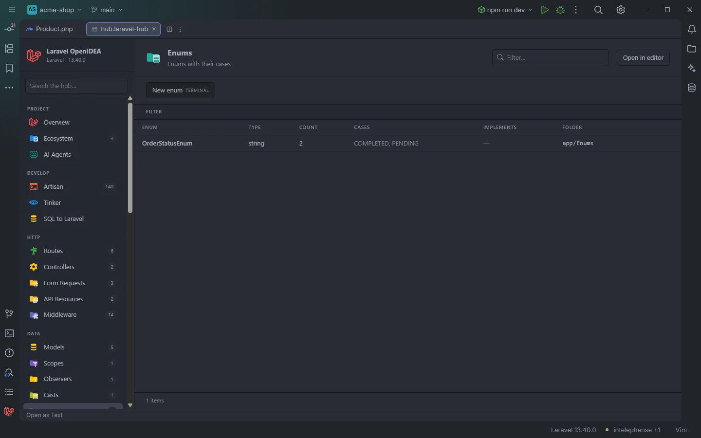

# Enums

Every PHP enum of the app with its backing type and its cases. A click opens the enum.

A string-backed enum and its cases

## How to use it

Click **Enums** under **Data** in the sidebar, or open `storage/openidea/hub/enums.laravel-hub`. Type a case name in **Filter…** to find the enum that has it, or pick a **Type**.

## What you see

### Columns

| Column | Content |
| --- | --- |
| Enum | The enum's name |
| Type | `string` or `int` for a backed enum, `pure` for one without a backing type |
| Count | The number of cases |
| Cases | The case names, in the order they are declared |
| Implements | The interfaces the enum declares, or `—` |
| Folder | The folder of the file, such as `app/Enums` |

Only the case names are shown, not their values; a model's detail page in [Models](Hub-Models.md) shows the values of the enums its columns are cast to.

### Facets

**Type**, **Implements** (split, one count per interface) and **Folder**.

### Actions

| Button | Command | Mode |
| --- | --- | --- |
| **New enum** | `make:enum` | Terminal |

`make:enum` exists from Laravel 11 on.

## Details

- Every `enum` declaration in the plugin's token scan of `app/`, `database/factories/`, `database/seeders/`, `routes/` and the bootstrap files is listed, wherever its folder.
- Cases are the `case` lines of the enum's body; constants and methods aren't listed.
- A click opens the file at the enum's name.
- With no enum the section reads `Nothing found in this project yet.`

## Settings and permissions

The table needs only `project.read`. **New enum** needs `process:php` or `process:docker`. See [Permissions](Permissions.md).

## Related

- [Casts in the editor](Casts.md) (enum members after a cast column)
- [Enum values](Inspection-Enum-Values.md)
- [Static completion](Static-Completion.md)
- [Casts](Hub-Casts.md)
- [The hub](Hub.md)

---
[← Wiki home](Home.md)
