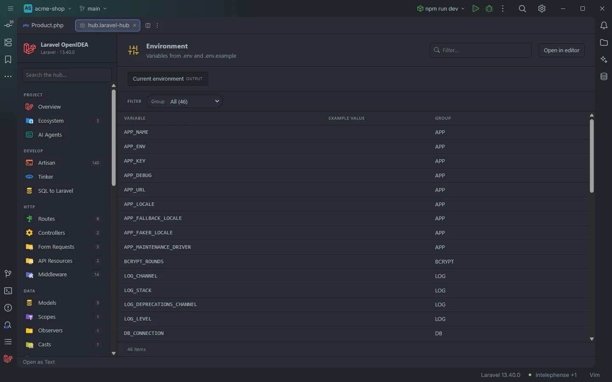

# Environment

The **Environment** section lists the variables of `.env` and `.env.example`, grouped by prefix. It shows which variables the project knows about without ever displaying the values of your `.env`.

46 variables of the acme-shop demo, grouped by prefix

## How to use it

Open the hub and pick **Environment** in the **Configure** group of the sidebar.

- Click a row to open the file at the variable.
- Use **Group** to list one family of variables (`DB`, `MAIL`, `REDIS`…).
- Type in **Filter…** to find a variable.

Search, filters, sorting and paging are described in [The hub](Hub.md).

## What you see

| Column | Content |
| --- | --- |
| **Variable** | The variable name, `APP_NAME`. |
| **Example value** | The value from `.env.example`, for variables that are only in `.env.example` (see below). |
| **Group** | The part before the first underscore: `APP` for `APP_NAME`, `DB` for `DB_HOST`. A name without an underscore shows `—`. |

Variables from `.env` come first, in file order, then the ones that only `.env.example` has.

### Filters

| Filter | Values |
| --- | --- |
| **Group** | Each prefix, with its number of variables. |

### Toolbar buttons

| Button | Runs | Where the output goes |
| --- | --- | --- |
| **Current environment** | `php artisan env` | Output drawer (*OUTPUT*) |

`php artisan env` prints the environment the app runs in (`local`, `production`…). The drawer is described in [The hub](Hub.md).

## Details

- **Data source:** the plugin's env index, the one behind `env('…')` completion. It reads `.env`, then `.env.example`. No PHP is run.
- **Values are never read from `.env`.** Only `.env.example` values are shown, since that file is meant to be shared.
- Each variable is listed once. A variable found in `.env` takes the row, so when a variable is in both files its `.env.example` value is not shown either; the column fills in only for variables that `.env.example` has and `.env` lacks. That makes the column a quick list of what your `.env` is missing. In a project without a `.env`, every variable comes from `.env.example` with its value.
- Comment lines (`#`) are skipped, an `export ` prefix is accepted, and a name may contain letters, digits, `_` and `.`.
- Changes to `.env` and `.env.example` are picked up even when they are made outside the editor (OpenIDEA doesn't report changes to git-ignored files, so the plugin checks them itself).
- Each row opens the variable's line in `.env`, or in `.env.example` when only that file has it.
- Empty state: *Nothing found in this project yet.* when neither file exists.

## Settings and permissions

The table needs only the required permissions. **Current environment** runs Artisan and needs `process:php` or `process:docker`. See [Settings](Settings.md) and [Permissions](Permissions.md).

## Related

- [The hub](Hub.md)
- [Environment variables in the editor](Environment-Variables.md)
- [`.env` keys](Inspection-Env-Keys.md): keys missing between `.env` and `.env.example`
- [Config](Hub-Config.md): `env()` calls in config files
- [Privacy and security](Privacy-and-Security.md)

---
[← Wiki home](Home.md)
