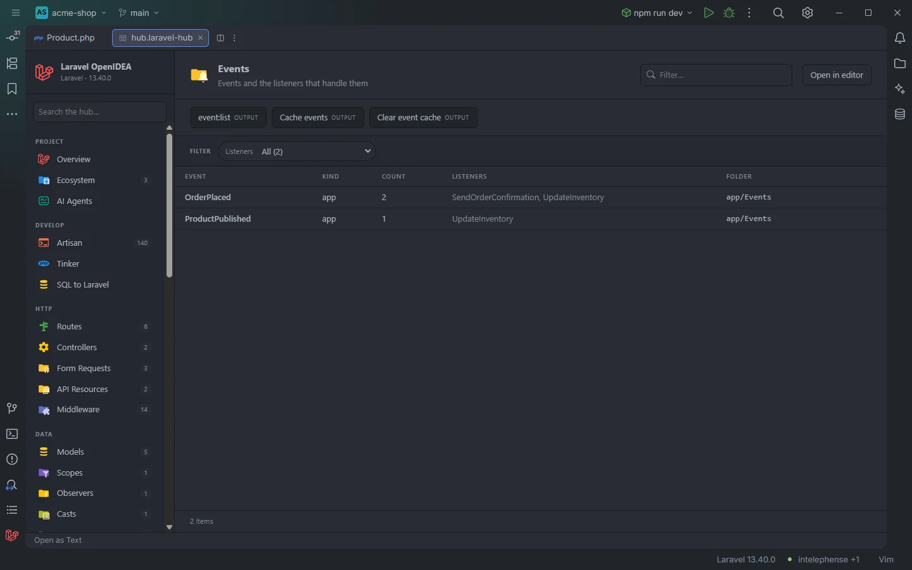

# Events

The **Events** section lists the project's event classes, and the framework or package events the project listens to, each with the listeners that handle it. It answers "what happens when this event is dispatched?".

Two app events and their listeners, with the event cache buttons

## How to use it

Open the hub and pick **Events** in the **Run** group of the sidebar. The badge counts the app's event classes.

- Click an app event to open its class.
- Use **Listeners** to find every event a listener handles, and **Kind** to separate app events, broadcast events and framework or package events.
- Click **Count** to sort by the number of listeners and find events nobody listens to.

Search, filters, sorting and paging are described in [The hub](Hub.md).

## What you see

| Column | Content |
| --- | --- |
| **Event** | The event class name (short name). |
| **Kind** | `app` for a class of the project, `app · broadcast` when it implements `ShouldBroadcast` or `ShouldBroadcastNow`, `framework / package` for an event that is not a project class but has a listener in the project (`Login`, `MessageSent`…). |
| **Count** | The number of distinct listener classes. |
| **Listeners** | Their names, comma separated, or `—`. A closure listener is `closure`. |
| **Folder** | The directory of the event class. Empty for framework and package events. |

App events come first, then the framework and package events in alphabetical order.

### Filters

| Filter | Values |
| --- | --- |
| **Kind** | `app`, `app · broadcast`, `framework / package` (shown when at least two exist). |
| **Listeners** | Each listener; an event with several listeners is counted under each. |

### Toolbar buttons

| Button | Runs | Where the output goes |
| --- | --- | --- |
| **event:list** | `php artisan event:list` | Output drawer |
| **Cache events** | `php artisan event:cache` | Output drawer |
| **Clear event cache** | `php artisan event:clear` | Output drawer |

`event:list` shows the listeners as the booted app registers them, including package listeners and auto-discovered ones, and is the reference when this table and Laravel disagree. The drawer is described in [The hub](Hub.md).

## Details

- **Data source:** the plugin's scan of the project's PHP files (`app/`, `database/factories/`, `database/seeders/`, `routes/`, `bootstrap/app.php`, `bootstrap/providers.php`) plus the `$listen` arrays of `app/Providers/**/*.php`. No PHP is run.
- An **app event** is a class in an `/Events/` folder (that no earlier role claims, see [All Classes](Hub-Classes.md)).
- **Listeners** are found the same way as in the [Listeners](Hub-Listeners.md) section: `handle()` / `__invoke()` parameter types (union types too), `#[ListensTo]`, `Event::listen()`, subscribers and `$listen`. Events are matched by short class name.
- Events dispatched by string name (`event('order.placed')`) appear as `framework / package` rows when something listens to that string.
- Framework and package rows have no file to open.
- Empty state: *Nothing found in this project yet.* when there are no events and no listeners.

## Settings and permissions

The table needs only the required permissions. The buttons run Artisan and need `process:php` or `process:docker`. See [Settings](Settings.md) and [Permissions](Permissions.md).

## Related

- [The hub](Hub.md)
- [Listeners](Hub-Listeners.md)
- [Live Audit](Hub-Live-Audit.md): every event dispatched at runtime, with its payload and the listeners that received it
- [Observers](Hub-Observers.md): model events

---
[← Wiki home](Home.md)
