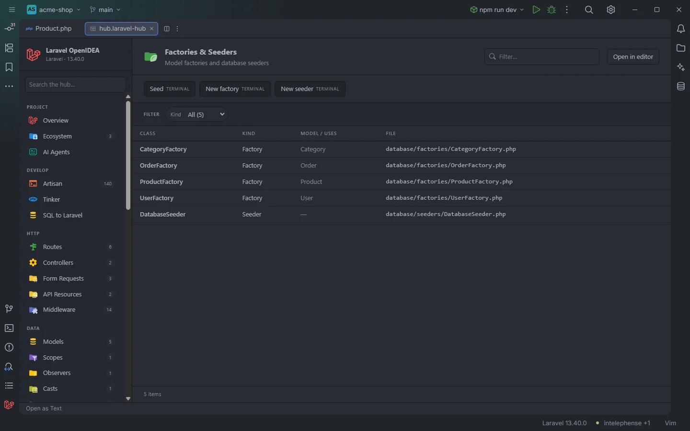

# Factories & Seeders

Every model factory and database seeder of the app: which model each factory builds and which seeders each seeder calls. A click opens the factory's `definition()` or the seeder's `run()`.

Four factories and the database seeder

## How to use it

Click **Factories & Seeders** under **Data** in the sidebar, or open `storage/openidea/hub/factories.laravel-hub`. Pick a **Kind** to see only factories or only seeders.

## What you see

### Columns

| Column | Content |
| --- | --- |
| Class | The class name |
| Kind | `Factory` or `Seeder` |
| Model / uses | For a factory, its name without `Factory` (`OrderFactory` → `Order`). For a seeder, the seeders its `run()` refers to (`UserSeeder, ProductSeeder`), alphabetical, or `—` |
| File | The file, relative to the project |

### Facets

**Kind**.

### Actions

| Button | Command | Mode |
| --- | --- | --- |
| **Seed** | `db:seed` | Terminal |
| **New factory** | `make:factory` | Terminal |
| **New seeder** | `make:seeder` | Terminal |

The generators ask for the name in the terminal.

## Details

- A class is a factory when it extends `Factory` or lives under `database/factories/`, and a seeder when it extends `Seeder` or lives under `database/seeders/`, unless an earlier rule gave it another role.
- A seeder's **uses** are the classes ending in `Seeder` named in `run()` as `X::class` or `new X`, which covers `$this->call([UserSeeder::class, …])`. Factories called from a seeder aren't listed there.
- **Model** is derived from the factory's name only. The model's detail page in [Models](Hub-Models.md) finds a model's factory the precise way (`#[UseFactory]`, `newFactory()`, then the naming convention).
- A click opens the factory at `definition()` or the seeder at `run()`, or at the class name when the method is missing.
- Classes come from the plugin's token scan of `app/`, `database/factories/`, `database/seeders/`, `routes/` and the bootstrap files; nothing runs.
- With neither factories nor seeders the section reads `Nothing found in this project yet.`

## Settings and permissions

The table needs only `project.read`. The buttons need `process:php` or `process:docker`. See [Permissions](Permissions.md).

## Related

- [Factories in the editor](Factories.md)
- [Models](Hub-Models.md)
- [Database](Hub-Database.md)
- [The hub](Hub.md)

---
[← Wiki home](Home.md)
