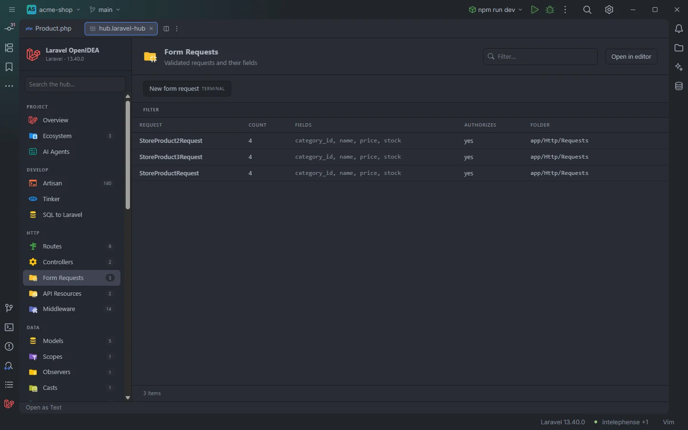

# Form Requests

Every Form Request of the app with the fields its `rules()` validates and whether it has an `authorize()` method. A click opens the class.

Form Requests and their validated fields

## How to use it

Click **Form Requests** under **HTTP** in the sidebar, or open `storage/openidea/hub/requests.laravel-hub`. Type a field name in **Filter…** (`email`) to find every request that validates it.

## What you see

### Columns

| Column | Content |
| --- | --- |
| Request | The class name |
| Count | The number of fields |
| Fields | The validated fields, in alphabetical order, each once |
| Authorizes | `yes` when the class declares `authorize()`, `no` otherwise |
| Folder | The folder of the file, such as `app/Http/Requests/Admin` |

### Facets

**Authorizes** and **Folder**.

### Actions

| Button | Command | Mode |
| --- | --- | --- |
| **New form request** | `make:request` | Terminal |

Artisan asks for the name in the terminal.

## Details

- A class is a Form Request when it extends `FormRequest` or its file is under a `/Http/Requests/` folder. Abstract classes are left out.
- The fields are the keys of `key => value` pairs in the body of `rules()`. Quotes are removed, and only keys made of letters, digits, `_`, `.`, `*` and `-` are kept, so `items.*.id` is listed while a key built from variables isn't. Keys added in other methods (`prepareForValidation()`, a parent class) aren't seen.
- Classes come from the plugin's token scan of `app/`, `database/factories/`, `database/seeders/`, `routes/` and the bootstrap files; see [Controllers](Hub-Controllers.md#details).
- A click opens the file at the class name.
- With no Form Request the section reads `Nothing found in this project yet.`
- To turn an inline `$request->validate([…])` into a Form Request, see [Extract Form Request](Extract-Form-Request.md).

## Settings and permissions

The table needs only `project.read`. **New form request** needs `process:php` or `process:docker`. See [Permissions](Permissions.md).

## Related

- [Extract Form Request](Extract-Form-Request.md)
- [Validation rules](Validation-Rules.md)
- [Validation Rules in the hub](Hub-Rules.md)
- [Controllers](Hub-Controllers.md)
- [The hub](Hub.md)

---
[← Wiki home](Home.md)
