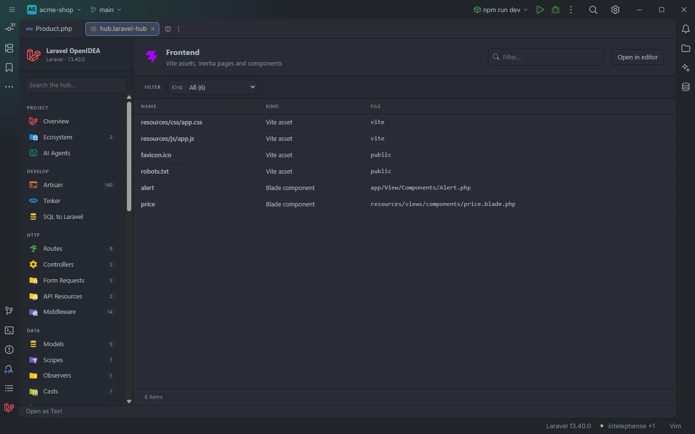

# Frontend

The **Frontend** section puts the front-end side of the project in one table: the asset files Vite and the browser load, Inertia pages, Livewire components and Blade components.

Assets and components of the acme-shop demo

## How to use it

Open the hub and pick **Frontend** in the **Views** group of the sidebar.

- Click a row to open the file.
- Type in **Filter…** to search names and the third column.
- Use the **Kind** select to show one kind of row, and click a header to sort.

Search, filters, sorting and paging are described in [The hub](Hub.md).

## What you see

| Column | Content |
| --- | --- |
| **Name** | The asset path, page name or component name (see below). |
| **Kind** | `Vite asset`, `Inertia page`, `Livewire component` or `Blade component`. |
| **File** | For components and Inertia pages, the file relative to the project root. For asset rows, where the file lives: `vite` for files under `resources/`, `public` for files under `public/`. |

Rows are grouped by kind in this order: assets, Inertia pages, Livewire components, Blade components.

| Kind | Read from | Name shown |
| --- | --- | --- |
| Vite asset (`vite`) | Every file under `resources/css`, `js`, `ts`, `sass`, `scss`, `images`, `img` and `fonts` | The project-relative path, `resources/css/app.css`, as you write it in `@vite()` and `vite.config.js`. |
| Vite asset (`public`) | Every file under `public/`, except `.php` files, dot files, `public/storage/` and `public/build/` | The path inside `public/`, `favicon.ico`, as you write it in `asset()`. |
| Inertia page | `resources/js/Pages/`, `resources/js/pages/` and `resources/ts/Pages/`, files ending in `.vue`, `.tsx`, `.jsx`, `.svelte` or `.ts` | The page name without extension, `Products/Index`, as passed to `Inertia::render()`. |
| Livewire component | Same sources as [Components](Hub-Components.md) | The component name without `<livewire:`. |
| Blade component | Same sources as [Components](Hub-Components.md) | The component name without `<x-`. |

### Filters

| Filter | Values |
| --- | --- |
| **Kind** | The kinds present, with counts. |

The section has no toolbar buttons.

## Details

- **Data source:** the plugin's asset, Inertia page, Livewire and Blade component indexes, the ones behind `@vite`, `asset()`, `Inertia::render()`, `<livewire:` and `<x-` completion. No PHP and no Node tooling is run.
- Inertia pages with the same name in two folders or two extensions are listed once; the first match wins in the folder order above and the extension order `vue`, `tsx`, `jsx`, `svelte`, `ts`.
- Up to 3,000 files are read per asset folder and per `public/`, 5,000 per page folder and extension.
- The indexes are rebuilt when files under `resources/`, `public/` or `vite.config.*` change (assets), under `resources/js/` (Inertia pages), or in the component folders.
- Each row opens its file at line 1.
- Empty state: *Nothing found in this project yet.*

## Settings and permissions

Nothing beyond the plugin's required permissions. See [Permissions](Permissions.md).

## Related

- [The hub](Hub.md)
- [Front-end files](Frontend-Files.md): Vite entries, Ziggy routes and translation keys in JavaScript and TypeScript
- [Components](Hub-Components.md)
- [Blade](Blade.md): `@vite` and asset completion
- [Packages](Packages.md): Inertia and Livewire

---
[← Wiki home](Home.md)
