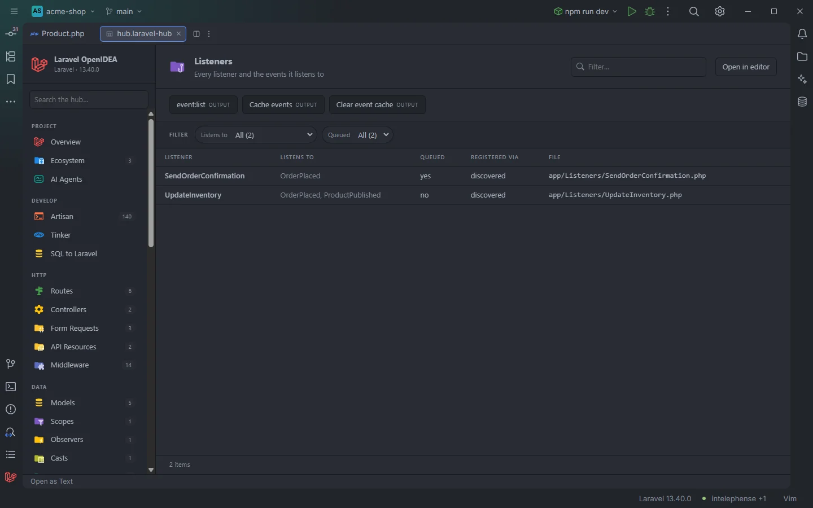

# Listeners

The **Listeners** section lists every event listener of the project and the events it listens to, whether it is queued, and how Laravel finds it: discovered from its type hints, registered with `Event::listen()`, through a subscriber or in a `$listen` array.

Listeners of the acme-shop demo

## How to use it

Open the hub and pick **Listeners** in the **Run** group of the sidebar. The badge counts the rows.

- Click a row to open the listener method or the registering call.
- Use **Listens to** to find every listener of one event, **Queued** to see what runs on the queue, and **Registered via** to see how each one is wired.

Search, filters, sorting and paging are described in [The hub](Hub.md).

## What you see

| Column | Content |
| --- | --- |
| **Listener** | The listener class. When the handling method is not `handle` or `__invoke`, it is shown as `Class@method` (`OrderSubscriber@onShipped`). A closure is `closure`. |
| **Listens to** | The event classes (short names) or event names, comma separated. |
| **Queued** | `yes` when the listener class implements `ShouldQueue` or `ShouldQueueAfterCommit`. Always `no` for `$listen` rows. |
| **Registered via** | `discovered`, `Event::listen`, `subscriber` or `$listen`. |
| **File** | The file of the listener, or of the call that registers it. |

A listener class with several handling methods has one row per method.

| Registered via | Found when |
| --- | --- |
| `discovered` | A class in a `/Listeners/` folder has a public `handle…()` method or `__invoke()` whose first parameter is typed: `handle(OrderShipped $event)`, or a union `handle(OrderShipped\|OrderCancelled $event)`. Any class method with a `#[ListensTo(Event::class)]` attribute counts too, and the attribute's classes win over the type. Types such as `object`, `mixed`, `array` and `string` are ignored. |
| `Event::listen` | `Event::listen(…)`, `$events->listen(…)` (any variable), `$this->events->listen(…)` or `events()->listen(…)`. The first argument gives the events (`OrderShipped::class`, a string name, or the parameter type of a closure); the second gives the listener (`[Listener::class, 'method']`, `Listener::class`, `'Listener@method'`, or a closure). |
| `subscriber` | A class with a `subscribe()` method: each `$events->listen(Event::class, …)` inside it, and each `Event::class => 'method'` pair of an array it returns. |
| `$listen` | Each `Event::class => [Listener::class, …]` entry of a `$listen` property in `app/Providers/**/*.php` (the `EventServiceProvider` of Laravel 10 and earlier). |

### Filters

| Filter | Values |
| --- | --- |
| **Listens to** | Each event; a listener of several events is counted under each. |
| **Queued** | `yes`, `no`. |
| **Registered via** | The registration kinds present. |

### Toolbar buttons

| Button | Runs | Where the output goes |
| --- | --- | --- |
| **event:list** | `php artisan event:list` | Output drawer |
| **Cache events** | `php artisan event:cache` | Output drawer |
| **Clear event cache** | `php artisan event:clear` | Output drawer |

The drawer is described in [The hub](Hub.md).

## Details

- **Data source:** the plugin's scan of the project's PHP files (`app/`, `database/factories/`, `database/seeders/`, `routes/`, `bootstrap/app.php`, `bootstrap/providers.php`), and up to 200 files of `app/Providers/` for `$listen`. No PHP is run.
- `discovered` mirrors Laravel's event discovery, but the plugin doesn't check whether discovery is enabled or which folders it scans. Use **event:list** for the list the booted app actually uses.
- A listener registered with a variable (`Event::listen($event, $listener)`) is listed with whatever names can be read; a fully dynamic one may show `closure` or no events.
- The `$listen` reader takes the first `$listen` of each provider file, and the line it opens is the line of `$listen`.
- Each row opens the handling method, the registering call, the `subscribe()` method or the `$listen` property.
- Empty state: *Nothing found in this project yet.*

## Settings and permissions

The table needs only the required permissions. The buttons run Artisan and need `process:php` or `process:docker`. See [Settings](Settings.md) and [Permissions](Permissions.md).

## Related

- [The hub](Hub.md)
- [Events](Hub-Events.md)
- [Queues & Workers](Hub-Queues.md): queued listeners next to jobs
- [Live Audit](Hub-Live-Audit.md): the listeners that actually received each event
- [Observers](Hub-Observers.md)

---
[← Wiki home](Home.md)
