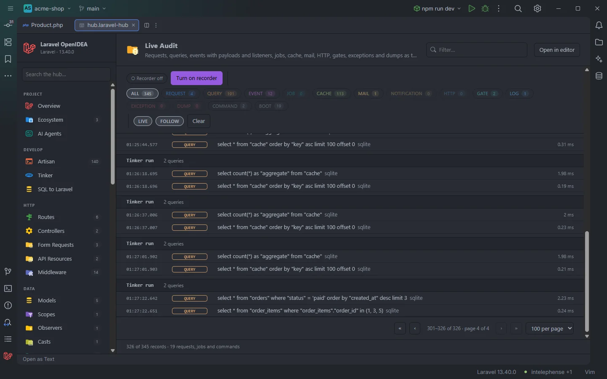
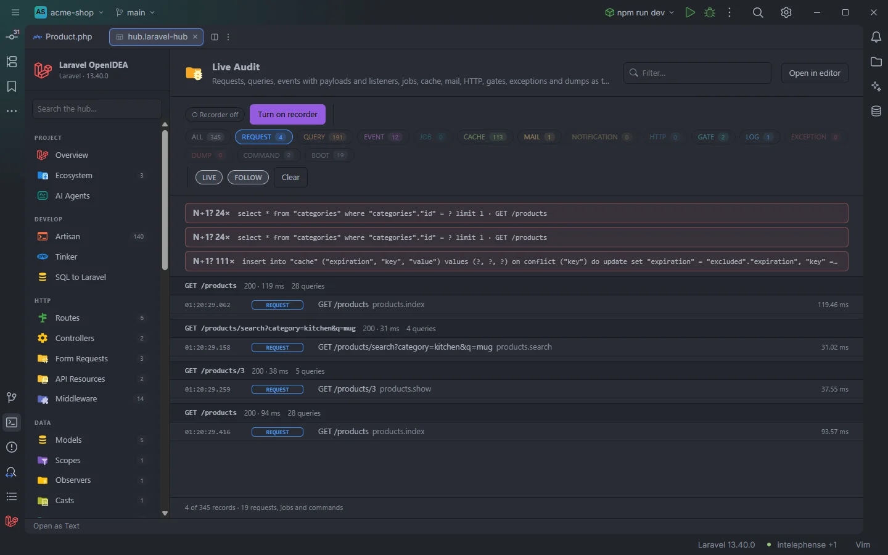
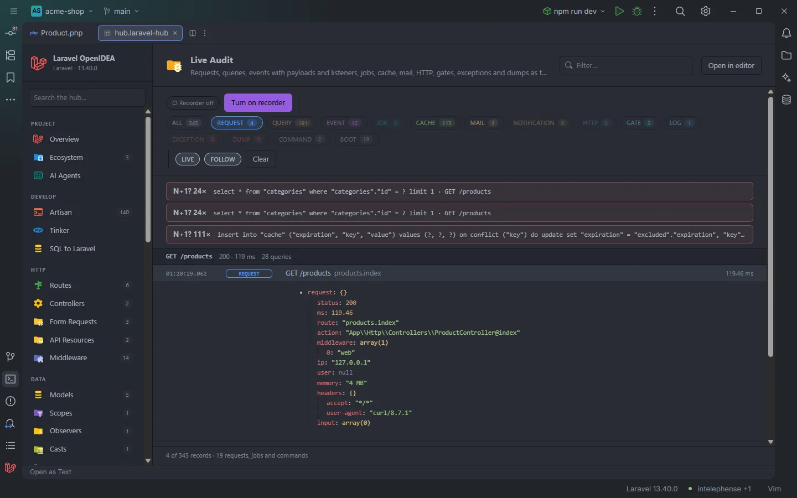

# Live Audit

**Live Audit** records what your app does while you use it, and shows it in the hub as it happens: every HTTP request with its route, middleware, input and timing; every SQL query with its bindings and the line of your code that ran it; every event with its payload and the listeners that received it; jobs queued, processed and failed; cache hits, misses and writes; mail, notifications, HTTP client calls, gate checks, log messages, exceptions with their stack and `dump()` output. It groups everything by request, job or command and points out N+1 queries, slow queries, slow requests, exceptions and failed jobs.

It needs no package in `composer.json` and changes no tracked file: a small recorder is installed in `storage/openidea` and hooked into `vendor/autoload.php`, and it only records in the local environment.

<p align="center"></p>
<p align="center"><sub>345 records, grouped by run, on the last page with Follow on</sub></p>

## How to use it

1. Open the hub and pick **Live Audit** in the **Observe** group of the sidebar. The section checks whether the recorder is installed (*Checking recorder…*).
2. Click **Turn on recorder**. The plugin installs the recorder through PHP (see [Turning the recorder on](#turning-the-recorder-on)) and shows *Recorder on. It records in the local environment; a composer install removes the hook.*
3. Use the app: open a page in the browser, run an Artisan command, dispatch a job, or run a [Tinker](Hub-Tinker.md) tab. Records show up within about a second and a half.
4. Click a type chip to see one kind of record, type in **Filter…** to search, and click a record to see its details.
5. Click **Turn off** when you are done. The records already written stay until you click **Clear**.

<p align="center"></p>
<p align="center"><sub>Only requests: the insights flag a query repeated 24 times on GET /products</sub></p>

## What you see

### The bar

| Control | What it does |
| --- | --- |
| State chip | *Checking recorder…* while the status is read, *● Recording (local env)* when the recorder is installed and hooked, *○ Recorder off* otherwise. |
| **Turn on recorder** / **Turn off** | Installs or uninstalls the recorder. Shows *Working…* and is disabled while PHP runs. |
| **ALL** chip | Shows every type except `boot`. Its count is the number of records loaded. |
| Type chips | `REQUEST`, `QUERY`, `EVENT`, `JOB`, `CACHE`, `MAIL`, `NOTIFICATION`, `HTTP`, `GATE`, `LOG`, `EXCEPTION`, `DUMP`, `COMMAND`, and `BOOT` when there are boot records, each with its count. A type with no record is dimmed. |
| **LIVE** | On by default. While on, new records are fetched every 1.5 seconds. Off pauses the list; nothing is lost, the next fetch after turning it back on brings everything written meanwhile. |
| **FOLLOW** | On by default. While on, the view jumps to the last page and scrolls to the newest record after each update. Moving to another page turns it off. |
| **Clear** | Empties the list and deletes `storage/logs/openidea-audit.jsonl` and its rotated copy `openidea-audit.jsonl.1`. |

Type chips work like the log level chips: a click shows only that type, a second click on the only selected type shows all again, and Ctrl+click (Cmd+click or Shift+click) adds or removes a type to combine several. Unselecting the last type returns to all. `boot` records are hidden until you pick the `BOOT` chip.

### Insights

Above the list, up to 12 insight cards point at problems in the loaded records. Red cards are the serious ones. Click a card that has a source line to open it.

| Card | When | Red when |
| --- | --- | --- |
| **N+1? 24×** | The same query ran 5 or more times from the same file and line within one request, job or run. Queries are compared as SQL with `?` placeholders, whitespace collapsed and `in (…)` lists ignored, so `where "id" in (?, ?)` and `where "id" in (?)` match. | 20 times or more |
| **Slow query 140 ms** | A query took 100 ms or more. | 500 ms or more |
| **Slow request 1200 ms** | A request took 1,000 ms or more. | 3,000 ms or more |
| **Exception** | An exception was logged. | Always |
| **Job failed** | A job failed; the card shows the job and the error. | Always |

Each card shows the SQL (with `?` placeholders) or the message, then ` · ` and the request, job or run it happened in, such as `GET /products`. Insights are computed from every loaded record, whatever the type chips and search show. When there are more than 12, the last 12 are kept.

### Groups

Records are grouped by the PHP process (or the job) that wrote them. Each group starts with a header row:

| Group | Header | Right side |
| --- | --- | --- |
| HTTP request | `GET /products?page=2` | `200 · 119 ms` and the number of queries |
| Queue job | The job class | The number of queries |
| Artisan command | `artisan orders:prune` | The time and the number of queries |
| Tinker tab, Cache section and other `php -r` runs of the plugin | `Tinker run` | The number of queries |
| Another console process | `artisan <arguments>` | The number of queries |
| Anything else | `HTTP`, or `pid 1234` when nothing else is known | The number of queries |

A request, job or command record names the group; when there is none, the `boot` record does. Each job a worker processes starts a group of its own, so the queries and events of one job are not mixed with the next one.

### A record

Each line shows the time (`01:20:29.062`, local time with milliseconds), a type badge, a summary, and on the right the duration and the source line (`ProductController.php:24`), which opens the file when clicked.

| Type | Summary | Second part |
| --- | --- | --- |
| `request` | `GET /products/search?category=kitchen` | The route name (or action) and `· user 5` when someone is logged in |
| `query` | The SQL with the bindings filled in | The connection name |
| `event` | The event name | `→ ` the listeners, or `no listeners` |
| `job processing`, `job processed`, `job failed`, `job queued` | The job class | The status, the queue, and the error for a failure |
| `cache` | `hit cart:5`, `miss …`, `write …`, `forget …` | The store |
| `mail` | The subject (or the mailable class) | The number of recipients, `1 recipient(s)` |
| `notification` | The notification class | `mail → App\Models\User#5` |
| `http` | `GET https://api.example.com/rates` | The status code |
| `gate` | The ability | `allowed` or `denied` |
| `log` | The message | The level |
| `exception` | `RuntimeException: Payment declined` | The last two segments of the file and the line |
| `dump` | The first line of the dumped value | |
| `command` | `artisan orders:prune` | `exit 0` |
| `boot` | `console: artisan …` or `http` | The PHP and Laravel versions |

Click a line to expand it; click again to collapse it. Expanded records stay open while the list updates.

<p align="center"></p>
<p align="center"><sub>An expanded request: route, action, middleware, memory, headers and input</sub></p>

| Type | Details |
| --- | --- |
| Every record with a source line | `at path/to/File.php:24`, a link to the line. |
| `query` | The SQL with bindings filled in and SQL keywords highlighted, then `bindings: [...]`. |
| `event` | *Listeners* as chips, then the payload as a tree. |
| `request` | A tree with `status`, `ms`, `route`, `action`, `middleware`, `ip`, `user`, `memory` (MB), `headers` and `input`. |
| `exception` | The stack, one `at Class->method path:line` link per frame. |
| `dump` | The whole dumped text. |
| `log` | The context as a tree. |
| `job` (queued) | The job object as a tree. |

Trees show models as their class with `@key`, `@exists`, `@dirty` and their attributes, collections as their class with `@count` and the first items, and other objects as their class with their public properties.

### Search, paging and the count

The **Filter…** box at the top of the hub searches the whole record (SQL, URIs, payloads, messages…), case-insensitively, and highlights the match in the summary. With more than 50 visible records a pager appears (100 per page by default). The count under the list reads `4 of 345 records · 19 requests, jobs and commands`, the second number being the number of groups. See [The hub](Hub.md) for paging.

### Empty states

| Message | When |
| --- | --- |
| An introduction, *An insanely complete audit of what your app does*, with a **Turn on recorder** button | The recorder is off and there is no record. |
| *Recording. Open a page, run a command or a Tinker tab and it shows up here.* | The recorder is on and nothing was recorded yet. |
| *No records yet.* | While the status is being checked. |
| *Nothing matches the filters.* | The type chips or the search hide every record. |

Errors from installing, uninstalling or clearing appear in a red **Recorder** card above the list. The section has no Artisan buttons in its header.

## Details

### Turning the recorder on

**Turn on recorder** runs the plugin's install script with PHP (or in the Docker Compose service, see [Settings](Settings.md)) in the project directory:

1. It checks that `vendor/autoload.php` exists. If not: *vendor/autoload.php is missing; run composer install*.
2. It creates `storage/openidea/` (mode 0775) with a `.gitignore` containing `*`, so nothing in that folder is ever committed.
3. It writes the recorder to `storage/openidea/Recorder.php` and checks it with `php -l`. If this PHP can't compile it, the file is removed and the card shows *recorder does not compile on this PHP: …*.
4. It hooks `vendor/autoload.php`: the line `return ComposerAutoloaderInit…::getLoader();` becomes

   ```php
   $__openideaLoader = ComposerAutoloaderInit…::getLoader(); /* openidea-recorder */ if (is_file($__openideaRecorder = __DIR__ . '/../storage/openidea/Recorder.php')) { require_once $__openideaRecorder; } /* openidea-recorder */ return $__openideaLoader;
   ```

   The patched file is written next to the original as `vendor/autoload.php.openidea`, checked with `php -l`, and only then moved over `vendor/autoload.php`. If the file doesn't have the expected shape: *vendor/autoload.php has an unexpected shape*; if the patched file doesn't compile: *could not hook vendor/autoload.php: …*. An existing hook is removed first, so turning it on twice is safe.
5. When PHP runs as root (in a container), the new files are given the owner and group of the project directory, so they don't end up owned by root on your machine.

Because `vendor/` and `storage/` are ignored by git in a Laravel project, no tracked file changes. The hook calls `require_once` only when `Recorder.php` exists, so deleting `storage/openidea` by hand is also safe.

**`composer install`, `composer update` and `composer dump-autoload` rewrite `vendor/autoload.php` and remove the hook.** The section then shows *○ Recorder off*; click **Turn on recorder** again.

### Turning it off

**Turn off** removes the hook from `vendor/autoload.php` (restoring the original `return …::getLoader();`), deletes `storage/openidea/Recorder.php`, and removes `storage/openidea/` if nothing but its `.gitignore` is left. The folder stays when it holds the plugin's other files (the MCP server, the IDE helper stub, the hub tab files). The recorded file `storage/logs/openidea-audit.jsonl` is kept; use **Clear** to delete it.

### When it records

The recorder is loaded by every PHP process that loads `vendor/autoload.php`: web requests, Artisan commands, queue workers, the scheduler, Tinker, and the plugin's own PHP runs. It attaches itself once the Laravel application has booted, then decides whether to record:

| `APP_ENV` | `OPENIDEA_AUDIT` | Records? |
| --- | --- | --- |
| `local`, `development` or `dev` | not set or `true` | Yes |
| any | `false` or `0` | No |
| anything else (`testing`, `staging`, `production`…) | `true` | Yes |
| anything else | not set | No |

So test runs (`APP_ENV=testing`) and production are not recorded unless you set `OPENIDEA_AUDIT=true` there (`1` does not turn it on, only `true` does). `OPENIDEA_AUDIT=false` in `.env` turns recording off without uninstalling. Both variables are read with `env()`: with a cached config (`config:cache`), only variables set in the real environment count.

The state chip only reports whether the recorder is installed and hooked; it says *Recording (local env)* even when the app runs in another environment and records nothing.

### Record types

Every record is one JSON line with these common fields: `t` (Unix time, 4 decimals), `seq` (per process), `scope` (a random 12-character id for the process, renewed for each processed job), `pid` and `type`. Records that come from your code also carry `file` and `line`: the first frame of the call stack outside `vendor/`, `storage/openidea`, `eval()`'d code and `php -r` code, which is the line of your code that ran the query, dispatched the event or hit the cache.

| Type | Recorded on | Fields |
| --- | --- | --- |
| `boot` | Once per process, when the app has booted | `context` (`http` or `console`), `argv` (the first 8 arguments, console only), `php`, `laravel`, `env` |
| `request` | `RequestHandled` | `method`, `uri`, `query` (the query string), `status`, `ms` (since the app booted), `route` (name), `action`, `middleware` (first 20), `ip`, `user` (the auth identifier), `input` (first 30 fields, masked), `headers` (`accept`, `content-type`, `user-agent`, `referer` and `x-requested-with` only, each cut at 200 characters), `memory` (peak bytes) |
| `query` | `QueryExecuted` | `sql`, `bindings` (dates as `Y-m-d H:i:s`, strings cut at 200 characters, objects as their type), `ms`, `connection`, `file`, `line` |
| `event` | Every other event dispatched after boot (see below) | `name`, `listeners`, `payload` (the event object or the payload array, masked), `file`, `line` |
| `job` | `JobQueued`, `JobProcessing`, `JobProcessed`, `JobFailed` | `status` (`queued`, `processing`, `processed`, `failed`), `job`, `queue`, `connection`, `id`; `attempt` when processing; `ms` when processed or failed; `error` (`Class: message`) when failed; `payload` (the job object, masked) and `file`/`line` when queued |
| `cache` | `CacheHit`, `CacheMissed`, `KeyWritten`, `KeyForgotten` | `op` (`hit`, `miss`, `write`, `forget`), `key`, `store`, `ttl` (writes), `file`, `line` |
| `mail` | `MessageSent` | `subject`, `to` (only the count, `2 recipient(s)`), `mailable` |
| `notification` | `NotificationSent` | `notification`, `channel`, `notifiable` (`App\Models\User#5`) |
| `http` | HTTP client `ResponseReceived` | `method`, `url` (with `token`, `key`, `secret`, `signature` and `password` query values replaced by `•••`), `status`, `ms` (transfer time), `file`, `line` |
| `gate` | `GateEvaluated` | `ability`, `result` (true or false), `user`, `file`, `line` |
| `log` | `MessageLogged` without an exception | `level`, `message` (first 2,000 characters), `context` (masked), `file`, `line` |
| `exception` | `MessageLogged` with an `exception` in its context, which is how Laravel reports exceptions | `level`, `message`, `class`, `file`, `line`, `trace` (first 15 frames with `file`, `line`, `call`) |
| `dump` | `dump()` and `dd()` | `value` (the dump as plain text, first 20,000 characters), `file`, `line` |
| `command` | `CommandFinished` | `command`, `exit`, `ms` |

Notes on the types:

- **Events.** Every event is recorded except the ones that have their own type above and framework noise: `StatementPrepared`, `ConnectionEstablished`, `ArtisanStarting`, `LocaleUpdated`, `CommandStarting`, `JobQueueing`, the cache `RetrievingKey`/`WritingKey` events, the routing `Routing`, `PreparingResponse` and `ResponsePrepared` events, and names starting with `eloquent.booting`, `eloquent.booted`, `eloquent.retrieved`, `bootstrapping:`, `bootstrapped:`, `composing:`, `creating:` or `Illuminate\Http\Client\Events\`. Model events such as `eloquent.created: App\Models\Order` are recorded.
- **Listeners** are read from the dispatcher when the event fires: class names, `Class@method`, and closures as `Closure File.php:12` (or `Closure (framework)` for the framework's own). The recorder's own listener is left out.
- **Commands.** `schedule:run`, `schedule:work`, `queue:work` and `horizon:work` are not recorded as commands (they run for a long time), but what they do is: each processed job gets its own group.
- **Dumps.** The recorder installs a VarDumper handler that writes the record and then hands the value to the previous handler (or the normal CLI or HTML dumper), so `dump()` still prints where it used to.
- **Exceptions** are recorded when they are reported to the log. Exceptions listed in `dontReport`, or caught by your code and never logged, don't appear.
- **Times.** A request's `ms` is measured from the moment the app finished booting, so it doesn't include the framework's bootstrap. A command's `ms` is measured the same way; a job's from the start of its processing.

### Masking

Values that pass through the recorder's value formatter (request `input`, event `payload`, log `context`, the queued job `payload`, and model attributes inside them) are masked by key name, case-insensitively, anywhere in the key:

| Masked | Key contains |
| --- | --- |
| Always | `pass` (so `password` and `passport` too), `secret`, `token`, `api_key` / `api-key` / `apikey`, `authorization`, `cookie`, `credential`, `private`, `signature`, `otp`, `cvv`, `card`; or the key is `key` or ends in `_key`, `.key` or `-key` (`app_key`, `stripe.key`) |
| Personal data, unless `OPENIDEA_AUDIT_SHOW_PII=true` | `email` / `e-mail`, `cpf`, `cnpj`, `document`, `phone`, `telefone`, `celular`, `mobile`, `birth`, `nascimento`, `address`, `endereco`, `cep`, `zip`, `ssn`, or ends in `rg` |

A masked value is replaced by `•••` (`null` stays `null`). Model attributes listed in the model's `$hidden` are masked too. `OPENIDEA_AUDIT_SHOW_PII` accepts `true` or `1` and is read when the app boots.

Because matching is by substring, some harmless keys are masked as well: `accepted_terms` contains `cep`, `footprint` contains `otp`, `org` ends in `rg`, `compass` contains `pass`. A key that merely contains `key` elsewhere, such as `keyword` or `monkey`, is kept.

Not masked:

- **SQL bindings**, which are stored as they are (only shortened). A query that filters or inserts on an e-mail or a token keeps that value in the record.
- The request's **query string** (`query`, also shown in the summary), the **URI**, **log messages**, **exception messages**, **dump output** and the **mail subject**.

Headers other than the five listed above are never recorded, so `Cookie` and `Authorization` don't reach the file. Mail recipients are only counted.

Values are also shortened: strings longer than 400 characters are cut with `…`, arrays keep their first 25 entries (`"…": "12 more"`), nesting stops at three levels (`{App\Models\User}` or `[8 items]`), models keep their first 30 attributes, collections their first 10 items, enums become `App\Enums\Status::Paid`, dates `Y-m-d H:i:s.u P`, closures `{Closure}`.

### The file

- Records go to `storage/logs/openidea-audit.jsonl` (`storage_path('logs/openidea-audit.jsonl')`), one JSON object per line, appended with an exclusive lock so concurrent requests don't interleave.
- Before each write, if the file is larger than 8,000,000 bytes, it is renamed to `openidea-audit.jsonl.1` (replacing the previous one) and a new file is started. The hub reads only the current file, so after a rotation the list starts again from the new file.
- Writing never breaks the app: any failure is swallowed.
- **Clear** deletes both files.

### How the hub reads it

- The hub reads the file through the IDE, not through PHP, so viewing records works without the `process:php` permission once the recorder is installed.
- Every 1.5 seconds (while the section is open and **LIVE** is on) it asks for what was added since the last read. When the file size hasn't changed nothing is sent; when the file shrank (cleared or rotated) the list is reloaded from the start.
- One update parses at most the last 4,000 lines, skips lines that aren't valid JSON, and sends at most about 900 KB, dropping the oldest records of a very large first load.
- The list keeps the newest 6,000 records; older ones are dropped from the view (not from the file).
- When the file doesn't exist, the list is emptied.

### Where it runs

Install, uninstall, **Clear** and the status check run the plugin's `install.php` script with the Artisan runner: `php` on your machine (`php-win` on Windows when the `process:php-win` permission is allowed, so no console window flashes), or `docker compose run --rm` / `docker compose exec` in the configured service. With Docker the recorder is installed in the project directory mounted in the container and records what the containerised app does. The status is checked once, the first time the section is opened in a hub tab.

## Settings and permissions

| What | Needs |
| --- | --- |
| Viewing records | The required permissions only |
| **Turn on recorder**, **Turn off**, **Clear**, the status check | `process:php`, or `process:docker` when Artisan runs through Docker Compose (`process:php-win` optional on Windows) |

Without the permission, the **Recorder** card shows *Allow "process:php" for Laravel OpenIdea in Settings › Plugins to run Artisan with php*. The `artisanRunner` and `dockerService` settings choose where PHP runs. The recorder itself is controlled by the app's environment variables:

| Variable | Effect |
| --- | --- |
| `OPENIDEA_AUDIT` | `false` or `0`: never record. `true`: also record outside `local`, `development` and `dev`. |
| `OPENIDEA_AUDIT_SHOW_PII` | `true` or `1`: don't mask personal data keys. Secrets stay masked. |

See [Settings](Settings.md), [Permissions](Permissions.md) and [Privacy and security](Privacy-and-Security.md).

### AI agents

The `laravel-openidea` MCP server reads the same file: `audit_recent` returns recent records (filtered by type and text, up to 2,000, newest last) with N+1, slow query, exception and failed job insights, and `audit_recorder` turns the recorder on or off (write access level). See [AI agents and MCP](AI-Agents.md).

## Related

- [The hub](Hub.md)
- [N+1 queries](Inspection-N-Plus-One.md): the inspection that catches N+1 patterns in the editor before they run
- [Tinker](Hub-Tinker.md): each run appears as a *Tinker run* group
- [Logs](Hub-Logs.md), [Profiles](Hub-Profiles.md), [Debug Calls](Hub-Debug-Calls.md), [Debug Tools](Hub-Debug-Tools.md)
- [Privacy and security](Privacy-and-Security.md)
- [How it works](How-It-Works.md)

---
[← Wiki home](Home.md)
