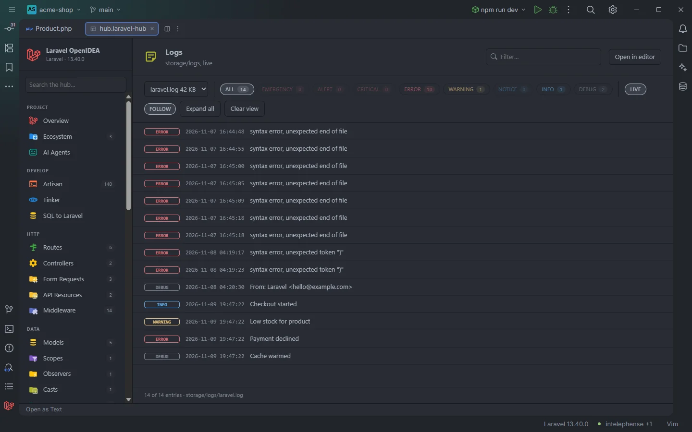
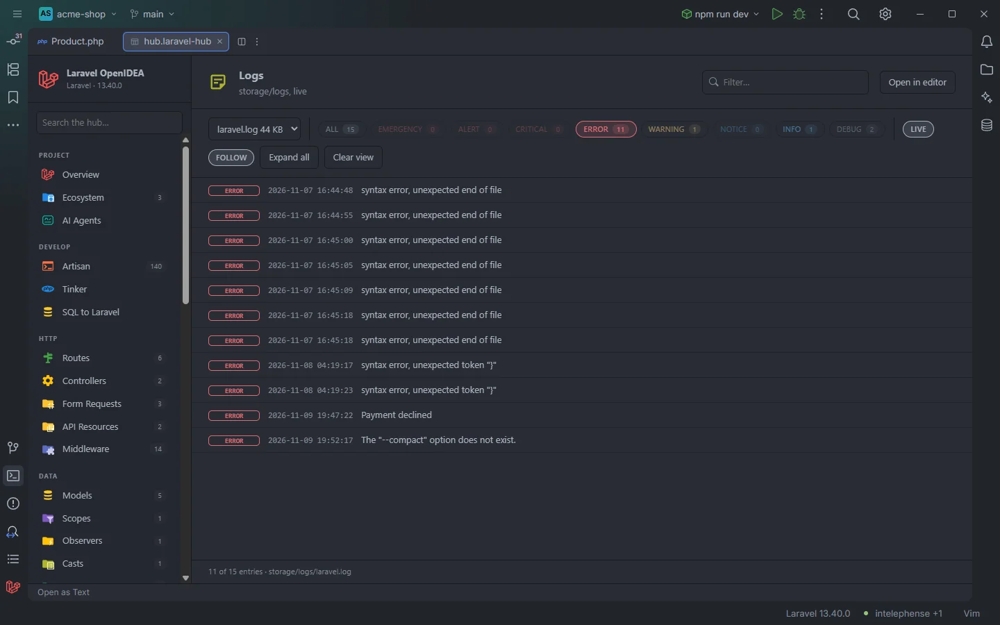

# Logs

The **Logs** section is a live viewer for the files in `storage/logs`: each entry on one line with its level and time, level chips with counts, search, stack traces that open the file and line they point to, and a view that follows the file as the app writes to it.

laravel.log of the acme-shop demo, following new entries

## How to use it

Open the hub and pick **Logs** in the **Observe** group of the sidebar. The first log file found is loaded right away, and new entries appear within two seconds of being written.

- Pick another file in the select on the left of the bar.
- Click a level chip to show only that level; click it again to show every level. Ctrl+click (Cmd+click, or Shift+click) adds or removes a level to combine several.
- Type in **Filter…** to keep the entries whose message or details contain the text.
- Click an entry that has details (context or a stack trace) to expand it; **Expand all** opens every entry.
- Click a file path in a stack trace to open that file at that line.

Only errors, after clicking the ERROR chip

## What you see

### The bar

| Control | What it does |
| --- | --- |
| File select | Every log file found, with its size in KB (at least 1). |
| **ALL** chip | Shows every level. Its count is the number of loaded entries (minus those hidden by **Clear view**). |
| Level chips | `EMERGENCY`, `ALERT`, `CRITICAL`, `ERROR`, `WARNING`, `NOTICE`, `INFO`, `DEBUG`, each with its count. A level with no entry is dimmed. |
| **LIVE** | On by default. While on, the file is checked every 2 seconds and the list updates when its size changed. Off freezes the list. |
| **FOLLOW** | On by default. While on, the view jumps to the last page and scrolls to the newest entry after every update. Moving to another page turns it off. |
| **Expand all** / **Collapse all** | Opens or closes the details of every entry. |
| **Clear view** | Hides the entries loaded so far, so only entries written after the click show up. The file is not touched. Switching files, or the file shrinking (rotation or truncation), brings them back. |

### An entry

Each entry shows a level badge, the time from the log line (`2026-11-09 19:47:22`) and the message. When the line carries a JSON context (` {"…` or ` [{…`), the context moves to the details, and the lines that follow (a stack trace) are added to the details too. Entries with details can be expanded with a click.

In the details, every absolute path ending in `.php` followed by `(123)` or `:123` is a link that opens that file at that line. Paths from a Docker container (`/var/www/html/app/Models/User.php`) are mapped to the project by the folder they contain (`app/`, `routes/`, `config/`, `database/`, `resources/`, `vendor/`, `bootstrap/`, `tests/`, `lang/`, `public/`).

Search terms are highlighted in messages and details. The count under the list reads `11 of 15 entries · storage/logs/laravel.log`. With more than 50 entries a pager appears (100 per page by default, see [The hub](Hub.md)).

### Empty states

| Message | When |
| --- | --- |
| *No log files in storage/logs yet.* | None of the candidate files exist. |
| *This log is empty.* | The selected file has no entries. |
| *No entry matches the filters.* | The level chips or the search hide every entry. |

The section has no Artisan buttons. To tail every channel in a terminal, use **Pail (live logs)** in [Debug Tools](Hub-Debug-Tools.md).

## Details

- **Which files.** The plugin looks for `storage/logs/<name>.log` and the daily files `storage/logs/<name>-YYYY-MM-DD.log` of the last 14 days (by UTC date), where `<name>` is `laravel`, `worker`, `schedule` and every log channel name in `config/logging.php`. Names are tried in alphabetical order, each plain file before its daily files from today backwards; the first file found is opened. A channel whose `path` uses another file name, or older daily files, are not listed.
- **Parsing.** A new entry starts at a line of the form `[time] env.LEVEL: message`, the Monolog line format Laravel uses. The level is lowercased. Lines before the first entry become `info` entries. Only the last 2,000 entries of a file are kept.
- **Reading.** The file is read by the plugin through the IDE, not by PHP, so the section works without the `process:php` permission and while the app is down. Every 2 seconds (while the section is open and **LIVE** is on) the file is read again; when its size is unchanged nothing is sent. Only files under `storage/logs/` can be read this way.
- Levels other than the eight above are shown while **ALL** is selected.
- A file with no line in that format (JSON logs, custom formatters) is shown one line per entry, each as `info`.

## Settings and permissions

Nothing beyond the plugin's required permissions. See [Permissions](Permissions.md).

## Related

- [The hub](Hub.md)
- [Live Audit](Hub-Live-Audit.md): logs and exceptions next to the request, query or job that produced them
- [Debug Tools](Hub-Debug-Tools.md): Pail
- [Helpers](Helpers.md): `logs('…')` channel completion
- [Troubleshooting and logs](Troubleshooting.md): the plugin's own log, which is the IDE log, not this one

---
[← Wiki home](Home.md)
