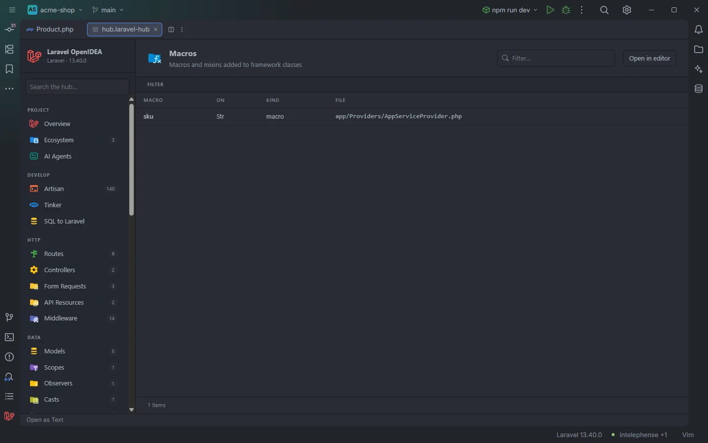

# Macros

The **Macros** section lists every macro and mixin the project adds to framework classes (`Str::macro()`, `Collection::macro()`, `Builder::mixin()`…), with the class it extends and where it is registered. Macros are invisible to most tools; this section shows where each one comes from.

Macros of the acme-shop demo

## How to use it

Open the hub and pick **Macros** in the **App** group of the sidebar. The badge counts the macro and mixin calls.

- Click a row to open the line that registers the macro.
- Use **On** to see the macros of one class and **Kind** to separate macros from mixins.
- Type in **Filter…** to find a macro by name.

Search, filters, sorting and paging are described in [The hub](Hub.md).

## What you see

| Column | Content |
| --- | --- |
| **Macro** | The macro name (the first argument, without quotes). For a mixin, the mixin class: `mixin(new StrMixin)` or `mixin(StrMixin::class)` shows `StrMixin`. |
| **On** | What the call is made on: the class for a static call (`Str`, `Collection`, `Builder`, `Route`), or `$variable` / `->property` for a call on an object. |
| **Kind** | `macro` or `mixin`. |
| **File** | The file that registers it, relative to the project root. |

### Filters

| Filter | Values |
| --- | --- |
| **On** | Each class or receiver. |
| **Kind** | `macro`, `mixin`. |

The section has no toolbar buttons.

## Details

- **Data source:** the plugin's scan of the project's PHP files (`app/`, `database/factories/`, `database/seeders/`, `routes/`, `bootstrap/app.php`, `bootstrap/providers.php`). Every `::macro(`, `->macro(`, `::mixin(` and `->mixin(` call found there is a row. Nothing is run.
- The **On** class is the short name as written in the call, so `\Illuminate\Support\Str::macro()` shows `Str`.
- Macros added by packages, or from files outside the scanned folders, are not listed.
- Each row opens the file at the registering line.
- Empty state: *Nothing found in this project yet.*

## Settings and permissions

Nothing beyond the plugin's required permissions. See [Permissions](Permissions.md).

## Related

- [The hub](Hub.md)
- [Service Providers](Hub-Providers.md)
- [Static completion](Static-Completion.md)
- [Blade](Blade.md): custom Blade directives registered with `Blade::directive()`

---
[← Wiki home](Home.md)
